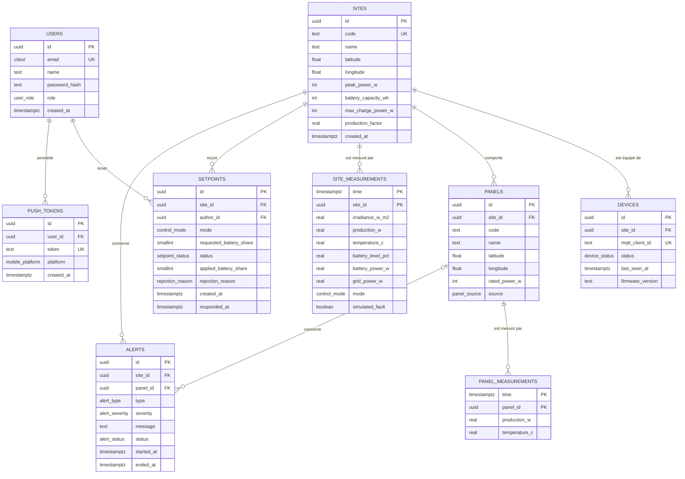

# 01 · Modèle de données

> Étape 1 de la conception. Référence unique pour la base de données : le schéma Drizzle (étape 5) devra reproduire **exactement** ce document. Toute évolution du modèle passe d'abord par une modification de ce fichier, relue en pull request.
>
> Les identifiants (tables, colonnes, énumérations) sont **en anglais**, conformément à la décision [D012](../journal/decisions/D012-langue-du-code.md). Les descriptions restent en français.

## 1. Conventions

| Sujet | Règle |
|---|---|
| SGBD | PostgreSQL 16 ou supérieur, avec les extensions `timescaledb` et `citext` |
| Nommage des tables | Anglais, `snake_case`, **au pluriel** (`sites`, `panels`, `site_measurements`). Le pluriel évite le mot réservé `user`. |
| Nommage des colonnes | Anglais, `snake_case` (`created_at`, `battery_level_pct`) |
| Côté TypeScript | Mêmes noms en `camelCase` (`createdAt`, `batteryLevelPct`). La correspondance est faite par Drizzle. |
| Clés primaires | `id uuid` généré par `gen_random_uuid()`, sauf pour les tables de mesures (clé composite incluant l'horodatage, exigence de TimescaleDB) |
| Dates | Toujours `timestamptz`, stockées en UTC. Colonnes suffixées `_at` (`created_at`, `responded_at`), sauf `time` dans les tables de mesures. |
| Unités | Puissances en **watts (W)**, énergies en **wattheures (Wh)**, températures en **°C**, ensoleillement en **W/m²**, pourcentages de 0 à 100. L'unité figure dans le nom de la colonne quand elle n'est pas évidente (`_w`, `_wh`, `_pct`, `_c`, `_w_m2`). |
| Signes | `battery_power_w` : positif = charge, négatif = décharge. `grid_power_w` : positif = injection sur le réseau. |
| Énumérations | Types `ENUM` PostgreSQL, valeurs en anglais `snake_case` |
| Suppression | Pas de suppression logique. Les suppressions physiques sont rares (voir les règles `ON DELETE`). |
| Mots de passe | Jamais en clair : hachage **argon2id** côté API |

### Glossaire métier

| Français (documentation, interface) | Anglais (code) |
|---|---|
| Utilisateur | `user` |
| Exploitant / Lecteur | `operator` / `viewer` |
| Site (parc) | `site` |
| Objet (ESP32) | `device` |
| Panneau | `panel` |
| Mesure | `measurement` |
| Ensoleillement | `irradiance` |
| Production | `production` |
| Niveau de batterie | `battery level` |
| Réseau | `grid` |
| Consigne | `setpoint` |
| Part envoyée vers la batterie | `battery share` |
| État appliqué | `control state` |
| Mode manuel / automatique / restitution | `manual` / `automatic` / `discharge` |
| Alerte | `alert` |
| Jeton de notification | `push token` |

## 2. Modèle conceptuel



## 3. Énumérations

| Type | Valeurs | Signification |
|---|---|---|
| `user_role` | `operator`, `viewer` | L'exploitant (`operator`) peut envoyer des consignes, le lecteur (`viewer`) consulte seulement |
| `mobile_platform` | `android`, `ios` | Plateforme du téléphone qui a enregistré un jeton de notification |
| `device_status` | `unknown`, `online`, `offline` | `unknown` tant que l'objet n'a jamais rien publié |
| `panel_source` | `seed`, `discovered`, `manual` | Origine du panneau : données de démonstration, détecté automatiquement à la réception de ses mesures, ou ajouté par un exploitant ([D020](../journal/decisions/D020-inventaire-des-panneaux.md)) |
| `control_mode` | `manual`, `automatic`, `discharge` | Modes manuel, automatique et restitution (voir l'étude de faisabilité, section 4) |
| `setpoint_status` | `sent`, `applied`, `partial`, `rejected`, `no_response` | Voir le diagramme d'états dans [02-uml.md](02-uml.md) |
| `rejection_reason` | `battery_full`, `battery_low`, `charge_limit`, `invalid_setpoint` | Raison donnée par l'objet quand il n'applique pas tout ou partie d'une consigne |
| `alert_type` | `low_production`, `overheating`, `battery_low`, `battery_full`, `setpoint_rejected`, `setpoint_no_response`, `device_offline` | Voir les règles d'alerte dans [02-uml.md](02-uml.md) |
| `alert_severity` | `info`, `warning`, `critical` | Seules `warning` et `critical` déclenchent une notification push |
| `alert_status` | `active`, `resolved` | Une alerte est résolue automatiquement quand sa condition disparaît |

## 4. Dictionnaire de données

### `users`

| Colonne | Type | Null | Défaut | Contraintes | Description |
|---|---|---|---|---|---|
| `id` | `uuid` | non | `gen_random_uuid()` | PK | Identifiant |
| `email` | `citext` | non | | unique | Identifiant de connexion, insensible à la casse |
| `name` | `text` | non | | 1 à 100 caractères | Nom affiché dans l'app et dans l'historique des consignes |
| `password_hash` | `text` | non | | | Empreinte argon2id |
| `role` | `user_role` | non | `'viewer'` | | Droits dans l'app |
| `created_at` | `timestamptz` | non | `now()` | | Date de création |

### `push_tokens`

| Colonne | Type | Null | Défaut | Contraintes | Description |
|---|---|---|---|---|---|
| `id` | `uuid` | non | `gen_random_uuid()` | PK | Identifiant |
| `user_id` | `uuid` | non | | FK → `users.id`, `ON DELETE CASCADE` | Propriétaire du téléphone |
| `token` | `text` | non | | unique | Jeton Expo (`ExponentPushToken[...]`) |
| `platform` | `mobile_platform` | non | | | Android ou iOS |
| `created_at` | `timestamptz` | non | `now()` | | Date d'enregistrement |

Un même jeton ne peut appartenir qu'à un utilisateur : si un autre utilisateur se connecte sur le même téléphone, la ligne est réattribuée (mise à jour de `user_id`).

### `sites`

| Colonne | Type | Null | Défaut | Contraintes | Description |
|---|---|---|---|---|---|
| `id` | `uuid` | non | `gen_random_uuid()` | PK | Identifiant |
| `code` | `text` | non | | unique, `^[A-Z0-9]{3,16}$` | Code court utilisé dans les topics MQTT (`SITE01`) |
| `name` | `text` | non | | 1 à 100 caractères | Nom affiché |
| `latitude` | `double precision` | non | | entre -90 et 90 | Position du site |
| `longitude` | `double precision` | non | | entre -180 et 180 | Position du site |
| `peak_power_w` | `integer` | non | | > 0 | Puissance maximale du parc (W) |
| `battery_capacity_wh` | `integer` | non | | > 0 | Capacité de la batterie (Wh) |
| `max_charge_power_w` | `integer` | non | | > 0 | Puissance maximale de charge et de restitution (W) |
| `production_factor` | `real` | non | | > 0 | Production attendue (W) par W/m² d'ensoleillement |
| `created_at` | `timestamptz` | non | `now()` | | Date de création |

### `devices`

| Colonne | Type | Null | Défaut | Contraintes | Description |
|---|---|---|---|---|---|
| `id` | `uuid` | non | `gen_random_uuid()` | PK | Identifiant |
| `site_id` | `uuid` | non | | FK → `sites.id`, `ON DELETE CASCADE` | Site équipé |
| `mqtt_client_id` | `text` | non | | unique | Identifiant de connexion de l'objet sur le broker |
| `status` | `device_status` | non | `'unknown'` | | Dernier statut connu |
| `last_seen_at` | `timestamptz` | oui | | | Date du dernier message reçu de cet objet |
| `firmware_version` | `text` | oui | | | Version annoncée par l'objet à sa connexion |

Dans le socle, chaque site a exactement un objet. Le modèle autorise plusieurs objets pour la suite (bonus tracker).

### `panels`

| Colonne | Type | Null | Défaut | Contraintes | Description |
|---|---|---|---|---|---|
| `id` | `uuid` | non | `gen_random_uuid()` | PK | Identifiant |
| `site_id` | `uuid` | non | | FK → `sites.id`, `ON DELETE CASCADE` | Site d'appartenance |
| `code` | `text` | non | | `^P[0-9]{2,3}$`, unique par site | Code utilisé dans les topics MQTT (`P07`) |
| `name` | `text` | non | | 1 à 100 caractères | Nom affiché (« Rangée A, panneau 7 ») |
| `latitude` | `double precision` | oui | | entre -90 et 90 ; renseignée **si et seulement si** `longitude` l'est | Position sur la carte ; vide tant que le panneau n'est pas positionné |
| `longitude` | `double precision` | oui | | entre -180 et 180 | Position sur la carte |
| `rated_power_w` | `integer` | non | | > 0 | Puissance maximale du panneau (W) ; 200 par défaut pour un panneau détecté, modifiable par l'exploitant |
| `source` | `panel_source` | non | `'manual'` | | Origine du panneau |

**Inventaire des panneaux** ([D020](../journal/decisions/D020-inventaire-des-panneaux.md)) :
- les panneaux de démonstration sont créés par le seed (`source = 'seed'`) ;
- quand l'API reçoit les mesures d'un code inconnu sur un site connu, elle crée le panneau avec `source = 'discovered'`, `name` = son code, sans position et avec la puissance par défaut (`INSERT … ON CONFLICT (site_id, code) DO NOTHING`), dans la limite de `MAX_PANELS_PER_SITE` ;
- un panneau sans position est dit **non positionné** : absent de la carte, il apparaît dans la liste « Panneaux à positionner » ; l'exploitant le positionne (position GPS du téléphone), le renomme, corrige sa puissance ou le supprime.

### `site_measurements` (table TimescaleDB)

Une ligne toutes les 5 secondes par site, publiée par l'ESP32.

| Colonne | Type | Null | Contraintes | Description |
|---|---|---|---|---|
| `time` | `timestamptz` | non | PK (avec `site_id`) | Date de la mesure |
| `site_id` | `uuid` | non | PK, FK → `sites.id` | Site mesuré |
| `irradiance_w_m2` | `real` | non | ≥ 0 | Ensoleillement (W/m²) |
| `production_w` | `real` | non | ≥ 0 | Production totale du site (W) |
| `temperature_c` | `real` | non | entre -40 et 125 | Température des panneaux (°C) |
| `battery_level_pct` | `real` | non | entre 0 et 100 | Niveau de charge de la batterie (%) |
| `battery_power_w` | `real` | non | | Positif = charge, négatif = décharge (W) |
| `grid_power_w` | `real` | non | ≥ 0 | Puissance injectée sur le réseau (W) |
| `mode` | `control_mode` | non | | Mode appliqué par l'objet au moment de la mesure |
| `simulated_fault` | `boolean` | non | défaut `false` | Panne injectée par le bouton de démo |

### `panel_measurements` (table TimescaleDB)

Une ligne toutes les 10 secondes par panneau, publiée par le simulateur.

| Colonne | Type | Null | Contraintes | Description |
|---|---|---|---|---|
| `time` | `timestamptz` | non | PK (avec `panel_id`) | Date de la mesure |
| `panel_id` | `uuid` | non | PK, FK → `panels.id` | Panneau mesuré |
| `production_w` | `real` | non | ≥ 0 | Production du panneau (W) |
| `temperature_c` | `real` | non | entre -40 et 125 | Température du panneau (°C) |

### `setpoints` (consignes)

| Colonne | Type | Null | Défaut | Contraintes | Description |
|---|---|---|---|---|---|
| `id` | `uuid` | non | `gen_random_uuid()` | PK | Identifiant, transmis à l'objet dans le message MQTT |
| `site_id` | `uuid` | non | | FK → `sites.id`, `ON DELETE CASCADE` | Site piloté |
| `author_id` | `uuid` | non | | FK → `users.id`, `ON DELETE RESTRICT` | Utilisateur qui a envoyé la consigne |
| `mode` | `control_mode` | non | | | Mode demandé |
| `requested_battery_share` | `smallint` | oui | | 0 à 100 ; renseignée **si et seulement si** `mode = 'manual'` | Part de la production à envoyer vers la batterie (%) |
| `status` | `setpoint_status` | non | `'sent'` | | Voir le diagramme d'états |
| `applied_battery_share` | `smallint` | oui | | 0 à 100 | Part réellement appliquée, d'après la première réponse de l'objet |
| `rejection_reason` | `rejection_reason` | oui | | renseignée si `status` vaut `partial` ou `rejected` | Raison donnée par l'objet |
| `created_at` | `timestamptz` | non | `now()` | | Date d'envoi |
| `responded_at` | `timestamptz` | oui | | | Date de la première réponse de l'objet |

La consigne la plus récente d'un site est la **consigne en vigueur**. Les consignes ne sont jamais modifiées par l'utilisateur : chaque changement crée une nouvelle ligne, ce qui constitue l'historique.

### `alerts`

| Colonne | Type | Null | Défaut | Contraintes | Description |
|---|---|---|---|---|---|
| `id` | `uuid` | non | `gen_random_uuid()` | PK | Identifiant |
| `site_id` | `uuid` | non | | FK → `sites.id`, `ON DELETE CASCADE` | Site concerné |
| `panel_id` | `uuid` | oui | | FK → `panels.id`, `ON DELETE CASCADE` | Panneau concerné, si l'alerte porte sur un panneau |
| `type` | `alert_type` | non | | | Nature de l'alerte |
| `severity` | `alert_severity` | non | | | Gravité (définie par type, voir [02-uml.md](02-uml.md)) |
| `message` | `text` | non | | 1 à 200 caractères | Texte **en français** affiché et envoyé en notification |
| `status` | `alert_status` | non | `'active'` | | État de l'alerte |
| `started_at` | `timestamptz` | non | `now()` | | Date d'ouverture |
| `ended_at` | `timestamptz` | oui | | renseignée **si et seulement si** `status = 'resolved'` | Date de résolution |

**Une seule alerte active à la fois** par couple (site, panneau, type) : garanti par un index unique partiel.

## 5. Spécificités TimescaleDB

| Table | Partitionnement | Rétention | Justification |
|---|---|---|---|
| `site_measurements` | Par `time`, tranches de 1 jour | 30 jours | Suffisant pour l'historique affiché dans l'app |
| `panel_measurements` | Par `time`, tranches de 1 jour | 30 jours | Idem |

Les historiques renvoyés à l'app sont **agrégés à la volée** avec `time_bucket()` (moyenne par intervalle de 1 min, 5 min, 15 min ou 1 h selon la période demandée). Pas d'agrégat continu dans le socle.

**Volumétrie estimée** (1 site, 20 panneaux) :

| Table | Lignes par jour | Lignes sur 30 jours |
|---|---|---|
| `site_measurements` | 17 280 | ≈ 520 000 |
| `panel_measurements` | 172 800 | ≈ 5,2 millions |

Ces volumes sont faibles pour PostgreSQL et TimescaleDB.

## 6. Index

| Table | Index | Usage |
|---|---|---|
| `site_measurements` | PK `(site_id, time)` | Dernière mesure et historique d'un site |
| `panel_measurements` | PK `(panel_id, time)` | Dernière mesure et historique d'un panneau |
| `panels` | unique `(site_id, code)` | Résolution d'un topic MQTT vers un panneau |
| `setpoints` | `(site_id, created_at DESC)` | Consigne en vigueur et historique paginé |
| `alerts` | `(status, started_at DESC)` | Liste des alertes actives et récentes |
| `alerts` | unique partiel `(site_id, panel_id, type) NULLS NOT DISTINCT WHERE status = 'active'` | Une seule alerte active par cause |
| `push_tokens` | `(user_id)` | Envoi des notifications |

## 7. Script SQL de référence

Ce script décrit l'état cible. À l'étape 5, il sera traduit en schéma Drizzle et en migrations. Les parties propres à TimescaleDB (`create_hypertable`, `add_retention_policy`) iront dans une migration SQL écrite à la main.

```sql
CREATE EXTENSION IF NOT EXISTS timescaledb;
CREATE EXTENSION IF NOT EXISTS citext;

-- Enums
CREATE TYPE user_role AS ENUM ('operator', 'viewer');
CREATE TYPE mobile_platform AS ENUM ('android', 'ios');
CREATE TYPE device_status AS ENUM ('unknown', 'online', 'offline');
CREATE TYPE panel_source AS ENUM ('seed', 'discovered', 'manual');
CREATE TYPE control_mode AS ENUM ('manual', 'automatic', 'discharge');
CREATE TYPE setpoint_status AS ENUM ('sent', 'applied', 'partial', 'rejected', 'no_response');
CREATE TYPE rejection_reason AS ENUM ('battery_full', 'battery_low', 'charge_limit', 'invalid_setpoint');
CREATE TYPE alert_type AS ENUM (
  'low_production', 'overheating', 'battery_low', 'battery_full',
  'setpoint_rejected', 'setpoint_no_response', 'device_offline'
);
CREATE TYPE alert_severity AS ENUM ('info', 'warning', 'critical');
CREATE TYPE alert_status AS ENUM ('active', 'resolved');

-- Users
CREATE TABLE users (
  id            uuid PRIMARY KEY DEFAULT gen_random_uuid(),
  email         citext NOT NULL UNIQUE,
  name          text NOT NULL CHECK (char_length(name) BETWEEN 1 AND 100),
  password_hash text NOT NULL,
  role          user_role NOT NULL DEFAULT 'viewer',
  created_at    timestamptz NOT NULL DEFAULT now()
);

CREATE TABLE push_tokens (
  id         uuid PRIMARY KEY DEFAULT gen_random_uuid(),
  user_id    uuid NOT NULL REFERENCES users (id) ON DELETE CASCADE,
  token      text NOT NULL UNIQUE,
  platform   mobile_platform NOT NULL,
  created_at timestamptz NOT NULL DEFAULT now()
);
CREATE INDEX push_tokens_user_idx ON push_tokens (user_id);

-- Solar park
CREATE TABLE sites (
  id                  uuid PRIMARY KEY DEFAULT gen_random_uuid(),
  code                text NOT NULL UNIQUE CHECK (code ~ '^[A-Z0-9]{3,16}$'),
  name                text NOT NULL CHECK (char_length(name) BETWEEN 1 AND 100),
  latitude            double precision NOT NULL CHECK (latitude BETWEEN -90 AND 90),
  longitude           double precision NOT NULL CHECK (longitude BETWEEN -180 AND 180),
  peak_power_w        integer NOT NULL CHECK (peak_power_w > 0),
  battery_capacity_wh integer NOT NULL CHECK (battery_capacity_wh > 0),
  max_charge_power_w  integer NOT NULL CHECK (max_charge_power_w > 0),
  production_factor   real NOT NULL CHECK (production_factor > 0),
  created_at          timestamptz NOT NULL DEFAULT now()
);

CREATE TABLE devices (
  id               uuid PRIMARY KEY DEFAULT gen_random_uuid(),
  site_id          uuid NOT NULL REFERENCES sites (id) ON DELETE CASCADE,
  mqtt_client_id   text NOT NULL UNIQUE,
  status           device_status NOT NULL DEFAULT 'unknown',
  last_seen_at     timestamptz,
  firmware_version text
);

CREATE TABLE panels (
  id            uuid PRIMARY KEY DEFAULT gen_random_uuid(),
  site_id       uuid NOT NULL REFERENCES sites (id) ON DELETE CASCADE,
  code          text NOT NULL CHECK (code ~ '^P[0-9]{2,3}$'),
  name          text NOT NULL CHECK (char_length(name) BETWEEN 1 AND 100),
  latitude      double precision CHECK (latitude BETWEEN -90 AND 90),
  longitude     double precision CHECK (longitude BETWEEN -180 AND 180),
  rated_power_w integer NOT NULL CHECK (rated_power_w > 0),
  source        panel_source NOT NULL DEFAULT 'manual',
  UNIQUE (site_id, code),
  CHECK ((latitude IS NULL) = (longitude IS NULL))
);

-- Measurements (TimescaleDB hypertables)
CREATE TABLE site_measurements (
  time              timestamptz NOT NULL,
  site_id           uuid NOT NULL REFERENCES sites (id) ON DELETE CASCADE,
  irradiance_w_m2   real NOT NULL CHECK (irradiance_w_m2 >= 0),
  production_w      real NOT NULL CHECK (production_w >= 0),
  temperature_c     real NOT NULL CHECK (temperature_c BETWEEN -40 AND 125),
  battery_level_pct real NOT NULL CHECK (battery_level_pct BETWEEN 0 AND 100),
  battery_power_w   real NOT NULL,
  grid_power_w      real NOT NULL CHECK (grid_power_w >= 0),
  mode              control_mode NOT NULL,
  simulated_fault   boolean NOT NULL DEFAULT false,
  PRIMARY KEY (site_id, time)
);
SELECT create_hypertable('site_measurements', by_range('time', INTERVAL '1 day'));
SELECT add_retention_policy('site_measurements', INTERVAL '30 days');

CREATE TABLE panel_measurements (
  time          timestamptz NOT NULL,
  panel_id      uuid NOT NULL REFERENCES panels (id) ON DELETE CASCADE,
  production_w  real NOT NULL CHECK (production_w >= 0),
  temperature_c real NOT NULL CHECK (temperature_c BETWEEN -40 AND 125),
  PRIMARY KEY (panel_id, time)
);
SELECT create_hypertable('panel_measurements', by_range('time', INTERVAL '1 day'));
SELECT add_retention_policy('panel_measurements', INTERVAL '30 days');

-- Control
CREATE TABLE setpoints (
  id                      uuid PRIMARY KEY DEFAULT gen_random_uuid(),
  site_id                 uuid NOT NULL REFERENCES sites (id) ON DELETE CASCADE,
  author_id               uuid NOT NULL REFERENCES users (id) ON DELETE RESTRICT,
  mode                    control_mode NOT NULL,
  requested_battery_share smallint CHECK (requested_battery_share BETWEEN 0 AND 100),
  status                  setpoint_status NOT NULL DEFAULT 'sent',
  applied_battery_share   smallint CHECK (applied_battery_share BETWEEN 0 AND 100),
  rejection_reason        rejection_reason,
  created_at              timestamptz NOT NULL DEFAULT now(),
  responded_at            timestamptz,
  CHECK ((mode = 'manual') = (requested_battery_share IS NOT NULL)),
  CHECK ((status IN ('partial', 'rejected')) = (rejection_reason IS NOT NULL))
);
CREATE INDEX setpoints_site_created_idx ON setpoints (site_id, created_at DESC);

-- Alerts
CREATE TABLE alerts (
  id         uuid PRIMARY KEY DEFAULT gen_random_uuid(),
  site_id    uuid NOT NULL REFERENCES sites (id) ON DELETE CASCADE,
  panel_id   uuid REFERENCES panels (id) ON DELETE CASCADE,
  type       alert_type NOT NULL,
  severity   alert_severity NOT NULL,
  message    text NOT NULL CHECK (char_length(message) BETWEEN 1 AND 200),
  status     alert_status NOT NULL DEFAULT 'active',
  started_at timestamptz NOT NULL DEFAULT now(),
  ended_at   timestamptz,
  CHECK ((status = 'resolved') = (ended_at IS NOT NULL))
);
CREATE INDEX alerts_status_started_idx ON alerts (status, started_at DESC);
CREATE UNIQUE INDEX alerts_active_unique_idx
  ON alerts (site_id, panel_id, type) NULLS NOT DISTINCT
  WHERE status = 'active';
```

## 8. Données de démonstration

Insérées par un script de *seed* (étape 5), à partir du fichier versionné `infra/seed/demo-site.json` (site, objet, panneaux). Les **mots de passe ne figurent pas ici** : ils sont lus dans des variables d'environnement du script. Les panneaux du seed ont `source = 'seed'`.

| Donnée | Valeur |
|---|---|
| Site | `code` = `SITE01`, `name` = « Parc solaire de démonstration », latitude 47.2500, longitude -1.5500 |
| Paramètres du site | `peak_power_w` = 4 000, `battery_capacity_wh` = 10 000, `max_charge_power_w` = 3 000, `production_factor` = 4.0 |
| Objet | `mqtt_client_id` = `device-site01` |
| Panneaux | 20 panneaux `P01` à `P20`, 4 rangées (A à D) de 5, espacés d'environ 10 m, `rated_power_w` = 200 |
| Utilisateurs | 1 exploitant (`operator@demo.local`, rôle `operator`), 1 lecteur (`viewer@demo.local`, rôle `viewer`) |

Les paramètres du site doivent être **identiques** dans le firmware de l'ESP32 (capacité, puissance de charge maximale, puissance crête) : ils sont repris dans [03-cartographie-technique.md](03-cartographie-technique.md), section « Constantes partagées ».
