# 02 · Modélisation UML

> Étape 1 de la conception. Ce document décrit **le comportement attendu** du système : qui fait quoi, dans quel ordre, et avec quelles règles. Les noms techniques (topics, routes, champs) sont définis dans [03-cartographie-technique.md](03-cartographie-technique.md) ; les tables dans [01-modele-donnees.md](01-modele-donnees.md).
>
> Les diagrammes sont écrits en Mermaid et s'affichent directement sur GitHub. Les identifiants techniques sont en anglais ([D012](../journal/decisions/D012-langue-du-code.md)) ; les textes explicatifs et les noms de cas d'utilisation restent en français. Pour alléger les diagrammes, les routes de l'API y sont écrites sans leur préfixe `/v1`.

## 1. Acteurs

| Acteur | Nom dans le code | Type | Description |
|---|---|---|---|
| **Exploitant** | rôle `operator` | Humain | Supervise le parc et le pilote (envoie des consignes) |
| **Lecteur** | rôle `viewer` | Humain | Consulte les données, sans droit de pilotage |
| **Objet** | `device` | Système | ESP32 du site, simulé dans Wokwi : publie les mesures, applique les consignes |
| **Simulateur** | `simulator` | Système | Script qui publie les mesures des 20 panneaux |
| **Service de notifications Expo** | — | Système externe | Achemine les notifications push vers les téléphones |
| **Planificateur** | `scheduler` | Interne à l'API | Tâches périodiques : délais de réponse aux consignes, détection d'objet silencieux |

L'**Exploitant** hérite de toutes les capacités du **Lecteur**.

## 2. Cas d'utilisation

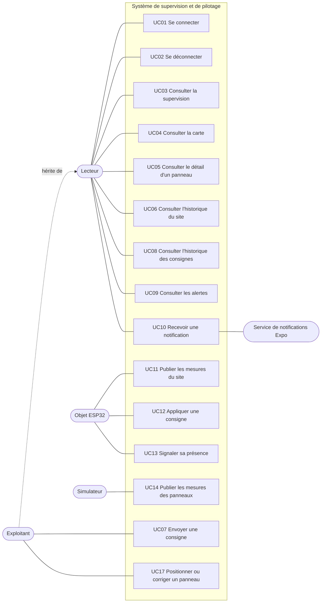

| ID | Cas d'utilisation | Acteur principal | Résumé | Priorité |
|---|---|---|---|---|
| UC01 | Se connecter | Lecteur | Saisie de l'e-mail et du mot de passe, obtention d'un jeton, enregistrement du jeton de notification du téléphone | Socle |
| UC02 | Se déconnecter | Lecteur | Suppression du jeton local et du jeton de notification côté API | Socle |
| UC03 | Consulter la supervision | Lecteur | Production, batterie, répartition actuelle, mode, statut de l'objet, nombre d'alertes | Socle |
| UC04 | Consulter la carte | Lecteur | Panneaux positionnés et colorés selon leur statut | Socle |
| UC05 | Consulter le détail d'un panneau | Lecteur | Dernières valeurs et historique d'un panneau | Socle |
| UC06 | Consulter l'historique du site | Lecteur | Graphiques de production, batterie et flux sur une période | Socle |
| UC07 | Envoyer une consigne | Exploitant | Choix du mode et de la répartition, confirmation, suivi de l'application | Socle |
| UC08 | Consulter l'historique des consignes | Lecteur | Liste des consignes : auteur, demande, résultat | Socle |
| UC09 | Consulter les alertes | Lecteur | Alertes actives et résolues | Socle |
| UC10 | Recevoir une notification | Lecteur | Notification push à l'ouverture d'une alerte `warning` ou `critical` | Socle |
| UC11 | Publier les mesures du site | Objet | Toutes les 5 s | Socle |
| UC12 | Appliquer une consigne | Objet | Application avec limites de sécurité, réponse avec l'état appliqué | Socle |
| UC13 | Signaler sa présence | Objet | Statut `online` à la connexion, `offline` via le Last Will | Socle |
| UC14 | Publier les mesures des panneaux | Simulateur | Toutes les 10 s par panneau ; un code inconnu crée un panneau non positionné | Socle |
| UC15 | Consulter la vue 3D | Lecteur | Panneaux en 3D colorés par statut | Bonus |
| UC16 | Piloter l'orientation des panneaux | Exploitant | Mode automatique ou position de sécurité du tracker | Bonus |
| UC17 | Positionner ou corriger un panneau | Exploitant | Placer un panneau détecté à la position GPS du téléphone, corriger son nom ou sa puissance, le supprimer | Socle |
| UC18 | Ajouter un panneau sur le terrain | Exploitant | Scanner le QR code d'un panneau, capter la position, enregistrer | Bonus |

### Description détaillée de UC07 « Envoyer une consigne »

| Rubrique | Contenu |
|---|---|
| Acteur | Exploitant |
| Préconditions | Utilisateur connecté avec le rôle `operator` ; téléphone connecté au réseau ; objet du site `online` |
| Déclencheur | L'utilisateur ouvre l'écran Pilotage et modifie le mode ou la répartition |
| Scénario nominal | 1. L'utilisateur choisit le mode. 2. En mode manuel, il règle la part batterie (pas de 10 %). 3. Il appuie sur « Appliquer ». 4. L'app affiche un résumé et demande confirmation. 5. L'app envoie la consigne à l'API. 6. L'API vérifie les droits et les bornes, enregistre la consigne (`sent`), la publie sur MQTT et répond 202. 7. L'objet applique la consigne et publie son état. 8. L'API met à jour la consigne (`applied`). 9. L'app, qui interroge l'API toutes les 2 s tant que la consigne est `sent`, affiche « Appliquée ». |
| Variante A | 7a. La batterie est pleine : l'objet refuse la charge. 8a. Consigne `rejected`, raison `battery_full`, alerte `setpoint_rejected`. 9a. L'app affiche le refus et sa raison. |
| Variante B | 7b. La puissance de charge maximale est dépassée : l'objet applique une part réduite. 8b. Consigne `partial`, raison `charge_limit`. |
| Variante C | 7c. Aucune réponse en 30 s. 8c. Le planificateur passe la consigne en `no_response` et ouvre une alerte. Si une réponse arrive plus tard, la consigne prend le statut de cette réponse. |
| Exceptions | Rôle `viewer` : bouton masqué dans l'app, et 403 côté API. Objet hors ligne : pilotage désactivé dans l'app, et 409 côté API. Téléphone hors ligne : pilotage désactivé. Valeurs hors bornes : 422. |
| Postconditions | Une ligne `setpoints` existe ; la consigne est publiée en retained sur le broker ; l'historique la montre avec son résultat |

## 3. Diagramme de classes du domaine

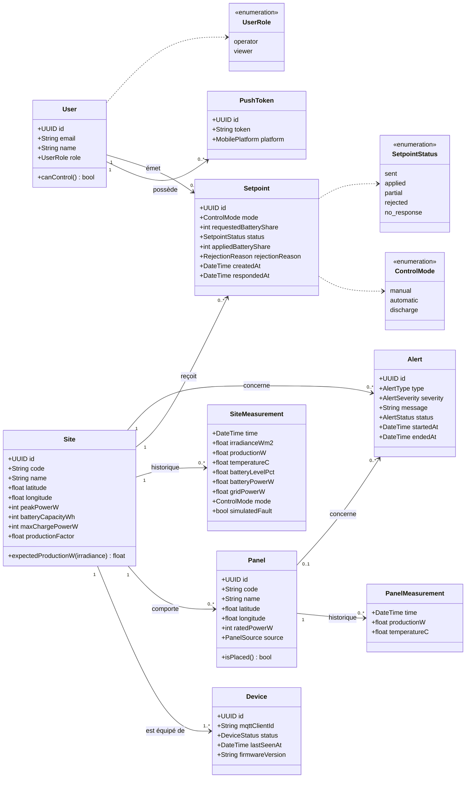

## 4. Diagrammes de séquence

### 4.1 Connexion (UC01)

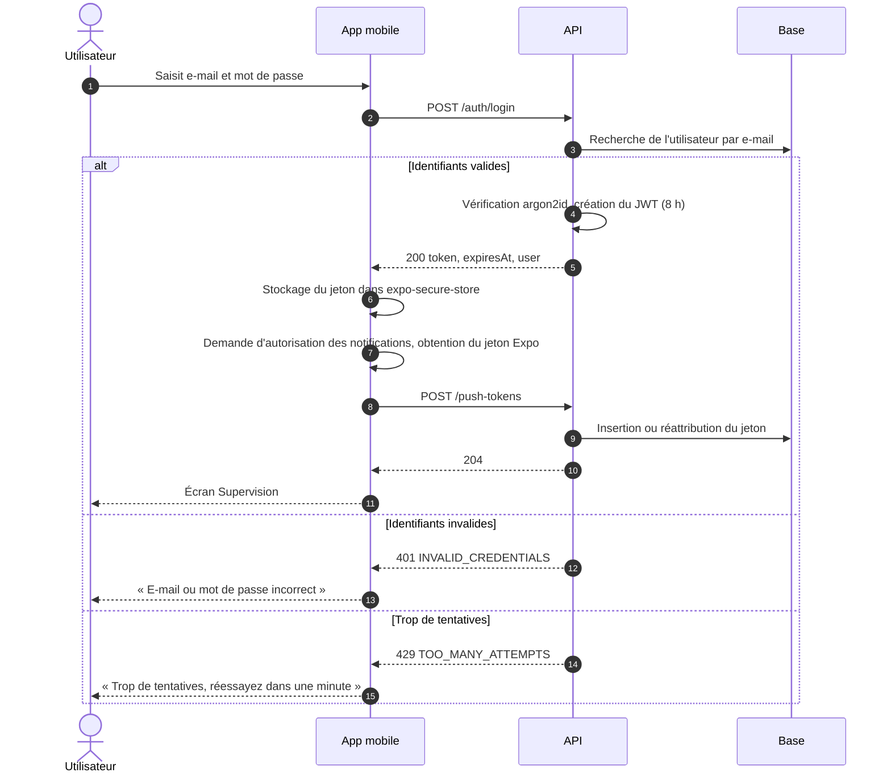

### 4.2 Publication et affichage des mesures (UC11, UC03)

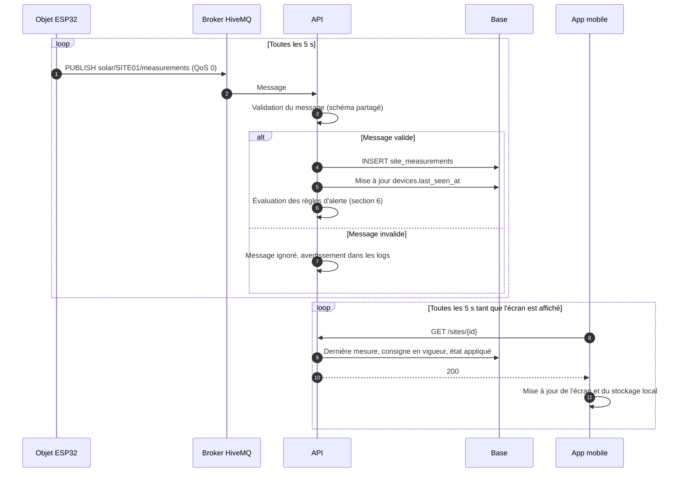

### 4.3 Envoi et application d'une consigne (UC07, UC12)

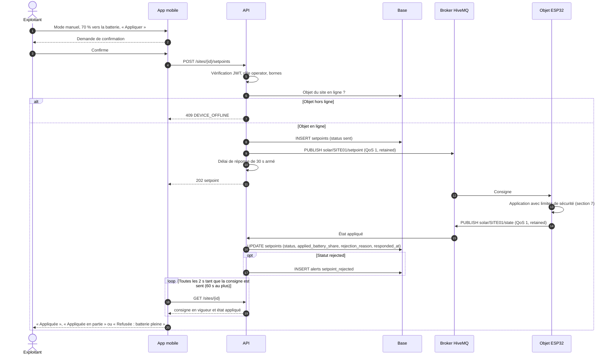

### 4.4 Objet hors ligne puis reconnexion (UC13)

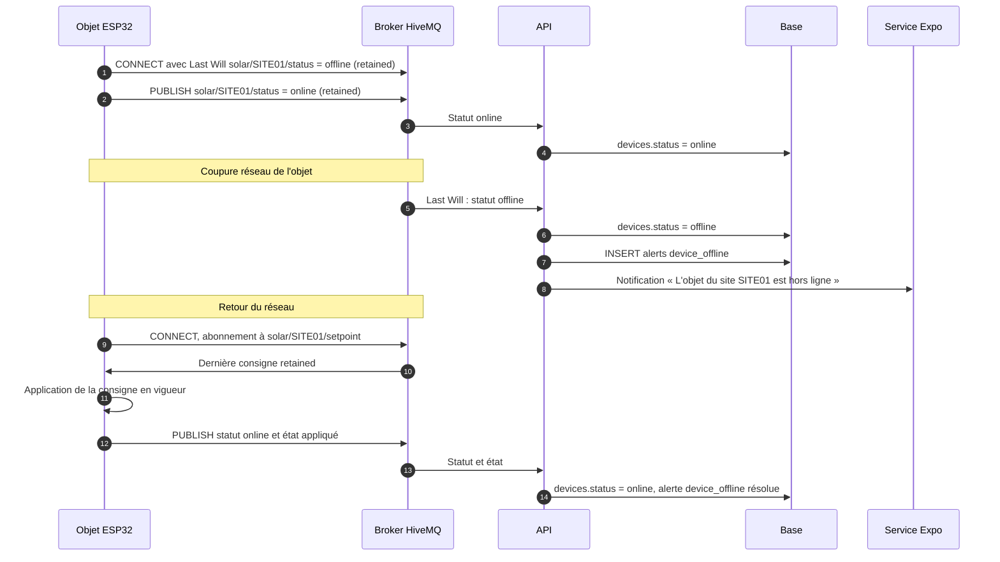

Si le Last Will n'arrive pas (cas d'une connexion qui reste ouverte sans trafic), le **planificateur** passe l'objet en `offline` lorsqu'aucun message n'a été reçu depuis **60 s**.

### 4.5 Ouverture d'une alerte et notification (UC10)

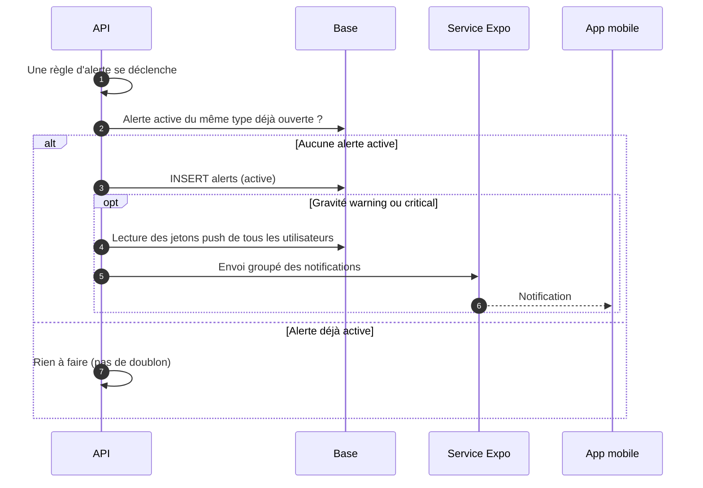

### 4.6 Détection puis positionnement d'un panneau (UC14, UC17)

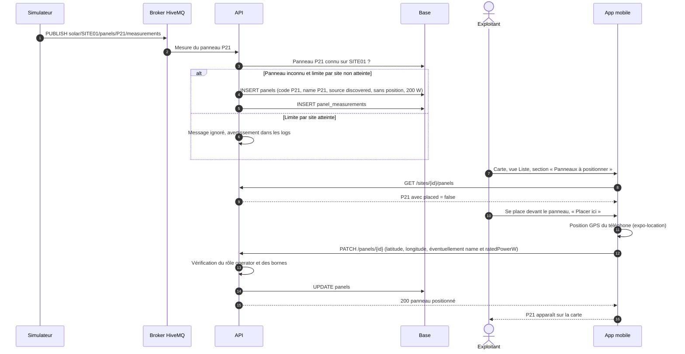

Un panneau supprimé par erreur réapparaît comme « détecté » à sa prochaine mesure : c'est voulu, la suppression sert à retirer un panneau qui ne publie plus.

## 5. Diagrammes d'états

### 5.1 Consigne (`setpoint_status`)

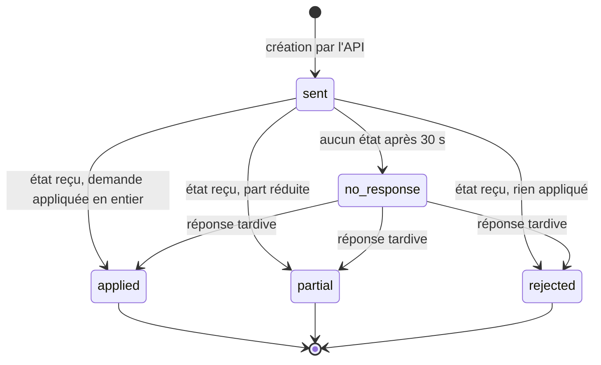

Le statut d'une consigne reflète **la première réponse** de l'objet. Ce qui se passe ensuite (par exemple la batterie qui devient pleine une heure plus tard) n'est pas reporté sur la consigne : c'est visible dans l'**état appliqué courant** du site, affiché sur l'écran Pilotage.

Une réponse est rattachée à une consigne par son identifiant (`setpointId`). Une réponse dont l'identifiant ne correspond pas à la consigne en vigueur met à jour l'état appliqué courant, mais pas le statut des consignes.

### 5.2 Objet (`device_status`)

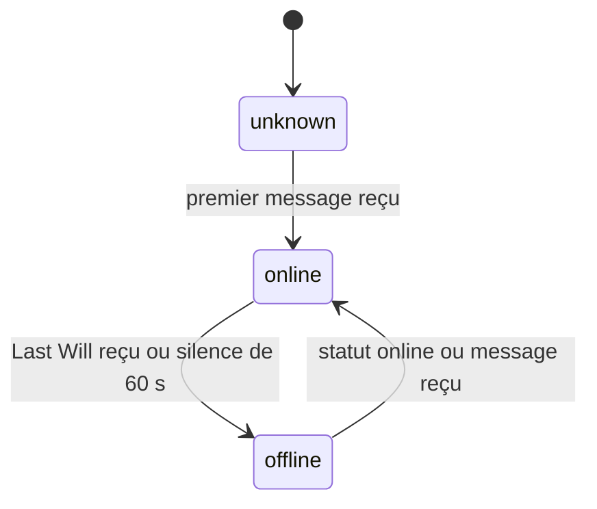

### 5.3 Alerte (`alert_status`)

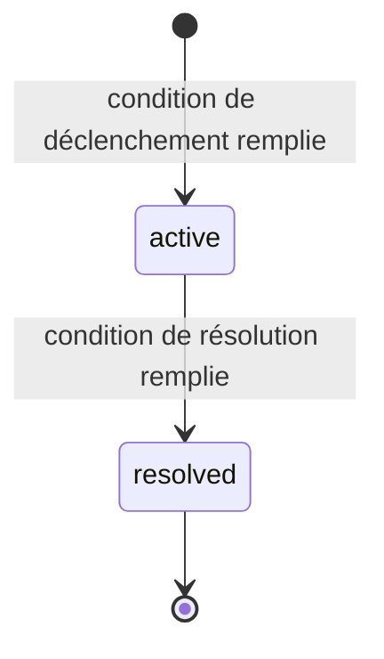

Une alerte résolue n'est jamais rouverte : si la condition réapparaît, une **nouvelle** alerte est créée.

## 6. Règles d'alerte

Évaluées par l'API à la réception de chaque message, ou par le planificateur. Les seuils de résolution diffèrent des seuils de déclenchement (hystérésis), pour éviter qu'une alerte s'ouvre et se ferme en boucle. Les messages sont rédigés **en français**, car ils sont affichés tels quels dans l'app.

| Type | Déclenchement | Résolution | Gravité | Portée | Message (modèle) |
|---|---|---|---|---|---|
| `low_production` | Ensoleillement > 100 W/m² **et** production < 70 % de la production attendue, en continu pendant 60 s | Production ≥ 80 % de l'attendue, ou ensoleillement ≤ 100 W/m² | `warning` | Site ou panneau | « Production basse sur {nom} : {x} W au lieu de {y} W attendus » |
| `overheating` | Température > 75 °C | Température < 70 °C | `critical` | Site ou panneau | « Surchauffe sur {nom} : {t} °C » |
| `battery_low` | Niveau ≤ 20 % | Niveau ≥ 25 % | `warning` | Site | « Batterie faible sur {site} : {n} % » |
| `battery_full` | Niveau ≥ 95 % | Niveau ≤ 90 % | `info` | Site | « Batterie pleine sur {site} : la charge est suspendue » |
| `setpoint_rejected` | Consigne passée en `rejected` | Nouvelle consigne envoyée sur le site | `warning` | Site | « Consigne refusée sur {site} : {raison} » |
| `setpoint_no_response` | Consigne passée en `no_response` | Réponse reçue ou nouvelle consigne | `critical` | Site | « L'objet du site {site} ne répond pas à la consigne » |
| `device_offline` | Objet passé en `offline` | Objet de nouveau `online` | `critical` | Site | « L'objet du site {site} est hors ligne » |

**Calculs :**

```
expected production of a site  = irradiance_w_m2 × sites.production_factor
expected production of a panel = irradiance_w_m2 × panels.rated_power_w / 1000
```

L'ensoleillement utilisé pour les panneaux est celui de la **dernière mesure du site** (les panneaux simulés n'ont pas de capteur d'ensoleillement).

**Statut d'un panneau sur la carte** (calculé par l'API, non stocké) :

| Statut | Condition | Rendu sur la carte |
|---|---|---|
| `normal` | Aucune alerte active sur le panneau, mesure reçue depuis moins de 60 s | Vert, icône « validé » |
| `alert` | Au moins une alerte active sur le panneau | Orange ou rouge selon la gravité, icône « attention » |
| `no_data` | Aucune mesure depuis 60 s | Gris, icône « déconnecté » |

Un panneau **non positionné** (sans latitude ni longitude) a l'un de ces statuts, mais n'apparaît pas sur la carte : il est listé dans la section « Panneaux à positionner » de la vue Liste.

## 7. Algorithme de pilotage de l'objet

Exécuté par l'ESP32 **chaque seconde**. Le temps de la batterie est accéléré d'un facteur 60 (1 s réelle = 1 min simulée) pour que la démo soit visible : passer de 20 % à 95 % de charge prend environ 2 à 3 minutes réelles.

Notations : `P` production (W), `level` niveau de batterie (%), `share` part vers la batterie (%), `Pbat` puissance vers la batterie (W), `Pgrid` puissance vers le réseau (W), `Pmax` puissance de charge maximale (W).

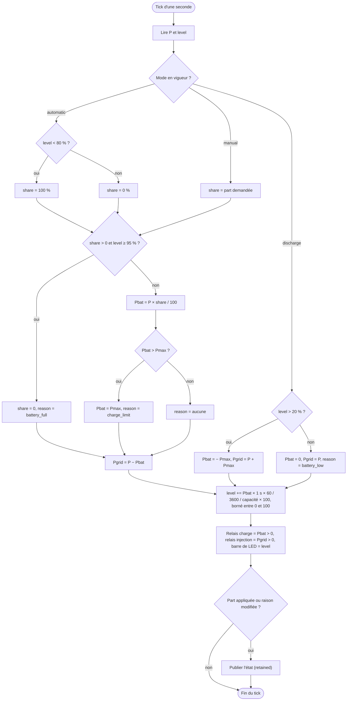

**Statut renvoyé à la réception d'une consigne** (premier état publié après réception) :

| Situation | `status` | `appliedBatteryShare` | `reason` |
|---|---|---|---|
| Consigne mal formée ou hors bornes | `rejected` | `null` | `invalid_setpoint` |
| Manuel ou automatique, demande appliquée en entier | `applied` | part appliquée | `null` |
| Manuel, part réduite par la puissance de charge maximale | `partial` | part effective (arrondie à l'entier) | `charge_limit` |
| Manuel avec part > 0, batterie ≥ 95 % | `rejected` | 0 | `battery_full` |
| Restitution avec batterie ≤ 20 % | `rejected` | `null` | `battery_low` |
| Restitution avec batterie > 20 % | `applied` | `null` | `null` |

Quand la production est nulle (nuit), la part demandée est considérée comme appliquée : la répartition est respectée, les flux sont simplement à zéro.
