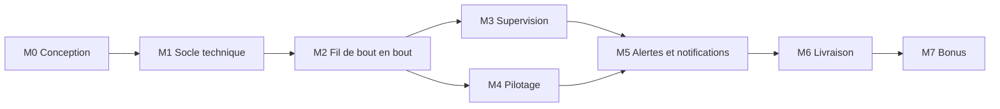

# 04 · Besoins fonctionnels : milestones et issues

> Étape 2 de la conception. Ce document liste **tous les développements à réaliser**, découpés en issues GitHub regroupées en milestones. Il sert de source pour créer les issues sur GitHub : une fois validé, chaque entrée devient une issue, avec le même titre, les mêmes labels, la même milestone et le même contenu.
>
> Les issues ont été créées sur GitHub le 6 novembre 2026 : les numéros `#n` de ce document sont ceux de GitHub. Toute modification d'une issue se fait **d'abord ici**, puis est reportée sur GitHub.

## 1. Conventions

### 1.1 Langue

| Élément | Langue |
|---|---|
| Titre et contenu des issues, milestones | Français |
| Labels | Anglais (ce sont des identifiants, [D012](../journal/decisions/D012-langue-du-code.md)) |
| Noms techniques cités dans les issues (routes, tables, fichiers) | Anglais, entre accents graves |

### 1.2 Structure d'une issue

Chaque issue contient, dans cet ordre :

| Rubrique | Contenu |
|---|---|
| **Contexte** | Pourquoi cette tâche existe, en une ou deux phrases |
| **À faire** | Ce qui doit être réalisé, précisément |
| **Critères d'acceptation** | Liste à cocher, vérifiable sans interprétation |
| **Dépend de** | Issues à terminer avant de commencer |
| **Références** | Sections des documents de conception à respecter |

### 1.3 Définition de « terminé »

Une issue n'est fermée que si **tous** ces points sont vrais :

- [ ] Tous les critères d'acceptation sont cochés.
- [ ] Le code respecte les documents de conception (noms, formats, règles). En cas d'écart nécessaire, le document est modifié dans la même pull request et une fiche de décision est créée si le choix est structurant.
- [ ] Le lint, la vérification des types et les tests passent en CI.
- [ ] Les tests demandés par l'issue sont écrits.
- [ ] La pull request est relue et approuvée par au moins un autre membre du groupe.
- [ ] La pull request référence l'issue (`Closes #n`) et est fusionnée dans `main`.

### 1.4 Labels

| Label | Couleur suggérée | Signification |
|---|---|---|
| `type:feature` | vert | Fonctionnalité visible ou comportement nouveau |
| `type:chore` | gris | Mise en place, configuration, outillage |
| `type:test` | jaune | Tests uniquement |
| `type:docs` | bleu clair | Documentation, dossier, journal |
| `type:design` | violet | Maquettage, charte graphique |
| `area:mobile` | | `apps/mobile` |
| `area:api` | | `apps/api` |
| `area:contracts` | | `packages/contracts` |
| `area:simulator` | | `tools/simulator` |
| `area:firmware` | | `firmware/site-device` |
| `area:infra` | | `infra/`, hébergement, broker |
| `area:ci` | | `.github/` |
| `priority:core` | rouge | Fait partie du socle |
| `priority:bonus` | orange | À traiter seulement une fois le socle terminé |

### 1.5 Milestones

| Milestone | Objectif | Livrable de fin |
|---|---|---|
| **M0 · Conception** | Terminer les étapes 3 et 4 de la conception | Maquettes validées, `CLAUDE.md` et `.claude/` en place |
| **M1 · Socle technique** | Dépôt prêt pour le développement (étape 5) | `pnpm install` puis `pnpm dev` démarrent la base et l'API ; CI verte |
| **M2 · Fil de bout en bout** | Une mesure part de l'ESP32 et s'affiche dans l'app | Démo : tourner le potentiomètre dans Wokwi change la valeur dans l'app |
| **M3 · Supervision** | Toutes les fonctions de consultation | Connexion, supervision, carte, détail, historiques, affichage sans réseau |
| **M4 · Pilotage** | Communication bidirectionnelle complète | Une consigne envoyée depuis l'app est appliquée ou refusée par l'objet, et l'app l'affiche |
| **M5 · Alertes et notifications** | Règles d'alerte et notifications push | Panne injectée → notification sur le téléphone |
| **M6 · Livraison** | Projet prêt pour la soutenance | APK installé, démo hébergée, dossier et documentation complets |
| **M7 · Bonus** | Améliorations facultatives | Vue 3D, rotation des panneaux, flux temps réel |

Les milestones M0 à M6 constituent le socle ; M7 regroupe les bonus, traités uniquement une fois le socle terminé.

Sur GitHub, les milestones portent uniquement leur intitulé (« Conception », « Socle technique »…) et les issues uniquement leur titre : les codes `Mx` ne servent que dans ce document. Aucune estimation de durée n'est indiquée.

### 1.6 Ordre et parallélisme

M3 et M4 peuvent avancer en parallèle une fois M2 terminé. Au sein d'une milestone, les issues sans dépendance entre elles peuvent être prises par des personnes différentes.

### 1.7 Récapitulatif

| Issue | Titre | Milestone | Zone |
|---|---|---|---|
| #1 | Charte graphique : typographie, icônes, couleurs accessibles | M0 | design |
| #2 | Maquettes des écrans de l'app | M0 | design |
| #3 | Rédiger `CLAUDE.md` et le dossier `.claude/` | M0 | docs |
| #4 | Modèles d'issue et de pull request GitHub | M0 | ci |
| #5 | Initialiser le monorepo pnpm | M1 | ci |
| #6 | Configurer ESLint et Prettier pour tout le dépôt | M1 | ci |
| #7 | Créer le paquet `contracts` : enums et constantes | M1 | contracts |
| #8 | Contracts : schémas des messages MQTT et topics | M1 | contracts |
| #9 | Contracts : schémas de l'API REST | M1 | contracts |
| #10 | Infra : base PostgreSQL + TimescaleDB avec Docker Compose | M1 | infra |
| #11 | Infra : broker Mosquitto auto-hébergé | M1 | infra |
| #12 | API : squelette Fastify | M1 | api |
| #13 | API : schéma Drizzle et migrations | M1 | api |
| #14 | API : données de démonstration (seed) | M1 | api |
| #15 | Mobile : initialiser l'app Expo | M1 | mobile |
| #16 | Simulateur : squelette | M1 | simulator |
| #17 | CI : lint, types et tests sur chaque pull request | M1 | ci |
| #18 | Configurer Dependabot | M1 | ci |
| #19 | Firmware : projet PlatformIO et montage Wokwi | M2 | firmware |
| #20 | Firmware : WiFi, heure NTP, MQTT sur TLS et statut | M2 | firmware |
| #21 | Firmware : lecture des capteurs et publication des mesures | M2 | firmware |
| #22 | API : client MQTT | M2 | api |
| #23 | API : enregistrement des mesures du site | M2 | api |
| #24 | API : routes de consultation des sites | M2 | api |
| #25 | Mobile : client API, TanStack Query et base SQLite locale | M2 | mobile |
| #26 | Mobile : écran Supervision, version minimale | M2 | mobile |
| #27 | API : authentification | M3 | api |
| #28 | Mobile : connexion et déconnexion | M3 | mobile |
| #29 | API : suivi du statut des objets | M3 | api |
| #30 | Simulateur : publication des mesures des panneaux | M3 | simulator |
| #31 | API : enregistrement des mesures des panneaux | M3 | api |
| #32 | API : routes de consultation des panneaux | M3 | api |
| #33 | API : historiques agrégés | M3 | api |
| #34 | Mobile : écran Supervision complet | M3 | mobile |
| #35 | Mobile : écran Carte | M3 | mobile |
| #36 | Mobile : écran Détail d'un panneau | M3 | mobile |
| #37 | Mobile : affichage sans réseau | M3 | mobile |
| #38 | Firmware : batterie simulée, relais et barre de LED | M4 | firmware |
| #39 | Firmware : algorithme de pilotage | M4 | firmware |
| #40 | Firmware : réception des consignes et publication de l'état | M4 | firmware |
| #41 | API : envoi d'une consigne | M4 | api |
| #42 | API : traitement de l'état appliqué | M4 | api |
| #43 | API : délai de réponse aux consignes | M4 | api |
| #44 | API : historique des consignes | M4 | api |
| #45 | Mobile : écran Pilotage | M4 | mobile |
| #46 | Mobile : historique des consignes | M4 | mobile |
| #47 | API : moteur de règles d'alerte | M5 | api |
| #48 | API : route de consultation des alertes | M5 | api |
| #49 | API : jetons et envoi des notifications push | M5 | api |
| #50 | Mobile : notifications et écran Alertes | M5 | mobile |
| #51 | Revue de sécurité et dossier sécurité | M6 | docs |
| #52 | Compléter les tests | M6 | test |
| #53 | Construire et distribuer l'APK | M6 | mobile |
| #54 | Héberger l'API et la base pour la démo | M6 | infra |
| #55 | Documentation technique | M6 | docs |
| #56 | Scénario de démonstration et répétition | M6 | docs |
| #57 | Point final du journal | M6 | docs |
| #58 | Bonus : vue 3D du parc | M7 | mobile |
| #59 | Bonus : rotation des panneaux | M7 | firmware, api, mobile |
| #60 | Bonus : flux temps réel poussé (SSE) | M7 | api, mobile |
| #61 | API : positionnement, modification et suppression d'un panneau | M3 | api |
| #62 | Mobile : panneaux à positionner | M3 | mobile |
| #63 | Bonus : ajout d'un panneau sur le terrain par QR code | M7 | api, mobile |
| #64 | Simulateur : mode objet du site | M2 | simulator |
| #65 | Infra : connexion de l'ESP32 de Wokwi au broker | M2 | infra |

---

## 2. M0 · Conception

### #1 · Charte graphique : typographie, icônes, couleurs accessibles

**Labels :** `type:design`, `priority:core`

**Contexte :** l'app doit être cohérente et accessible (usage en extérieur, en plein soleil). La charte est la base du maquettage et du thème de l'app.

**À faire :**
- Choisir et justifier la typographie (piste : Red Hat Display pour les titres, Red Hat Text pour le texte, fichiers embarqués dans l'app).
- Choisir et justifier le jeu d'icônes (piste : Phosphor, via `phosphor-react-native`) et lister les icônes nécessaires par écran.
- Définir la palette : couleurs principales, neutres, couleurs d'état (normal, avertissement, critique, sans données), en thème clair et sombre.
- Vérifier les contrastes (niveau AA minimum : 4,5:1 pour le texte, 3:1 pour les éléments graphiques).
- Définir l'échelle typographique et les espacements.
- Rédiger le document `docs/conception/05-charte-graphique.md` et une fiche de décision pour chaque choix (typographie, icônes, palette).

**Critères d'acceptation :**
- [ ] Le document de charte existe et contient : polices, tailles, graisses, palette en clair et en sombre, icônes, espacements.
- [ ] Chaque couple texte / fond a son ratio de contraste indiqué, tous ≥ 4,5:1.
- [ ] Aucun état n'est signalé par la seule couleur (une icône ou un texte l'accompagne toujours).
- [ ] Les licences des polices et des icônes sont indiquées et compatibles avec le projet.
- [ ] Les fiches de décision sont ajoutées au journal.

**Dépend de :** — · **Références :** [Étude, section 8](../etude-faisabilite-parc-solaire.md)

### #2 · Maquettes des écrans de l'app

**Labels :** `type:design`, `priority:core`

**Contexte :** les développeurs mobiles doivent savoir exactement quoi construire, sans interprétation.

**À faire :**
- Maquetter les écrans : Connexion, Supervision, Carte, Pilotage, Alertes, Détail d'un panneau.
- Maquetter les états de chaque écran : chargement, vide, erreur, sans réseau, rôle `viewer` (pilotage désactivé), objet hors ligne.
- Maquetter le dialogue de confirmation d'une consigne et les trois résultats (appliquée, partielle, refusée).
- Exporter les maquettes (images ou lien vers l'outil) dans `docs/conception/maquettes/`.

**Critères d'acceptation :**
- [ ] Les 6 écrans et tous leurs états listés sont maquettés.
- [ ] Les maquettes appliquent la charte (#1).
- [ ] Chaque élément affiché correspond à un champ de l'API (section 7.3 de la cartographie).
- [ ] Les maquettes sont relues par le groupe.

**Dépend de :** #1 · **Références :** [UML, cas d'utilisation](02-uml.md), [Cartographie, section 5.3 et 7.3](03-cartographie-technique.md)

### #3 · Rédiger `CLAUDE.md` et le dossier `.claude/`

**Labels :** `type:docs`, `priority:core`

**Contexte :** plusieurs personnes développent, avec ou sans assistant IA. Les règles doivent être écrites pour que le code produit soit homogène.

**À faire :**
- Rédiger `CLAUDE.md` à la racine : présentation, organisation du dépôt, commandes, règles de langue ([D012](../journal/decisions/D012-langue-du-code.md)), format des commits, règles de branche et de pull request, obligation de respecter les documents de conception, tenue du journal.
- Créer `.claude/settings.json` (permissions partagées) et des skills dédiés (par exemple : créer un module d'API, créer un écran mobile, ajouter un message MQTT, rédiger une fiche de décision).
- Ajouter une fiche de décision sur les règles de travail.

**Critères d'acceptation :**
- [ ] `CLAUDE.md` couvre tous les points listés.
- [ ] Au moins 4 skills sont rédigés et testés sur un exemple.
- [ ] Le groupe a relu et validé les règles.

**Dépend de :** — · **Références :** [Journal](../journal/README.md)

### #4 · Modèles d'issue et de pull request GitHub

**Labels :** `type:chore`, `area:ci`, `priority:core`

**À faire :**
- Créer `.github/ISSUE_TEMPLATE/tache.md` reprenant la structure de la section 1.2.
- Créer `.github/PULL_REQUEST_TEMPLATE.md` reprenant la définition de « terminé » (section 1.3).
- Créer les labels de la section 1.4 et les milestones de la section 1.5 sur GitHub.

**Critères d'acceptation :**
- [ ] Une nouvelle issue propose le modèle.
- [ ] Une nouvelle pull request affiche la liste de contrôle.
- [ ] Les labels et milestones existent sur GitHub.

**Dépend de :** — · **Références :** sections 1.2 à 1.5 de ce document

---

## 3. M1 · Socle technique

### #5 · Initialiser le monorepo pnpm

**Labels :** `type:chore`, `area:ci`, `priority:core`

**À faire :**
- Créer `package.json` racine (privé), `pnpm-workspace.yaml` (`apps/*`, `packages/*`, `tools/*`), `tsconfig.base.json` (mode strict).
- Fixer la version de Node.js (`.nvmrc` et champ `engines`) et de pnpm (champ `packageManager`).
- Ajouter `.gitignore`, `.gitattributes` (fins de ligne LF), `.editorconfig`.
- Scripts racine : `dev`, `build`, `lint`, `typecheck`, `test`, `format`.
- Mettre à jour le README racine avec les commandes de démarrage.

**Critères d'acceptation :**
- [ ] `pnpm install` fonctionne sur un clone neuf, sous Windows, macOS et Linux.
- [ ] Les fichiers versionnés sont en fins de ligne LF.
- [ ] Les scripts racine s'exécutent sur tous les paquets (même vides).

**Dépend de :** — · **Références :** [Cartographie, section 3](03-cartographie-technique.md)

### #6 · Configurer ESLint et Prettier pour tout le dépôt

**Labels :** `type:chore`, `area:ci`, `priority:core`

**À faire :** configuration ESLint commune (format « flat config ») et Prettier à la racine, avec les règles TypeScript ; extension spécifique pour React Native dans `apps/mobile`.

**Critères d'acceptation :**
- [ ] `pnpm lint` et `pnpm format --check` passent sur le dépôt.
- [ ] Les règles sont identiques pour tous les paquets TypeScript.

**Dépend de :** #5

### #7 · Créer le paquet `contracts` : enums et constantes

**Labels :** `type:feature`, `area:contracts`, `priority:core`

**À faire :**
- Créer `packages/contracts` (nom `@solar/contracts`), avec Vitest.
- `src/enums.ts` : toutes les énumérations de la section 3 du modèle de données, en schémas Zod et en types.
- `src/constants.ts` : toutes les constantes de la section 8 de la cartographie.

**Critères d'acceptation :**
- [ ] Les valeurs des enums sont identiques à celles de la base, au caractère près.
- [ ] Les constantes portent exactement les noms et valeurs de la cartographie.
- [ ] Le paquet s'importe depuis un autre paquet du dépôt.

**Dépend de :** #5 · **Références :** [Modèle de données, section 3](01-modele-donnees.md), [Cartographie, section 8](03-cartographie-technique.md)

### #8 · Contracts : schémas des messages MQTT et topics

**Labels :** `type:feature`, `area:contracts`, `priority:core`

**À faire :**
- `src/mqtt/messages.ts` : schémas `SiteMeasurement`, `PanelMeasurement`, `Setpoint`, `ControlState`, `DeviceStatus`, avec toutes les bornes de la section 6.2.
- `src/mqtt/topics.ts` : fonctions de construction (`siteMeasurementsTopic(siteCode)`…) et d'analyse (extraire le code du site et du panneau d'un topic reçu).

**Critères d'acceptation :**
- [ ] Chaque exemple JSON de la section 6.2 est accepté par son schéma (test).
- [ ] Un message avec une valeur hors bornes ou `v` différent de 1 est refusé (test).
- [ ] L'analyse d'un topic invalide renvoie une erreur explicite (test).

**Dépend de :** #7 · **Références :** [Cartographie, section 6](03-cartographie-technique.md)

### #9 · Contracts : schémas de l'API REST

**Labels :** `type:feature`, `area:contracts`, `priority:core`

**À faire :** schémas des corps de requête, des paramètres et des réponses de toutes les routes de la section 7.2, des objets de la section 7.3, et du format d'erreur avec ses codes.

**Critères d'acceptation :**
- [ ] Chaque route de la section 7.2 a ses schémas d'entrée et de sortie.
- [ ] Le schéma de consigne refuse une `batteryShare` absente en mode `manual`, présente dans les autres modes, ou non multiple de 10 (test).

**Dépend de :** #7 · **Références :** [Cartographie, section 7](03-cartographie-technique.md)

### #10 · Infra : base PostgreSQL + TimescaleDB avec Docker Compose

**Labels :** `type:chore`, `area:infra`, `priority:core`

**À faire :** `infra/docker-compose.yml` avec le service `db` (image `timescale/timescaledb`, volume persistant, contrôle de santé) et `infra/.env.example`.

**Critères d'acceptation :**
- [ ] `docker compose up -d db` démarre une base accessible sur le port 5432.
- [ ] Les extensions `timescaledb` et `citext` sont disponibles.
- [ ] Aucun mot de passe n'est versionné.

**Dépend de :** #5 · **Références :** [Cartographie, sections 5.6 et 9](03-cartographie-technique.md)

### #11 · Infra : broker Mosquitto auto-hébergé

**Labels :** `type:chore`, `area:infra`, `priority:core`

**Contexte :** l'offre gratuite de HiveMQ Cloud n'accepte plus de nouveau cluster ; le broker est auto-hébergé ([D023](../journal/decisions/D023-broker-mosquitto-auto-heberge.md)).

**À faire :**
- Service `mqtt` (`eclipse-mosquitto:2`) dans `infra/docker-compose.yml` : port 1883 publié sur `127.0.0.1` uniquement, port 8883 en TLS.
- Configuration versionnée dans `infra/mosquitto/config/` : `mosquitto.conf` (aucun accès anonyme) et `acl` (droits de la section 6.3).
- Script `pnpm mqtt:setup` : fichier de mots de passe haché et certificats TLS (autorité du projet, certificat du serveur pour les noms de `MQTT_TLS_HOSTS`), générés dans `infra/mosquitto/generated/`, ignoré par Git.
- Variables `MQTT_*` dans `infra/.env.example` ; `MQTT_URL=mqtt://127.0.0.1:1883` dans les `.env.example` de l'API et du simulateur.

**Critères d'acceptation :**
- [x] Une connexion anonyme ou avec un mauvais mot de passe est refusée.
- [x] Chacun des trois identifiants se connecte ; une publication hors de ses droits n'est pas distribuée.
- [x] Une connexion TLS sur le port 8883, avec le certificat de l'autorité du projet, fonctionne.
- [x] Aucun mot de passe ni clé privée n'est versionné.

**Dépend de :** #10 · **Références :** [D023](../journal/decisions/D023-broker-mosquitto-auto-heberge.md), [Cartographie, sections 5.6 et 6.3](03-cartographie-technique.md)

### #12 · API : squelette Fastify

**Labels :** `type:chore`, `area:api`, `priority:core`

**À faire :**
- Créer `apps/api` avec l'arborescence de la section 5.2.
- `config.ts` : lecture et validation des variables d'environnement (Zod) ; l'API refuse de démarrer si une variable manque.
- Fastify avec `fastify-type-provider-zod`, logs `pino`, préfixe `/v1`.
- Gestionnaire d'erreurs unique produisant le format `{ error: { code, message, details } }`.
- Route `GET /v1/health` (état de la base et du broker).
- `.env.example`.

**Critères d'acceptation :**
- [ ] `pnpm --filter api dev` démarre l'API.
- [ ] `GET /v1/health` renvoie 200 avec `status`, `database`, `broker`.
- [ ] Une route inconnue renvoie 404 au format d'erreur défini.
- [ ] Test avec `fastify.inject()` sur `/v1/health`.

**Dépend de :** #9, #10 · **Références :** [Cartographie, sections 5.2 et 7.1](03-cartographie-technique.md)

### #13 · API : schéma Drizzle et migrations

**Labels :** `type:chore`, `area:api`, `priority:core`

**À faire :**
- `db/schema.ts` reproduisant exactement le modèle de données (tables, colonnes, enums, contraintes, index).
- Migrations générées par `drizzle-kit`, plus une migration SQL manuelle pour `create_hypertable` et `add_retention_policy`.
- Scripts `db:migrate` et `db:generate`.

**Critères d'acceptation :**
- [ ] Sur une base vide, `pnpm --filter api db:migrate` crée un schéma identique au script SQL de référence.
- [ ] `site_measurements` et `panel_measurements` sont des hypertables avec une rétention de 30 jours.
- [ ] Les contraintes `CHECK` et l'index unique partiel des alertes sont présents.

**Dépend de :** #12 · **Références :** [Modèle de données, sections 4 à 7](01-modele-donnees.md)

### #14 · API : données de démonstration (seed)

**Labels :** `type:chore`, `area:api`, `priority:core`

**À faire :** fichier versionné `infra/seed/demo-site.json` (site, objet, 20 panneaux) et script `db:seed` qui le lit et insère aussi les 2 utilisateurs de la section 8 du modèle de données ; mots de passe lus dans `SEED_OPERATOR_PASSWORD` et `SEED_VIEWER_PASSWORD`.

**Critères d'acceptation :**
- [ ] Le script peut être relancé sans erreur ni doublon.
- [ ] Les valeurs correspondent exactement à la section 8 ; les panneaux ont `source = 'seed'`.
- [ ] Le fichier JSON est validé par un schéma avant insertion (erreur explicite sinon).

**Dépend de :** #13 · **Références :** [Modèle de données, section 8](01-modele-donnees.md)

### #15 · Mobile : initialiser l'app Expo

**Labels :** `type:chore`, `area:mobile`, `priority:core`

**À faire :**
- Créer `apps/mobile` (TypeScript, Expo Router) avec l'arborescence de la section 5.3 et des écrans vides pour chaque route.
- `app.config.ts` lisant `EXPO_PUBLIC_API_URL` ; `eas.json` avec les profils `development`, `preview`, `production`.
- Construire un *development build* Android et l'installer sur le téléphone de test.
- Configurer Jest (`jest-expo`) avec un premier test.

**Critères d'acceptation :**
- [ ] L'app démarre sur le téléphone de test et affiche la barre d'onglets.
- [ ] `pnpm --filter mobile test` passe.
- [ ] Le paquet `@solar/contracts` est importable depuis l'app.

**Dépend de :** #7 · **Références :** [Cartographie, section 5.3](03-cartographie-technique.md), [D005](../journal/decisions/D005-framework-mobile.md)

### #16 · Simulateur : squelette

**Labels :** `type:chore`, `area:simulator`, `priority:core`

**À faire :** créer `tools/simulator` (TypeScript, `tsx`), lecture des variables d'environnement, connexion MQTT, `.env.example`.

**Critères d'acceptation :**
- [ ] `pnpm --filter simulator dev` se connecte au broker et l'indique dans la console.

**Dépend de :** #7, #11 · **Références :** [Cartographie, section 5.4](03-cartographie-technique.md)

### #17 · CI : lint, types et tests sur chaque pull request

**Labels :** `type:chore`, `area:ci`, `priority:core`

**À faire :** workflow GitHub Actions déclenché sur les pull requests et sur `main` : installation pnpm avec cache, `lint`, `typecheck`, `test`.

**Critères d'acceptation :**
- [ ] Le workflow s'exécute sur une pull request et bloque la fusion en cas d'échec (règle de protection de `main`).
- [ ] Durée inférieure à 5 minutes.

**Dépend de :** #6

### #18 · Configurer Dependabot

**Labels :** `type:chore`, `area:ci`, `priority:core`

**À faire :** `.github/dependabot.yml` pour npm (chaque paquet du workspace) et GitHub Actions, fréquence hebdomadaire, mises à jour mineures groupées.

**Critères d'acceptation :**
- [ ] Dependabot ouvre ses premières pull requests et la CI s'y exécute.

**Dépend de :** #17

---

## 4. M2 · Fil de bout en bout

### #19 · Firmware : projet PlatformIO et montage Wokwi

**Labels :** `type:chore`, `area:firmware`, `priority:core`

**À faire :**
- Créer `firmware/site-device` (PlatformIO, framework Arduino, ESP32) avec `wokwi.toml` et `diagram.json`.
- Montage : photorésistance, potentiomètre, DS18B20 (avec résistance de rappel), 2 relais, barre de LED, bouton de panne.
- `include/secrets.example.h` versionné, `include/secrets.h` ignoré par Git.
- `include/config.h` reprenant les constantes partagées utilisées par l'objet.

**Critères d'acceptation :**
- [ ] La simulation démarre dans Wokwi (VS Code ou navigateur) et affiche un message sur le port série.
- [ ] Tous les composants sont présents et câblés selon un tableau de broches documenté dans le README du dossier.

**Dépend de :** #5 · **Références :** [Étude, section 6](../etude-faisabilite-parc-solaire.md)

### #20 · Firmware : WiFi, heure NTP, MQTT sur TLS et statut

**Labels :** `type:feature`, `area:firmware`, `priority:core`

**À faire :**
- Connexion au réseau `Wokwi-GUEST`, synchronisation de l'heure par NTP.
- Connexion MQTT en TLS (port 8883, certificat de l'autorité du projet embarqué) au broker Mosquitto, par le moyen retenu dans #65, avec l'identifiant `device-site01`.
- Last Will `{ "v": 1, "status": "offline" }` sur `solar/SITE01/status` (retained, QoS 1), puis publication de `online` avec la version du firmware.
- Reconnexion automatique (WiFi et MQTT).

**Critères d'acceptation :**
- [ ] Le statut `online` apparaît sur le broker au démarrage (vérifié avec un client MQTT).
- [ ] L'arrêt brutal de la simulation fait apparaître `offline`.
- [ ] Une coupure puis un retour du réseau rétablissent la connexion sans redémarrage.

**Dépend de :** #11, #19, #65 · **Références :** [Cartographie, section 6](03-cartographie-technique.md)

### #21 · Firmware : lecture des capteurs et publication des mesures

**Labels :** `type:feature`, `area:firmware`, `priority:core`

**À faire :**
- Lire l'ensoleillement (photorésistance → W/m²), la production (potentiomètre → 0 à 4 000 W), la température (DS18B20).
- Bouton de panne : chaque appui active ou désactive `simulatedFault` (production divisée par 5).
- Publier un `SiteMeasurement` toutes les 5 s (batterie et flux à des valeurs fixes en attendant #38).

**Critères d'acceptation :**
- [ ] Les messages respectent exactement le schéma de la section 6.2 (vérifiés en les passant au schéma Zod).
- [ ] Modifier un capteur dans Wokwi modifie la valeur publiée.

**Dépend de :** #20 · **Références :** [Cartographie, section 6.2](03-cartographie-technique.md)

### #22 · API : client MQTT

**Labels :** `type:feature`, `area:api`, `priority:core`

**À faire :** `mqtt/client.ts` (connexion TLS, reconnexion, abonnements de la section 6.1, fonction de publication) et `mqtt/handlers.ts` (validation de chaque message par son schéma, aiguillage vers le service concerné, avertissement en cas de message invalide).

**Critères d'acceptation :**
- [ ] L'API s'abonne aux 4 topics au démarrage et l'état du broker remonte dans `/v1/health`.
- [ ] Un message invalide est ignoré et journalisé, sans arrêter l'API (test).

**Dépend de :** #8, #12

### #23 · API : enregistrement des mesures du site

**Labels :** `type:feature`, `area:api`, `priority:core`

**À faire :** service `measurements` : résolution du code de site, contrôle de l'écart d'horloge (remplacement par l'heure de réception au-delà de 300 s), insertion dans `site_measurements`, mise à jour de `devices.last_seen_at`.

**Critères d'acceptation :**
- [ ] Une mesure publiée par l'ESP32 apparaît en base en moins de 2 s.
- [ ] Un code de site inconnu est ignoré et journalisé.
- [ ] Tests : horloge décalée, site inconnu, insertion nominale.

**Dépend de :** #13, #22 · **Références :** [UML, séquence 4.2](02-uml.md)

### #24 · API : routes de consultation des sites

**Labels :** `type:feature`, `area:api`, `priority:core`

**À faire :** `GET /v1/sites` et `GET /v1/sites/{id}` renvoyant `SiteSummary` et `SiteDetail`, dont `latestMeasurement` et `expectedProduction`. Authentification ajoutée plus tard (#27) : prévoir le point d'accroche.

**Critères d'acceptation :**
- [ ] Les réponses respectent les schémas de la section 7.3.
- [ ] `expectedProduction` = ensoleillement × `production_factor` (test).
- [ ] Un identifiant inconnu renvoie 404 `NOT_FOUND`.

**Dépend de :** #23 · **Références :** [Cartographie, section 7](03-cartographie-technique.md)

### #25 · Mobile : client API, TanStack Query et base SQLite locale

**Labels :** `type:feature`, `area:mobile`, `priority:core`

**À faire :**
- `src/api/` : client HTTP (URL de base, en-tête JWT, conversion des erreurs au format de l'API), hooks TanStack Query par ressource.
- `src/storage/` : base `expo-sqlite`, tables locales pour la dernière réponse de chaque ressource, fonctions de lecture et d'écriture.
- Chaque réponse reçue est enregistrée dans SQLite.

**Critères d'acceptation :**
- [ ] Un hook `useSite(id)` renvoie les données de l'API et les enregistre localement.
- [ ] Au démarrage sans réseau, le hook renvoie la dernière valeur enregistrée.
- [ ] Le JWT n'est jamais écrit dans SQLite.

**Dépend de :** #15 · **Références :** [D014](../journal/decisions/D014-stockage-local-sqlite.md), [Cartographie, section 5.3](03-cartographie-technique.md)

### #26 · Mobile : écran Supervision, version minimale

**Labels :** `type:feature`, `area:mobile`, `priority:core`

**À faire :** afficher la dernière mesure du site (production, ensoleillement, température, batterie), rafraîchie toutes les 5 s tant que l'écran est visible.

**Critères d'acceptation :**
- [ ] Tourner le potentiomètre dans Wokwi modifie la production affichée en moins de 10 s.
- [ ] États de chargement et d'erreur gérés.

**Dépend de :** #21, #24, #25 · **Références :** maquettes (#2)

---

## 5. M3 · Supervision

### #27 · API : authentification

**Labels :** `type:feature`, `area:api`, `priority:core`

**À faire :**
- `POST /v1/auth/login` : vérification argon2id, JWT HS256 de 8 h contenant `sub` et `role`.
- `GET /v1/auth/me`.
- Limitation à 5 tentatives de connexion par minute et par adresse IP.
- Protection de toutes les routes sauf `/v1/auth/login` et `/v1/health` ; vérification du rôle `operator` là où c'est requis.

**Critères d'acceptation :**
- [ ] Mauvais identifiants → 401 `INVALID_CREDENTIALS`, sans indiquer si c'est l'e-mail ou le mot de passe.
- [ ] Jeton absent ou expiré → 401 `UNAUTHENTICATED`.
- [ ] 6e tentative en une minute → 429 `TOO_MANY_ATTEMPTS`.
- [ ] Tests pour chacun de ces cas.

**Dépend de :** #14 · **Références :** [UML, séquence 4.1](02-uml.md), [Cartographie, section 7](03-cartographie-technique.md)

### #28 · Mobile : connexion et déconnexion

**Labels :** `type:feature`, `area:mobile`, `priority:core`

**À faire :**
- Écran de connexion ; jeton stocké dans `expo-secure-store` ; redirection vers la supervision.
- Retour à l'écran de connexion si l'API répond 401.
- Bouton de déconnexion (suppression du jeton local).
- Contexte d'authentification exposant l'utilisateur et son rôle.

**Critères d'acceptation :**
- [ ] Les messages d'erreur sont ceux de la séquence 4.1.
- [ ] L'utilisateur reste connecté après redémarrage de l'app, jusqu'à l'expiration du jeton.
- [ ] Le rôle est disponible pour masquer le pilotage aux `viewer`.

**Dépend de :** #25, #27 · **Références :** [UML, séquence 4.1](02-uml.md)

### #29 · API : suivi du statut des objets

**Labels :** `type:feature`, `area:api`, `priority:core`

**À faire :** traitement du topic `status` (mise à jour de `devices.status` et `firmware_version`) ; planificateur passant l'objet en `offline` après 60 s sans message ; tout message reçu repasse l'objet en `online`.

**Critères d'acceptation :**
- [ ] Les transitions respectent le diagramme d'états 5.2.
- [ ] `deviceStatus` est exposé dans `SiteSummary`.
- [ ] Tests des transitions.

**Dépend de :** #22 · **Références :** [UML, sections 4.4 et 5.2](02-uml.md)

### #30 · Simulateur : publication des mesures des panneaux

**Labels :** `type:feature`, `area:simulator`, `priority:core`

**À faire :** abonnement à `solar/SITE01/measurements` pour connaître l'ensoleillement ; toutes les 10 s, publication d'un `PanelMeasurement` pour chacun des 20 panneaux (production = ensoleillement × 200 / 1000, ± 5 %) ; panneaux listés dans `FAULTY_PANELS` divisés par 5 ; panneaux listés dans `EXTRA_PANELS` (absents du seed) publiés en plus.

**Critères d'acceptation :**
- [ ] 20 messages valides toutes les 10 s, plus un par panneau de `EXTRA_PANELS`.
- [ ] Les panneaux en panne produisent environ 5 fois moins que les autres.

**Dépend de :** #8, #16 · **Références :** [Cartographie, section 5.4](03-cartographie-technique.md)

### #31 · API : enregistrement des mesures des panneaux

**Labels :** `type:feature`, `area:api`, `priority:core`

**À faire :** résolution du site et du code de panneau ; pour un code inconnu sur un site connu, création automatique du panneau ([D020](../journal/decisions/D020-inventaire-des-panneaux.md)) : `source = 'discovered'`, nom = code, sans position, puissance `DEFAULT_PANEL_RATED_POWER_W`, dans la limite de `MAX_PANELS_PER_SITE`.

**Critères d'acceptation :**
- [ ] Les mesures sont insérées dans `panel_measurements`.
- [ ] Un code inconnu crée un panneau non positionné, une seule fois même si plusieurs messages arrivent en même temps (test).
- [ ] Au-delà de `MAX_PANELS_PER_SITE`, le message est ignoré et journalisé (test).
- [ ] Un site inconnu est ignoré et journalisé (test).

**Dépend de :** #23, #30 · **Références :** [UML, séquence 4.6](02-uml.md)

### #32 · API : routes de consultation des panneaux

**Labels :** `type:feature`, `area:api`, `priority:core`

**À faire :** `GET /v1/sites/{id}/panels` et `GET /v1/panels/{id}`, avec le statut calculé (`normal`, `alert`, `no_data`) et la production attendue.

**Critères d'acceptation :**
- [ ] Le statut suit les règles de la section 6 de l'UML (test pour chaque statut).
- [ ] Réponses conformes à `PanelSummary` et `PanelDetail`.

**Dépend de :** #31 · **Références :** [UML, section 6](02-uml.md)

### #33 · API : historiques agrégés

**Labels :** `type:feature`, `area:api`, `priority:core`

**À faire :** `GET /v1/sites/{id}/measurements` et `GET /v1/panels/{id}/measurements` avec `from`, `to`, `interval`, agrégés par `time_bucket()`.

**Critères d'acceptation :**
- [ ] Un écart supérieur à 7 jours ou un intervalle inconnu renvoie 422.
- [ ] Les points sont triés par date croissante et moyennés par intervalle (test sur des données connues).

**Dépend de :** #23, #31 · **Références :** [Modèle de données, section 5](01-modele-donnees.md)

### #34 · Mobile : écran Supervision complet

**Labels :** `type:feature`, `area:mobile`, `priority:core`

**À faire :** compléter l'écran : production réelle et attendue, jauge de batterie, répartition batterie / réseau, mode en vigueur, statut de l'objet, nombre d'alertes actives, graphique d'historique (choix de la période : 1 h, 24 h, 7 jours).

**Critères d'acceptation :**
- [ ] Conforme aux maquettes, dans tous les états prévus.
- [ ] Les valeurs ont leur unité et sont lisibles par le lecteur d'écran (libellés d'accessibilité).
- [ ] Test de rendu du composant principal.

**Dépend de :** #26, #28, #29, #33 · **Références :** maquettes (#2)

### #35 · Mobile : écran Carte

**Labels :** `type:feature`, `area:mobile`, `priority:core`

**À faire :** carte centrée sur le site, un marqueur par panneau coloré et iconé selon son statut, légende, appui sur un marqueur → Détail du panneau ; liste des panneaux en alternative accessible.

**Critères d'acceptation :**
- [ ] Les 20 panneaux sont positionnés selon leurs coordonnées.
- [ ] Chaque statut a une couleur **et** une icône.
- [ ] La liste alternative donne accès aux mêmes informations.

**Dépend de :** #28, #32 · **Références :** [UML, section 6](02-uml.md)

### #36 · Mobile : écran Détail d'un panneau

**Labels :** `type:feature`, `area:mobile`, `priority:core`

**Critères d'acceptation :**
- [ ] Affiche production, production attendue, température, statut, alertes actives et historique.
- [ ] Conforme aux maquettes.

**Dépend de :** #35

### #37 · Mobile : affichage sans réseau

**Labels :** `type:feature`, `area:mobile`, `priority:core`

**À faire :** détection de la connexion (`netinfo`) ; bandeau « Hors ligne · données du {date} » ; écrans alimentés par SQLite ; pas d'erreur bloquante.

**Critères d'acceptation :**
- [ ] En mode avion, chaque écran affiche les dernières données reçues et leur ancienneté.
- [ ] Le retour du réseau relance le rafraîchissement sans action de l'utilisateur.

**Dépend de :** #34, #35 · **Références :** [Étude, section 8](../etude-faisabilite-parc-solaire.md)

---

## 6. M4 · Pilotage

### #38 · Firmware : batterie simulée, relais et barre de LED

**Labels :** `type:feature`, `area:firmware`, `priority:core`

**À faire :** modèle de batterie (capacité 10 000 Wh, facteur de temps 60) mis à jour chaque seconde ; relais de charge et d'injection ; barre de LED proportionnelle au niveau ; valeurs réelles publiées dans `SiteMeasurement`.

**Critères d'acceptation :**
- [ ] Avec 3 000 W vers la batterie, le niveau passe de 20 % à 95 % en environ 2 à 3 minutes réelles.
- [ ] Les relais et la barre de LED reflètent les flux et le niveau.

**Dépend de :** #21 · **Références :** [UML, section 7](02-uml.md)

### #39 · Firmware : algorithme de pilotage

**Labels :** `type:feature`, `area:firmware`, `priority:core`

**À faire :** implémenter exactement le logigramme de la section 7 de l'UML : modes `manual`, `automatic`, `discharge`, limites `battery_full`, `battery_low`, `charge_limit`.

**Critères d'acceptation :**
- [ ] Chaque ligne du tableau « statut renvoyé » de la section 7 est vérifiée dans Wokwi (scénario documenté dans la pull request).
- [ ] La fonction de calcul est séparée des entrées-sorties, pour pouvoir être testée.

**Dépend de :** #38 · **Références :** [UML, section 7](02-uml.md)

### #40 · Firmware : réception des consignes et publication de l'état

**Labels :** `type:feature`, `area:firmware`, `priority:core`

**À faire :** abonnement à `solar/SITE01/setpoint` (QoS 1) ; validation du message ; application ; publication d'un `ControlState` (retained, QoS 1) à la réception et à chaque changement de part appliquée ou de raison.

**Critères d'acceptation :**
- [ ] Une consigne invalide produit `rejected` / `invalid_setpoint`.
- [ ] Après une reconnexion, la consigne retained est appliquée.
- [ ] Les messages respectent le schéma `ControlState`.

**Dépend de :** #39 · **Références :** [Cartographie, section 6.2](03-cartographie-technique.md), [UML, séquences 4.3 et 4.4](02-uml.md)

### #41 · API : envoi d'une consigne

**Labels :** `type:feature`, `area:api`, `priority:core`

**À faire :** `POST /v1/sites/{id}/setpoints` : rôle `operator`, validation, refus 409 si l'objet est `offline`, insertion (`sent`), publication retained, réponse 202.

**Critères d'acceptation :**
- [ ] `viewer` → 403 ; objet hors ligne → 409 ; valeurs invalides → 422 (tests).
- [ ] Le message publié respecte le schéma `Setpoint` et porte l'identifiant de la consigne.
- [ ] Une nouvelle consigne résout l'alerte `setpoint_rejected` active du site.

**Dépend de :** #27, #29 · **Références :** [UML, UC07 et séquence 4.3](02-uml.md)

### #42 · API : traitement de l'état appliqué

**Labels :** `type:feature`, `area:api`, `priority:core`

**À faire :** traitement du topic `state` : mise à jour de la consigne correspondante (première réponse uniquement, y compris après `no_response`), état appliqué courant gardé en mémoire et exposé dans `SiteDetail.controlState`, récupération du message retained au démarrage.

**Critères d'acceptation :**
- [ ] Les transitions respectent le diagramme d'états 5.1 (tests).
- [ ] Une réponse dont l'identifiant ne correspond pas à la consigne en vigueur ne modifie aucune consigne.
- [ ] Après redémarrage de l'API, `controlState` est disponible sans nouvelle action de l'objet.

**Dépend de :** #41 · **Références :** [UML, section 5.1](02-uml.md)

### #43 · API : délai de réponse aux consignes

**Labels :** `type:feature`, `area:api`, `priority:core`

**Critères d'acceptation :**
- [ ] Une consigne restée `sent` 30 s passe en `no_response` (test avec horloge simulée).
- [ ] Le délai survit à un redémarrage de l'API (recherche des consignes `sent` trop anciennes au démarrage).

**Dépend de :** #42

### #44 · API : historique des consignes

**Labels :** `type:feature`, `area:api`, `priority:core`

**Critères d'acceptation :**
- [ ] `GET /v1/sites/{id}/setpoints` renvoie les consignes de la plus récente à la plus ancienne, avec l'auteur.
- [ ] La pagination par curseur fonctionne (test sur 25 consignes).

**Dépend de :** #41 · **Références :** [Cartographie, section 7.1](03-cartographie-technique.md)

### #45 · Mobile : écran Pilotage

**Labels :** `type:feature`, `area:mobile`, `priority:core`

**À faire :** choix du mode, curseur de part batterie (pas de 10 %), schéma des flux, jauge de batterie, bouton « Appliquer », dialogue de confirmation, suivi du statut (interrogation toutes les 2 s, 60 s au plus), affichage du résultat et de la raison ; pilotage désactivé pour un `viewer`, sans réseau ou si l'objet est hors ligne, avec un message expliquant pourquoi.

**Critères d'acceptation :**
- [ ] Le scénario nominal et les variantes A, B, C de UC07 sont démontrables.
- [ ] Chaque raison de refus a un libellé français compréhensible.
- [ ] Les trois cas de désactivation affichent leur message.

**Dépend de :** #28, #37, #42 · **Références :** [UML, UC07](02-uml.md), maquettes (#2)

### #46 · Mobile : historique des consignes

**Labels :** `type:feature`, `area:mobile`, `priority:core`

**Critères d'acceptation :**
- [ ] Liste sur l'écran Pilotage : date, auteur, demande, résultat ; chargement de la page suivante au défilement.

**Dépend de :** #44, #45

---

## 7. M5 · Alertes et notifications

### #47 · API : moteur de règles d'alerte

**Labels :** `type:feature`, `area:api`, `priority:core`

**À faire :** les 7 règles de la section 6 de l'UML, avec leurs seuils de déclenchement et de résolution, la durée de 60 s pour `low_production`, l'unicité des alertes actives, les messages en français.

**Critères d'acceptation :**
- [ ] Un test par règle couvrant le déclenchement, la non-répétition et la résolution.
- [ ] Une panne injectée (bouton ou `FAULTY_PANELS`) ouvre une alerte `low_production` en environ 60 s.

**Dépend de :** #29, #31, #42, #43 · **Références :** [UML, section 6](02-uml.md)

### #48 · API : route de consultation des alertes

**Labels :** `type:feature`, `area:api`, `priority:core`

**Critères d'acceptation :**
- [ ] `GET /v1/alerts` filtre par `status` et `siteId`, paginé, conforme à `Alert`.

**Dépend de :** #47

### #49 · API : jetons et envoi des notifications push

**Labels :** `type:feature`, `area:api`, `priority:core`

**À faire :** `POST /v1/push-tokens` (insertion ou réattribution), `DELETE /v1/push-tokens/{token}` ; envoi groupé via `expo-server-sdk` à l'ouverture d'une alerte `warning` ou `critical` ; suppression des jetons signalés invalides par Expo.

**Critères d'acceptation :**
- [ ] Une alerte `critical` déclenche une notification sur le téléphone de test.
- [ ] Une alerte `info` n'en déclenche pas.
- [ ] Tests avec le service Expo simulé.

**Dépend de :** #27, #47 · **Références :** [UML, séquence 4.5](02-uml.md)

### #50 · Mobile : notifications et écran Alertes

**Labels :** `type:feature`, `area:mobile`, `priority:core`

**À faire :** demande d'autorisation et enregistrement du jeton après connexion, suppression à la déconnexion ; écran Alertes (actives puis résolues, gravité par couleur et icône) ; appui sur une notification → écran Alertes.

**Critères d'acceptation :**
- [ ] La notification arrive app fermée et app ouverte.
- [ ] Après déconnexion, le téléphone ne reçoit plus de notification.

**Dépend de :** #28, #48, #49

---

## 8. M6 · Livraison

### #51 · Revue de sécurité et dossier sécurité

**Labels :** `type:docs`, `priority:core`

**À faire :** vérifier les points de la section 9 de l'étude (TLS, identifiants par client, JWT, rôles, double validation, secrets, validation des entrées) ; rédiger `docs/dossier-securite.md` (menaces identifiées, mesures en place, limites assumées, pistes d'évolution).

**Critères d'acceptation :**
- [ ] Chaque mesure de sécurité est vérifiée et sa preuve indiquée (test, capture, configuration).
- [ ] Aucun secret dans l'historique Git (vérifié avec un outil de détection).

**Dépend de :** M5 terminé · **Références :** [Étude, section 9](../etude-faisabilite-parc-solaire.md)

### #52 · Compléter les tests

**Labels :** `type:test`, `priority:core`

**Critères d'acceptation :**
- [ ] Les services de l'API (`setpoints`, `alerts`, `measurements`, `auth`) sont couverts à 80 % au moins.
- [ ] Tous les schémas de `contracts` ont un test d'acceptation et un test de refus.
- [ ] Les composants principaux de l'app (jauge, sélecteur de mode, marqueur de carte) ont un test de rendu.

**Dépend de :** M5 terminé

### #53 · Construire et distribuer l'APK

**Labels :** `type:chore`, `area:mobile`, `priority:core`

**Critères d'acceptation :**
- [ ] Le profil EAS `preview` produit un APK pointant vers l'API hébergée.
- [ ] L'APK est installé sur le téléphone de test et le lien est partagé au groupe.

**Dépend de :** #54

### #54 · Héberger l'API et la base pour la démo

**Labels :** `type:chore`, `area:infra`, `priority:core`

**À faire :** choisir l'hébergement (fiche de décision), déployer API et base avec Docker Compose, HTTPS, variables d'environnement, migrations et seed.

**Critères d'acceptation :**
- [ ] `GET https://<domaine>/v1/health` renvoie 200 depuis un réseau extérieur.
- [ ] La procédure de déploiement est documentée.

**Dépend de :** M5 terminé

### #55 · Documentation technique

**Labels :** `type:docs`, `priority:core`

**Critères d'acceptation :**
- [ ] Le README racine permet à une personne extérieure de lancer le projet (base, API, simulateur, Wokwi, app) en suivant les étapes.
- [ ] Chaque dossier (`apps/*`, `tools/*`, `packages/*`, `firmware/*`) a un README court.
- [ ] Les documents de conception sont à jour avec le code livré.

**Dépend de :** M5 terminé

### #56 · Scénario de démonstration et répétition

**Labels :** `type:docs`, `priority:core`

**Critères d'acceptation :**
- [ ] Le scénario couvre les cinq gestes du module et la communication bidirectionnelle (consigne appliquée puis refusée).
- [ ] Il a été répété en conditions réelles, avec un plan de secours en cas de panne réseau.

**Dépend de :** #53, #54

### #57 · Point final du journal

**Labels :** `type:docs`, `priority:core`

**Critères d'acceptation :**
- [ ] `docs/journal/points/` contient le point final : écarts entre prévu et réalisé, décisions de la période, bilan, pistes d'évolution.
- [ ] Toutes les fiches de décision ont leurs décideurs renseignés.

**Dépend de :** #55

---

## 9. M7 · Bonus

### #58 · Bonus : vue 3D du parc

**Labels :** `type:feature`, `area:mobile`, `priority:bonus`

**À faire :** écran 3D (React Three Fiber + `expo-gl`) : panneaux générés depuis leurs positions, colorés selon leur statut, appui sur un panneau → Détail. Commencer par une preuve de concept ; s'arrêter si elle montre que la 3D est trop coûteuse pour le temps restant.

**Critères d'acceptation :**
- [ ] Fluide sur le téléphone de test avec les 20 panneaux.
- [ ] Aucune information n'est disponible uniquement en 3D.

**Dépend de :** M6 terminé · **Références :** [D013](../journal/decisions/D013-vue-3d-bonus.md)

### #59 · Bonus : rotation des panneaux

**Labels :** `type:feature`, `area:firmware`, `area:api`, `area:mobile`, `priority:bonus`

**À faire :** servo et deux photorésistances sur l'ESP32 ; orientation automatique ; commande de mode et de position de sécurité depuis l'app. Nécessite une extension des contrats et du modèle de données (fiche de décision et mise à jour des documents avant développement).

**Critères d'acceptation :**
- [ ] Les documents de conception sont mis à jour avant le code.
- [ ] La position de sécurité commandée depuis l'app est appliquée et confirmée par l'objet.

**Dépend de :** M6 terminé

### #60 · Bonus : flux temps réel poussé (SSE)

**Labels :** `type:feature`, `area:api`, `area:mobile`, `priority:bonus`

**À faire :** route SSE poussant les nouvelles mesures et les changements d'état ; l'app remplace l'interrogation périodique par le flux quand il est disponible, avec retour automatique à l'interrogation en cas de coupure.

**Critères d'acceptation :**
- [ ] Délai d'affichage d'une nouvelle mesure inférieur à 2 s.
- [ ] Une coupure du flux ne bloque pas l'app.

**Dépend de :** M6 terminé · **Références :** [D010](../journal/decisions/D010-api-rest-fastify.md)

### #63 · Bonus : ajout d'un panneau sur le terrain par QR code

**Labels :** `type:feature`, `area:api`, `area:mobile`, `priority:bonus`

**À faire :** route `POST /v1/sites/{id}/panels` (rôle `operator`, `source = 'manual'`) ; écran d'ajout dans l'app : scan du QR code du panneau (caméra, `expo-camera`), position GPS du téléphone, puissance nominale, validation. Les documents de conception sont mis à jour avant le code.

**Critères d'acceptation :**
- [ ] Un panneau scanné et validé apparaît sur la carte.
- [ ] Un code déjà existant sur le site est refusé avec un message clair.
- [ ] Refus de la caméra ou de la localisation : saisie manuelle possible, message expliquant l'intérêt de l'autorisation.

**Dépend de :** #61, #62, M6 terminé · **Références :** [D020](../journal/decisions/D020-inventaire-des-panneaux.md), [UML, UC18](02-uml.md)

---

## 10. Ajouts au socle après la création des issues

Issues ajoutées le 6 novembre 2026 suite à la décision [D020](../journal/decisions/D020-inventaire-des-panneaux.md). Elles appartiennent à la milestone **M3 · Supervision**.

### #61 · API : positionnement, modification et suppression d'un panneau

**Labels :** `type:feature`, `area:api`, `priority:core`

**À faire :** `PATCH /v1/panels/{id}` (`name`, `latitude` et `longitude` ensemble, `ratedPowerW`) et `DELETE /v1/panels/{id}`, réservées au rôle `operator` ; `GET /v1/sites/{id}/panels` renvoie aussi les panneaux non positionnés (`placed = false`, position `null`).

**Critères d'acceptation :**
- [ ] `viewer` → 403 ; latitude sans longitude, ou valeurs hors bornes → 422 (tests).
- [ ] La suppression retire aussi les mesures et alertes du panneau.
- [ ] Un panneau supprimé qui publie de nouveau réapparaît comme détecté (test).

**Dépend de :** #27, #31, #32 · **Références :** [Cartographie, section 7](03-cartographie-technique.md), [UML, séquence 4.6](02-uml.md)

### #62 · Mobile : panneaux à positionner

**Labels :** `type:feature`, `area:mobile`, `priority:core`

**À faire :** dans la vue Liste de l'écran Carte, section « Panneaux à positionner » (code, date de détection, dernière production) ; bouton « Placer ici » qui demande l'autorisation de localisation (`expo-location`), affiche la position et sa précision, puis envoie le `PATCH` ; formulaire pour corriger le nom et la puissance ; suppression avec confirmation. Actions masquées pour un `viewer`.

**Critères d'acceptation :**
- [ ] Un panneau ajouté au simulateur (`EXTRA_PANELS`) apparaît dans la section, puis sur la carte une fois placé.
- [ ] Refus de la localisation : message expliquant comment l'autoriser, aucune erreur bloquante.
- [ ] Conforme à la maquette « Carte · liste et panneaux à positionner ».

**Dépend de :** #35, #61 · **Références :** [UML, UC17](02-uml.md), maquettes (#2)

## 11. Ajouts suite au changement de broker

Issues ajoutées le 6 novembre 2026 ([D023](../journal/decisions/D023-broker-mosquitto-auto-heberge.md), [D024](../journal/decisions/D024-objet-simule-et-connexion-wokwi.md)). Elles appartiennent à la milestone **M2 · Fil de bout en bout**.

### #64 · Simulateur : mode objet du site

**Labels :** `type:feature`, `area:simulator`, `priority:core`

**Contexte :** tant que l'ESP32 de Wokwi n'est pas relié au broker, le simulateur joue l'objet du site pour que l'API et l'app puissent être testées de bout en bout ([D024](../journal/decisions/D024-objet-simule-et-connexion-wokwi.md)).

**À faire :** avec `SIMULATE_DEVICE=true` :
- connexion avec un Last Will `{ "v": 1, "status": "offline" }` sur `solar/SITE01/status` (retained, QoS 1), puis publication de `online` ;
- publication d'un `SiteMeasurement` toutes les 5 s : ensoleillement suivant une courbe de journée accélérée, production proportionnelle, température, batterie et flux calculés ;
- abonnement à `solar/SITE01/setpoint`, application de l'algorithme de la section 7 de l'UML (modes, limites, facteur de temps de la batterie), publication d'un `ControlState` (retained, QoS 1) à la réception et à chaque changement ;
- l'algorithme est une fonction pure, séparée des entrées-sorties.

**Critères d'acceptation :**
- [ ] Tous les messages respectent les schémas de `@solar/contracts`.
- [ ] Un test par ligne du tableau « statut renvoyé » de la section 7 de l'UML.
- [ ] Un arrêt brutal du simulateur fait apparaître `offline` sur le broker.
- [ ] Sans `SIMULATE_DEVICE`, le simulateur ne publie que les mesures des panneaux.

**Dépend de :** #8, #11, #16 · **Références :** [UML, section 7](02-uml.md), [Cartographie, sections 5.4 et 6](03-cartographie-technique.md)

### #65 · Infra : connexion de l'ESP32 de Wokwi au broker

**Labels :** `type:chore`, `area:infra`, `priority:core`

**Contexte :** en offre gratuite, Wokwi n'atteint que des services joignables depuis Internet ([D023](../journal/decisions/D023-broker-mosquitto-auto-heberge.md)).

**À faire :**
- Tester un tunnel TCP gratuit vers le port 8883 (bore ou équivalent) ; en cas d'échec ou d'instabilité, retenir la passerelle privée de Wokwi (abonnement Hobby) ou un vrai ESP32, et le tracer dans le journal.
- Ajouter le nom d'hôte du tunnel à `MQTT_TLS_HOSTS`, relancer `pnpm mqtt:setup`.
- Documenter la procédure de lancement dans le README de `infra/`.

**Critères d'acceptation :**
- [ ] Un client MQTT extérieur à la machine se connecte en TLS avec l'identifiant `device-site01` et publie sur `solar/SITE01/status`.
- [ ] La procédure est documentée et testée par l'autre membre du binôme.
- [ ] La solution retenue est tracée dans une fiche de décision.

**Dépend de :** #11 · **Références :** [D023](../journal/decisions/D023-broker-mosquitto-auto-heberge.md), [D024](../journal/decisions/D024-objet-simule-et-connexion-wokwi.md)
