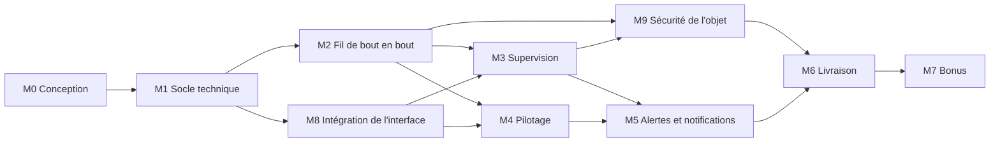

# 04 · Besoins fonctionnels : milestones et issues

> Étape 2 de la conception. Ce document liste **tous les développements à réaliser**, découpés en issues GitHub regroupées en milestones. Il sert de source pour créer les issues sur GitHub : une fois validé, chaque entrée devient une issue, avec le même titre, les mêmes labels, la même milestone et le même contenu.
>
> Les issues ont été créées sur GitHub le 6 novembre 2026 : les numéros `#n` de ce document sont ceux de GitHub. Toute modification d'une issue se fait **d'abord ici**, puis est reportée sur GitHub.

## 1. Conventions

### 1.1 Langue

| Élément | Langue |
|---|---|
| Titre et contenu des issues, milestones | Français |
| Labels | Anglais (ce sont des identifiants, [D012](../journal/decisions/D012-langue-du-code.md)) |
| Noms techniques cités dans les issues (routes, tables, fichiers) | Anglais, entre accents graves |

### 1.2 Structure d'une issue

Chaque issue contient, dans cet ordre :

| Rubrique | Contenu |
|---|---|
| **Contexte** | Pourquoi cette tâche existe, en une ou deux phrases |
| **À faire** | Ce qui doit être réalisé, précisément |
| **Critères d'acceptation** | Liste à cocher, vérifiable sans interprétation |
| **Dépend de** | Issues à terminer avant de commencer |
| **Références** | Sections des documents de conception à respecter |

### 1.3 Définition de « terminé »

Une issue n'est fermée que si **tous** ces points sont vrais :

- [ ] Tous les critères d'acceptation sont cochés.
- [ ] Le code respecte les documents de conception (noms, formats, règles). En cas d'écart nécessaire, le document est modifié dans la même pull request et une fiche de décision est créée si le choix est structurant.
- [ ] Le lint, la vérification des types et les tests passent en CI.
- [ ] Les tests demandés par l'issue sont écrits.
- [ ] La pull request est relue et approuvée par au moins un autre membre du groupe.
- [ ] La pull request référence l'issue (`Closes #n`) et est fusionnée dans `main`.

### 1.4 Labels

| Label | Couleur suggérée | Signification |
|---|---|---|
| `type:feature` | vert | Fonctionnalité visible ou comportement nouveau |
| `type:chore` | gris | Mise en place, configuration, outillage |
| `type:test` | jaune | Tests uniquement |
| `type:docs` | bleu clair | Documentation, dossier, journal |
| `type:design` | violet | Maquettage, charte graphique |
| `area:mobile` | | `apps/mobile` |
| `area:api` | | `apps/api` |
| `area:contracts` | | `packages/contracts` |
| `area:simulator` | | `tools/simulator` |
| `area:firmware` | | `firmware/site-device` |
| `area:infra` | | `infra/`, hébergement, broker |
| `area:ci` | | `.github/` |
| `priority:core` | rouge | Fait partie du socle |
| `priority:bonus` | orange | À traiter seulement une fois le socle terminé |

### 1.5 Milestones

| Milestone | Objectif | Livrable de fin |
|---|---|---|
| **M0 · Conception** | Terminer les étapes 3 et 4 de la conception | Maquettes validées, `CLAUDE.md` et `.claude/` en place |
| **M1 · Socle technique** | Dépôt prêt pour le développement (étape 5) | `pnpm install` puis `pnpm dev` démarrent la base et l'API ; CI verte |
| **M2 · Fil de bout en bout** | Une mesure part de l'ESP32 et s'affiche dans l'app | Démo : tourner le potentiomètre dans Wokwi change la valeur dans l'app |
| **M8 · Intégration de l'interface** | Toute l'app conforme aux maquettes, sur des données d'exemple | L'app complète est consultable sur le téléphone, dans les deux thèmes et tous ses états, sans API |
| **M3 · Supervision** | Toutes les fonctions de consultation | Connexion, supervision, carte, détail, historiques, affichage sans réseau |
| **M4 · Pilotage** | Communication bidirectionnelle complète | Une consigne envoyée depuis l'app est appliquée ou refusée par l'objet, et l'app l'affiche |
| **M5 · Alertes et notifications** | Règles d'alerte, notifications push Expo (Firebase), aucune au premier plan ([D030](../journal/decisions/D030-notifications-push-expo-et-locales.md), [D033](../journal/decisions/D033-regles-envoi-notifications-alerte.md)) | Panne injectée → notification sur le téléphone |
| **M9 · Sécurité de l'objet** | L'objet s'authentifie par certificat, sans secret dans son code | Un objet accepté dans l'app se connecte ; un objet révoqué est refusé par le broker |
| **M6 · Livraison** | Projet prêt pour la soutenance | APK installé, démo hébergée, dossier et documentation complets |
| **M7 · Bonus** | Améliorations facultatives | Vue 3D, rotation des panneaux, flux temps réel |

Les milestones M0 à M6, M8 et M9 constituent le socle (la sécurité de l'objet n'est pas un bonus) ; M7 regroupe les bonus, traités uniquement une fois le socle terminé.

Sur GitHub, les milestones portent uniquement leur intitulé (« Conception », « Socle technique »…) et les issues uniquement leur titre : les codes `Mx` ne servent que dans ce document. Aucune estimation de durée n'est indiquée.

### 1.6 Ordre et parallélisme

M2 (données) et M8 (interface) avancent en parallèle après le socle ; M3 et M4 branchent les écrans de M8 sur les données réelles et peuvent elles-mêmes avancer en parallèle. Au sein d'une milestone, les issues sans dépendance entre elles peuvent être prises par des personnes différentes.

### 1.7 Récapitulatif

| Issue | Titre | Milestone | Zone |
|---|---|---|---|
| #1 | Charte graphique : typographie, icônes, couleurs accessibles | M0 | design |
| #2 | Maquettes des écrans de l'app | M0 | design |
| #3 | Rédiger `CLAUDE.md` et le dossier `.claude/` | M0 | docs |
| #4 | Modèles d'issue et de pull request GitHub | M0 | ci |
| #5 | Initialiser le monorepo pnpm | M1 | ci |
| #6 | Configurer ESLint et Prettier pour tout le dépôt | M1 | ci |
| #7 | Créer le paquet `contracts` : enums et constantes | M1 | contracts |
| #8 | Contracts : schémas des messages MQTT et topics | M1 | contracts |
| #9 | Contracts : schémas de l'API REST | M1 | contracts |
| #10 | Infra : base PostgreSQL + TimescaleDB avec Docker Compose | M1 | infra |
| #11 | Infra : broker Mosquitto auto-hébergé | M1 | infra |
| #12 | API : squelette Fastify | M1 | api |
| #13 | API : schéma Drizzle et migrations | M1 | api |
| #14 | API : données de démonstration (seed) | M1 | api |
| #15 | Mobile : initialiser l'app Expo | M1 | mobile |
| #16 | Simulateur : squelette | M1 | simulator |
| #17 | CI : lint, types et tests sur chaque pull request | M1 | ci |
| #18 | Configurer Dependabot | M1 | ci |
| #19 | Firmware : projet PlatformIO et montage Wokwi | M2 | firmware |
| #20 | Firmware : WiFi, heure NTP, MQTT sur TLS et statut | M2 | firmware |
| #21 | Firmware : lecture des capteurs et publication des mesures | M2 | firmware |
| #22 | API : client MQTT | M2 | api |
| #23 | API : enregistrement des mesures du site | M2 | api |
| #24 | API : routes de consultation des sites | M2 | api |
| #25 | Mobile : source de données API et stockage SQLite | M2 | mobile |
| #26 | Mobile : brancher l'écran Supervision (dernière mesure) | M2 | mobile |
| #27 | API : authentification | M3 | api |
| #28 | Mobile : brancher la connexion et la déconnexion | M3 | mobile |
| #29 | API : suivi du statut des objets | M3 | api |
| #30 | Simulateur : publication des mesures des panneaux | M3 | simulator |
| #31 | API : enregistrement des mesures des panneaux | M3 | api |
| #32 | API : routes de consultation des panneaux | M3 | api |
| #33 | API : historiques agrégés | M3 | api |
| #34 | Mobile : brancher l'écran Supervision complet | M3 | mobile |
| #35 | Mobile : brancher l'écran Carte | M3 | mobile |
| #36 | Mobile : brancher l'écran Détail d'un panneau | M3 | mobile |
| #37 | Mobile : affichage sans réseau | M3 | mobile |
| #38 | Firmware : batterie simulée, relais et barre de LED | M4 | firmware |
| #39 | Firmware : algorithme de pilotage | M4 | firmware |
| #40 | Firmware : réception des consignes et publication de l'état | M4 | firmware |
| #41 | API : envoi d'une consigne | M4 | api |
| #42 | API : traitement de l'état appliqué | M4 | api |
| #43 | API : délai de réponse aux consignes | M4 | api |
| #44 | API : historique des consignes | M4 | api |
| #45 | Mobile : brancher l'écran Pilotage | M4 | mobile |
| #46 | Mobile : brancher l'historique des consignes | M4 | mobile |
| #47 | API : moteur de règles d'alerte | M5 | api |
| #48 | API : route de consultation des alertes | M5 | api |
| #49 | API : jetons et envoi des notifications push | M5 | api |
| #50 | Mobile : notifications push, écran Alertes | M5 | mobile |
| #51 | Revue de sécurité et dossier sécurité | M6 | docs |
| #52 | Compléter les tests | M6 | test |
| #53 | Construire et distribuer l'APK | M6 | mobile |
| #54 | Héberger l'API, la base et le broker sur le VPS | M6 | infra |
| #55 | Documentation technique | M6 | docs |
| #56 | Scénario de démonstration et répétition | M6 | docs |
| #57 | Point final du journal | M6 | docs |
| #58 | Bonus : vue 3D du parc | M7 | mobile |
| #59 | Bonus : rotation des panneaux | M7 | firmware, api, mobile |
| #60 | Bonus : flux temps réel poussé (SSE) | M7 | api, mobile |
| #61 | API : positionnement, modification et suppression d'un panneau | M3 | api |
| #62 | Mobile : brancher les panneaux à positionner | M3 | mobile |
| #106 | Mobile : lecture du graphique de production et carte des panneaux à positionner | M3 | mobile |
| #63 | Bonus : ajout d'un panneau sur le terrain par QR code | M7 | api, mobile |
| #64 | Simulateur : mode objet du site | M2 | simulator |
| #65 | Infra : connexion de l'ESP32 de Wokwi au broker | M2 | infra |
| #68 | Mobile : thème, polices et icônes | M8 | mobile |
| #69 | Mobile : navigation et composants communs | M8 | mobile |
| #70 | Mobile : couche de données remplaçable et jeu de données d'exemple | M8 | mobile |
| #71 | Mobile : intégration de l'écran Connexion | M8 | mobile |
| #72 | Mobile : intégration de l'écran Supervision | M8 | mobile |
| #73 | Mobile : intégration de l'écran Carte et de la vue liste | M8 | mobile |
| #74 | Mobile : intégration de l'écran Détail d'un panneau | M8 | mobile |
| #75 | Mobile : intégration de l'écran Pilotage | M8 | mobile |
| #76 | Mobile : intégration de l'écran Alertes | M8 | mobile |
| #80 | Infra : autorité des objets et TLS mutuel sur le broker | M9 | infra |
| #81 | API : enrôlement et révocation des objets | M9 | api, contracts |
| #82 | Mobile : gestion des objets (comparer, accepter, refuser, révoquer) | M9 | mobile |
| #83 | Firmware : enrôlement et connexion par certificat | M9 | firmware |
| #84 | Simulateur : enrôlement en mode objet du site | M9 | simulator |
| #104 | Mobile : marquer les alertes comme lues | M5 | mobile |
| #108 | Mobile : bandeau d'alerte quand l'app est ouverte | M5 | mobile, design |
| #110 | Performance : indicateurs tirés de la télémétrie | M6 | api, infra, docs |
| #111 | Mobile : suspendre les rafraîchissements en arrière-plan | M3 | mobile |
| #126 | Enrôlement : durées de certificat de 8 h, 24 h et une semaine | M9 | mobile, api, contracts |
| #127 | Mobile : le geste de rafraîchissement met à jour toutes les données de l'écran | M3 | mobile |

---

## 2. M0 · Conception

### #1 · Charte graphique : typographie, icônes, couleurs accessibles

**Labels :** `type:design`, `priority:core`

**Contexte :** l'app doit être cohérente et accessible (usage en extérieur, en plein soleil). La charte est la base du maquettage et du thème de l'app.

**À faire :**
- Choisir et justifier la typographie (piste : Red Hat Display pour les titres, Red Hat Text pour le texte, fichiers embarqués dans l'app).
- Choisir et justifier le jeu d'icônes (piste : Phosphor, via `phosphor-react-native`) et lister les icônes nécessaires par écran.
- Définir la palette : couleurs principales, neutres, couleurs d'état (normal, avertissement, critique, sans données), en thème clair et sombre.
- Vérifier les contrastes (niveau AA minimum : 4,5:1 pour le texte, 3:1 pour les éléments graphiques).
- Définir l'échelle typographique et les espacements.
- Rédiger le document `docs/conception/05-charte-graphique.md` et une fiche de décision pour chaque choix (typographie, icônes, palette).

**Critères d'acceptation :**
- [ ] Le document de charte existe et contient : polices, tailles, graisses, palette en clair et en sombre, icônes, espacements.
- [ ] Chaque couple texte / fond a son ratio de contraste indiqué, tous ≥ 4,5:1.
- [ ] Aucun état n'est signalé par la seule couleur (une icône ou un texte l'accompagne toujours).
- [ ] Les licences des polices et des icônes sont indiquées et compatibles avec le projet.
- [ ] Les fiches de décision sont ajoutées au journal.

**Dépend de :** — · **Références :** [Étude, section 8](../etude-faisabilite-parc-solaire.md)

### #2 · Maquettes des écrans de l'app

**Labels :** `type:design`, `priority:core`

**Contexte :** les développeurs mobiles doivent savoir exactement quoi construire, sans interprétation.

**À faire :**
- Maquetter les écrans : Connexion, Supervision, Carte, Pilotage, Alertes, Détail d'un panneau.
- Maquetter les états de chaque écran : chargement, vide, erreur, sans réseau, rôle `viewer` (pilotage désactivé), objet hors ligne.
- Maquetter le dialogue de confirmation d'une consigne et les trois résultats (appliquée, partielle, refusée).
- Exporter les maquettes (images ou lien vers l'outil) dans `docs/conception/maquettes/`.

**Critères d'acceptation :**
- [ ] Les 6 écrans et tous leurs états listés sont maquettés.
- [ ] Les maquettes appliquent la charte (#1).
- [ ] Chaque élément affiché correspond à un champ de l'API (section 7.3 de la cartographie).
- [ ] Les maquettes sont relues par le groupe.

**Dépend de :** #1 · **Références :** [UML, cas d'utilisation](02-uml.md), [Cartographie, section 5.3 et 7.3](03-cartographie-technique.md)

### #3 · Rédiger `CLAUDE.md` et le dossier `.claude/`

**Labels :** `type:docs`, `priority:core`

**Contexte :** plusieurs personnes développent, avec ou sans assistant IA. Les règles doivent être écrites pour que le code produit soit homogène.

**À faire :**
- Rédiger `CLAUDE.md` à la racine : présentation, organisation du dépôt, commandes, règles de langue ([D012](../journal/decisions/D012-langue-du-code.md)), format des commits, règles de branche et de pull request, obligation de respecter les documents de conception, tenue du journal.
- Créer `.claude/settings.json` (permissions partagées) et des skills dédiés (par exemple : créer un module d'API, créer un écran mobile, ajouter un message MQTT, rédiger une fiche de décision).
- Ajouter une fiche de décision sur les règles de travail.

**Critères d'acceptation :**
- [ ] `CLAUDE.md` couvre tous les points listés.
- [ ] Au moins 4 skills sont rédigés et testés sur un exemple.
- [ ] Le groupe a relu et validé les règles.

**Dépend de :** — · **Références :** [Journal](../journal/README.md)

### #4 · Modèles d'issue et de pull request GitHub

**Labels :** `type:chore`, `area:ci`, `priority:core`

**À faire :**
- Créer `.github/ISSUE_TEMPLATE/tache.md` reprenant la structure de la section 1.2.
- Créer `.github/PULL_REQUEST_TEMPLATE.md` reprenant la définition de « terminé » (section 1.3).
- Créer les labels de la section 1.4 et les milestones de la section 1.5 sur GitHub.

**Critères d'acceptation :**
- [ ] Une nouvelle issue propose le modèle.
- [ ] Une nouvelle pull request affiche la liste de contrôle.
- [ ] Les labels et milestones existent sur GitHub.

**Dépend de :** — · **Références :** sections 1.2 à 1.5 de ce document

---

## 3. M1 · Socle technique

### #5 · Initialiser le monorepo pnpm

**Labels :** `type:chore`, `area:ci`, `priority:core`

**À faire :**
- Créer `package.json` racine (privé), `pnpm-workspace.yaml` (`apps/*`, `packages/*`, `tools/*`), `tsconfig.base.json` (mode strict).
- Fixer la version de Node.js (`.nvmrc` et champ `engines`) et de pnpm (champ `packageManager`).
- Ajouter `.gitignore`, `.gitattributes` (fins de ligne LF), `.editorconfig`.
- Scripts racine : `dev`, `build`, `lint`, `typecheck`, `test`, `format`.
- Mettre à jour le README racine avec les commandes de démarrage.

**Critères d'acceptation :**
- [ ] `pnpm install` fonctionne sur un clone neuf, sous Windows, macOS et Linux.
- [ ] Les fichiers versionnés sont en fins de ligne LF.
- [ ] Les scripts racine s'exécutent sur tous les paquets (même vides).

**Dépend de :** — · **Références :** [Cartographie, section 3](03-cartographie-technique.md)

### #6 · Configurer ESLint et Prettier pour tout le dépôt

**Labels :** `type:chore`, `area:ci`, `priority:core`

**À faire :** configuration ESLint commune (format « flat config ») et Prettier à la racine, avec les règles TypeScript ; extension spécifique pour React Native dans `apps/mobile`.

**Critères d'acceptation :**
- [ ] `pnpm lint` et `pnpm format --check` passent sur le dépôt.
- [ ] Les règles sont identiques pour tous les paquets TypeScript.

**Dépend de :** #5

### #7 · Créer le paquet `contracts` : enums et constantes

**Labels :** `type:feature`, `area:contracts`, `priority:core`

**À faire :**
- Créer `packages/contracts` (nom `@solar/contracts`), avec Vitest.
- `src/enums.ts` : toutes les énumérations de la section 3 du modèle de données, en schémas Zod et en types.
- `src/constants.ts` : toutes les constantes de la section 8 de la cartographie.

**Critères d'acceptation :**
- [ ] Les valeurs des enums sont identiques à celles de la base, au caractère près.
- [ ] Les constantes portent exactement les noms et valeurs de la cartographie.
- [ ] Le paquet s'importe depuis un autre paquet du dépôt.

**Dépend de :** #5 · **Références :** [Modèle de données, section 3](01-modele-donnees.md), [Cartographie, section 8](03-cartographie-technique.md)

### #8 · Contracts : schémas des messages MQTT et topics

**Labels :** `type:feature`, `area:contracts`, `priority:core`

**À faire :**
- `src/mqtt/messages.ts` : schémas `SiteMeasurement`, `PanelMeasurement`, `Setpoint`, `ControlState`, `DeviceStatus`, avec toutes les bornes de la section 6.2.
- `src/mqtt/topics.ts` : fonctions de construction (`siteMeasurementsTopic(siteCode)`…) et d'analyse (extraire le code du site et du panneau d'un topic reçu).

**Critères d'acceptation :**
- [ ] Chaque exemple JSON de la section 6.2 est accepté par son schéma (test).
- [ ] Un message avec une valeur hors bornes ou `v` différent de 1 est refusé (test).
- [ ] L'analyse d'un topic invalide renvoie une erreur explicite (test).

**Dépend de :** #7 · **Références :** [Cartographie, section 6](03-cartographie-technique.md)

### #9 · Contracts : schémas de l'API REST

**Labels :** `type:feature`, `area:contracts`, `priority:core`

**À faire :** schémas des corps de requête, des paramètres et des réponses de toutes les routes de la section 7.2, des objets de la section 7.3, et du format d'erreur avec ses codes.

**Critères d'acceptation :**
- [ ] Chaque route de la section 7.2 a ses schémas d'entrée et de sortie.
- [ ] Le schéma de consigne refuse une `batteryShare` absente en mode `manual`, présente dans les autres modes, ou non multiple de 10 (test).

**Dépend de :** #7 · **Références :** [Cartographie, section 7](03-cartographie-technique.md)

### #10 · Infra : base PostgreSQL + TimescaleDB avec Docker Compose

**Labels :** `type:chore`, `area:infra`, `priority:core`

**À faire :** `infra/docker-compose.yml` avec le service `db` (image `timescale/timescaledb`, volume persistant, contrôle de santé) et `infra/.env.example`.

**Critères d'acceptation :**
- [ ] `docker compose up -d db` démarre une base accessible sur le port 5432.
- [ ] Les extensions `timescaledb` et `citext` sont disponibles.
- [ ] Aucun mot de passe n'est versionné.

**Dépend de :** #5 · **Références :** [Cartographie, sections 5.6 et 9](03-cartographie-technique.md)

### #11 · Infra : broker Mosquitto auto-hébergé

**Labels :** `type:chore`, `area:infra`, `priority:core`

**Contexte :** l'offre gratuite de HiveMQ Cloud n'accepte plus de nouveau cluster ; le broker est auto-hébergé ([D023](../journal/decisions/D023-broker-mosquitto-auto-heberge.md)).

**À faire :**
- Service `mqtt` (`eclipse-mosquitto:2`) dans `infra/docker-compose.yml` : port 1883 publié sur `127.0.0.1` uniquement, port 8883 en TLS.
- Configuration versionnée dans `infra/mosquitto/config/` : `mosquitto.conf` (aucun accès anonyme) et `acl` (droits de la section 6.3).
- Script `pnpm mqtt:setup` : fichier de mots de passe haché et certificats TLS (autorité du projet, certificat du serveur pour les noms de `MQTT_TLS_HOSTS`), générés dans `infra/mosquitto/generated/`, ignoré par Git.
- Variables `MQTT_*` dans `infra/.env.example` ; `MQTT_URL=mqtt://127.0.0.1:1883` dans les `.env.example` de l'API et du simulateur.

**Critères d'acceptation :**
- [x] Une connexion anonyme ou avec un mauvais mot de passe est refusée.
- [x] Chacun des trois identifiants se connecte ; une publication hors de ses droits n'est pas distribuée.
- [x] Une connexion TLS sur le port 8883, avec le certificat de l'autorité du projet, fonctionne.
- [x] Aucun mot de passe ni clé privée n'est versionné.

**Dépend de :** #10 · **Références :** [D023](../journal/decisions/D023-broker-mosquitto-auto-heberge.md), [Cartographie, sections 5.6 et 6.3](03-cartographie-technique.md)

### #12 · API : squelette Fastify

**Labels :** `type:chore`, `area:api`, `priority:core`

**À faire :**
- Créer `apps/api` avec l'arborescence de la section 5.2.
- `config.ts` : lecture et validation des variables d'environnement (Zod) ; l'API refuse de démarrer si une variable manque.
- Fastify avec `fastify-type-provider-zod`, logs `pino`, préfixe `/v1`.
- Gestionnaire d'erreurs unique produisant le format `{ error: { code, message, details } }`.
- Route `GET /v1/health` (état de la base et du broker).
- `.env.example`.

**Critères d'acceptation :**
- [ ] `pnpm --filter api dev` démarre l'API.
- [ ] `GET /v1/health` renvoie 200 avec `status`, `database`, `broker`.
- [ ] Une route inconnue renvoie 404 au format d'erreur défini.
- [ ] Test avec `fastify.inject()` sur `/v1/health`.

**Dépend de :** #9, #10 · **Références :** [Cartographie, sections 5.2 et 7.1](03-cartographie-technique.md)

### #13 · API : schéma Drizzle et migrations

**Labels :** `type:chore`, `area:api`, `priority:core`

**À faire :**
- `db/schema.ts` reproduisant exactement le modèle de données (tables, colonnes, enums, contraintes, index).
- Migrations générées par `drizzle-kit`, plus une migration SQL manuelle pour `create_hypertable` et `add_retention_policy`.
- Scripts `db:migrate` et `db:generate`.

**Critères d'acceptation :**
- [ ] Sur une base vide, `pnpm --filter api db:migrate` crée un schéma identique au script SQL de référence.
- [ ] `site_measurements` et `panel_measurements` sont des hypertables avec une rétention de 30 jours.
- [ ] Les contraintes `CHECK` et l'index unique partiel des alertes sont présents.

**Dépend de :** #12 · **Références :** [Modèle de données, sections 4 à 7](01-modele-donnees.md)

### #14 · API : données de démonstration (seed)

**Labels :** `type:chore`, `area:api`, `priority:core`

**À faire :** fichier versionné `infra/seed/demo-site.json` (site, objet, 20 panneaux) et script `db:seed` qui le lit et insère aussi les 2 utilisateurs de la section 8 du modèle de données ; mots de passe lus dans `SEED_OPERATOR_PASSWORD` et `SEED_VIEWER_PASSWORD`.

**Critères d'acceptation :**
- [ ] Le script peut être relancé sans erreur ni doublon.
- [ ] Les valeurs correspondent exactement à la section 8 ; les panneaux ont `source = 'seed'`.
- [ ] Le fichier JSON est validé par un schéma avant insertion (erreur explicite sinon).

**Dépend de :** #13 · **Références :** [Modèle de données, section 8](01-modele-donnees.md)

### #15 · Mobile : initialiser l'app Expo

**Labels :** `type:chore`, `area:mobile`, `priority:core`

**À faire :**
- Créer `apps/mobile` (TypeScript, Expo Router) avec l'arborescence de la section 5.3 et des écrans vides pour chaque route.
- `app.config.ts` lisant `EXPO_PUBLIC_API_URL` ; `eas.json` avec les profils `development`, `preview`, `production`.
- Construire un *development build* Android et l'installer sur le téléphone de test.
- Configurer Jest (`jest-expo`) avec un premier test.

**Critères d'acceptation :**
- [ ] L'app démarre sur le téléphone de test et affiche la barre d'onglets.
- [ ] `pnpm --filter mobile test` passe.
- [ ] Le paquet `@solar/contracts` est importable depuis l'app.

**Dépend de :** #7 · **Références :** [Cartographie, section 5.3](03-cartographie-technique.md), [D005](../journal/decisions/D005-framework-mobile.md)

### #16 · Simulateur : squelette

**Labels :** `type:chore`, `area:simulator`, `priority:core`

**À faire :** créer `tools/simulator` (TypeScript, `tsx`), lecture des variables d'environnement, connexion MQTT, `.env.example`.

**Critères d'acceptation :**
- [ ] `pnpm --filter simulator dev` se connecte au broker et l'indique dans la console.

**Dépend de :** #7, #11 · **Références :** [Cartographie, section 5.4](03-cartographie-technique.md)

### #17 · CI : lint, types et tests sur chaque pull request

**Labels :** `type:chore`, `area:ci`, `priority:core`

**À faire :** workflow GitHub Actions déclenché sur les pull requests et sur `main` : installation pnpm avec cache, `lint`, `typecheck`, `test`.

**Critères d'acceptation :**
- [ ] Le workflow s'exécute sur une pull request et bloque la fusion en cas d'échec (règle de protection de `main`).
- [ ] Durée inférieure à 5 minutes.

**Dépend de :** #6

### #18 · Configurer Dependabot

**Labels :** `type:chore`, `area:ci`, `priority:core`

**À faire :** `.github/dependabot.yml` pour npm (chaque paquet du workspace) et GitHub Actions, fréquence hebdomadaire, mises à jour mineures groupées.

**Critères d'acceptation :**
- [ ] Dependabot ouvre ses premières pull requests et la CI s'y exécute.

**Dépend de :** #17

---

## 4. M2 · Fil de bout en bout

### #19 · Firmware : projet PlatformIO et montage Wokwi

**Labels :** `type:chore`, `area:firmware`, `priority:core`

**À faire :**
- Créer `firmware/site-device` (PlatformIO, framework Arduino, ESP32) avec `wokwi.toml` et `diagram.json`.
- Montage : photorésistance, potentiomètre, DS18B20 (avec résistance de rappel), 2 relais, barre de LED, bouton de panne.
- `include/secrets.example.h` versionné, `include/secrets.h` ignoré par Git.
- `include/config.h` reprenant les constantes partagées utilisées par l'objet.

**Critères d'acceptation :**
- [ ] La simulation démarre dans Wokwi (VS Code ou navigateur) et affiche un message sur le port série.
- [ ] Tous les composants sont présents et câblés selon un tableau de broches documenté dans le README du dossier.

**Dépend de :** #5 · **Références :** [Étude, section 6](../etude-faisabilite-parc-solaire.md)

### #20 · Firmware : WiFi, heure NTP, MQTT sur TLS et statut

**Labels :** `type:feature`, `area:firmware`, `priority:core`

**À faire :**
- Connexion au réseau `Wokwi-GUEST`, synchronisation de l'heure par NTP.
- Connexion MQTT en TLS (port 8883, certificat de l'autorité du projet embarqué) au broker Mosquitto, par le moyen retenu dans #65, avec l'identifiant `device-site01` (identifiant et mot de passe, remplacés par un certificat client dans #83).
- Last Will `{ "v": 1, "status": "offline" }` sur `solar/SITE01/status` (retained, QoS 1), puis publication de `online` avec la version du firmware.
- Reconnexion automatique (WiFi et MQTT).

**Critères d'acceptation :**
- [ ] Le statut `online` apparaît sur le broker au démarrage (vérifié avec un client MQTT).
- [ ] L'arrêt brutal de la simulation fait apparaître `offline`.
- [ ] Une coupure puis un retour du réseau rétablissent la connexion sans redémarrage.

**Dépend de :** #11, #19, #65 · **Références :** [Cartographie, section 6](03-cartographie-technique.md)

### #21 · Firmware : lecture des capteurs et publication des mesures

**Labels :** `type:feature`, `area:firmware`, `priority:core`

**À faire :**
- Lire l'ensoleillement (photorésistance → W/m²), la production (potentiomètre → 0 à 4 000 W), la température (DS18B20).
- Bouton de panne : chaque appui active ou désactive `simulatedFault` (production divisée par 5).
- Publier un `SiteMeasurement` toutes les 5 s (batterie et flux à des valeurs fixes en attendant #38).

**Critères d'acceptation :**
- [ ] Les messages respectent exactement le schéma de la section 6.2 (vérifiés en les passant au schéma Zod).
- [ ] Modifier un capteur dans Wokwi modifie la valeur publiée.

**Dépend de :** #20 · **Références :** [Cartographie, section 6.2](03-cartographie-technique.md)

### #22 · API : client MQTT

**Labels :** `type:feature`, `area:api`, `priority:core`

**À faire :** `mqtt/client.ts` (connexion TLS, reconnexion, abonnements de la section 6.1, fonction de publication) et `mqtt/handlers.ts` (validation de chaque message par son schéma, aiguillage vers le service concerné, avertissement en cas de message invalide).

**Critères d'acceptation :**
- [ ] L'API s'abonne aux 4 topics au démarrage et l'état du broker remonte dans `/v1/health`.
- [ ] Un message invalide est ignoré et journalisé, sans arrêter l'API (test).

**Dépend de :** #8, #12

### #23 · API : enregistrement des mesures du site

**Labels :** `type:feature`, `area:api`, `priority:core`

**À faire :** service `measurements` : résolution du code de site, contrôle de l'écart d'horloge (remplacement par l'heure de réception au-delà de 300 s), insertion dans `site_measurements`, mise à jour de `devices.last_seen_at`.

**Critères d'acceptation :**
- [ ] Une mesure publiée par l'ESP32 apparaît en base en moins de 2 s.
- [ ] Un code de site inconnu est ignoré et journalisé.
- [ ] Tests : horloge décalée, site inconnu, insertion nominale.

**Dépend de :** #13, #22 · **Références :** [UML, séquence 4.2](02-uml.md)

### #24 · API : routes de consultation des sites

**Labels :** `type:feature`, `area:api`, `priority:core`

**À faire :** `GET /v1/sites` et `GET /v1/sites/{id}` renvoyant `SiteSummary` et `SiteDetail`, dont `latestMeasurement` et `expectedProduction`. Authentification ajoutée plus tard (#27) : prévoir le point d'accroche.

**Critères d'acceptation :**
- [ ] Les réponses respectent les schémas de la section 7.3.
- [ ] `expectedProduction` = ensoleillement × `production_factor` (test).
- [ ] Un identifiant inconnu renvoie 404 `NOT_FOUND`.

**Dépend de :** #23 · **Références :** [Cartographie, section 7](03-cartographie-technique.md)

### #25 · Mobile : source de données API et stockage SQLite

**Labels :** `type:feature`, `area:mobile`, `priority:core`

**Interface :** réalisée avec des données d'exemple dans #70 ([D025](../journal/decisions/D025-integration-interface.md)). Cette issue remplace la source `mock` par les données réelles (source `api` de `src/data/`), sans refaire l'écran.

**À faire :**
- `src/api/` : client HTTP (URL de base, en-tête JWT, conversion des erreurs au format de l'API), hooks TanStack Query par ressource.
- `src/storage/` : base `expo-sqlite`, tables locales pour la dernière réponse de chaque ressource, fonctions de lecture et d'écriture.
- Chaque réponse reçue est enregistrée dans SQLite.

**Critères d'acceptation :**
- [ ] Un hook `useSite(id)` renvoie les données de l'API et les enregistre localement.
- [ ] Au démarrage sans réseau, le hook renvoie la dernière valeur enregistrée.
- [ ] Le JWT n'est jamais écrit dans SQLite.

**Dépend de :** #15, #70 · **Références :** [D014](../journal/decisions/D014-stockage-local-sqlite.md), [Cartographie, section 5.3](03-cartographie-technique.md)

### #26 · Mobile : brancher l'écran Supervision (dernière mesure)

**Labels :** `type:feature`, `area:mobile`, `priority:core`

**Interface :** réalisée avec des données d'exemple dans #72 ([D025](../journal/decisions/D025-integration-interface.md)). Cette issue remplace la source `mock` par les données réelles (source `api` de `src/data/`), sans refaire l'écran.

**À faire :** afficher la dernière mesure du site (production, ensoleillement, température, batterie), rafraîchie toutes les 5 s tant que l'écran est visible.

**Critères d'acceptation :**
- [ ] Tourner le potentiomètre dans Wokwi modifie la production affichée en moins de 10 s.
- [ ] États de chargement et d'erreur gérés.

**Dépend de :** #21, #24, #25, #72 · **Références :** maquettes (#2)

---

## 5. M3 · Supervision

### #27 · API : authentification

**Labels :** `type:feature`, `area:api`, `priority:core`

**À faire :**
- `POST /v1/auth/login` : vérification argon2id, JWT HS256 de 8 h contenant `sub` et `role`.
- `GET /v1/auth/me`.
- Limitation à 5 tentatives de connexion par minute et par adresse IP.
- Protection de toutes les routes sauf `/v1/auth/login` et `/v1/health` ; vérification du rôle `operator` là où c'est requis.

**Critères d'acceptation :**
- [ ] Mauvais identifiants → 401 `INVALID_CREDENTIALS`, sans indiquer si c'est l'e-mail ou le mot de passe.
- [ ] Jeton absent ou expiré → 401 `UNAUTHENTICATED`.
- [ ] 6e tentative en une minute → 429 `TOO_MANY_ATTEMPTS`.
- [ ] Tests pour chacun de ces cas.

**Dépend de :** #14 · **Références :** [UML, séquence 4.1](02-uml.md), [Cartographie, section 7](03-cartographie-technique.md)

### #28 · Mobile : brancher la connexion et la déconnexion

**Labels :** `type:feature`, `area:mobile`, `priority:core`

**Interface :** réalisée avec des données d'exemple dans #71 ([D025](../journal/decisions/D025-integration-interface.md)). Cette issue remplace la source `mock` par les données réelles (source `api` de `src/data/`), sans refaire l'écran.

**À faire :**
- Écran de connexion ; jeton stocké dans `expo-secure-store` ; redirection vers la supervision.
- Retour à l'écran de connexion si l'API répond 401.
- Bouton de déconnexion (suppression du jeton local).
- Contexte d'authentification exposant l'utilisateur et son rôle.

**Critères d'acceptation :**
- [ ] Les messages d'erreur sont ceux de la séquence 4.1.
- [ ] L'utilisateur reste connecté après redémarrage de l'app, jusqu'à l'expiration du jeton.
- [ ] Le rôle est disponible pour masquer le pilotage aux `viewer`.

**Dépend de :** #25, #27, #71 · **Références :** [UML, séquence 4.1](02-uml.md)

### #29 · API : suivi du statut des objets

**Labels :** `type:feature`, `area:api`, `priority:core`

**À faire :** traitement du topic `status` (mise à jour de `devices.status` et `firmware_version`) ; planificateur passant l'objet en `offline` après 60 s sans message ; tout message reçu repasse l'objet en `online`.

**Critères d'acceptation :**
- [ ] Les transitions respectent le diagramme d'états 5.2.
- [ ] `deviceStatus` est exposé dans `SiteSummary`.
- [ ] Tests des transitions.

**Dépend de :** #22 · **Références :** [UML, sections 4.4 et 5.2](02-uml.md)

### #30 · Simulateur : publication des mesures des panneaux

**Labels :** `type:feature`, `area:simulator`, `priority:core`

**À faire :** abonnement à `solar/SITE01/measurements` pour connaître l'ensoleillement ; toutes les 10 s, publication d'un `PanelMeasurement` pour chacun des 20 panneaux (production = ensoleillement × 200 / 1000, ± 5 %) ; panneaux listés dans `FAULTY_PANELS` divisés par 5 ; panneaux listés dans `EXTRA_PANELS` (absents du seed) publiés en plus.

**Critères d'acceptation :**
- [ ] 20 messages valides toutes les 10 s, plus un par panneau de `EXTRA_PANELS`.
- [ ] Les panneaux en panne produisent environ 5 fois moins que les autres.

**Dépend de :** #8, #16 · **Références :** [Cartographie, section 5.4](03-cartographie-technique.md)

### #31 · API : enregistrement des mesures des panneaux

**Labels :** `type:feature`, `area:api`, `priority:core`

**À faire :** résolution du site et du code de panneau ; pour un code inconnu sur un site connu, création automatique du panneau ([D020](../journal/decisions/D020-inventaire-des-panneaux.md)) : `source = 'discovered'`, nom = code, sans position, puissance `DEFAULT_PANEL_RATED_POWER_W`, dans la limite de `MAX_PANELS_PER_SITE`.

**Critères d'acceptation :**
- [ ] Les mesures sont insérées dans `panel_measurements`.
- [ ] Un code inconnu crée un panneau non positionné, une seule fois même si plusieurs messages arrivent en même temps (test).
- [ ] Au-delà de `MAX_PANELS_PER_SITE`, le message est ignoré et journalisé (test).
- [ ] Un site inconnu est ignoré et journalisé (test).

**Dépend de :** #23, #30 · **Références :** [UML, séquence 4.6](02-uml.md)

### #32 · API : routes de consultation des panneaux

**Labels :** `type:feature`, `area:api`, `priority:core`

**À faire :** `GET /v1/sites/{id}/panels` et `GET /v1/panels/{id}`, avec le statut calculé (`normal`, `alert`, `no_data`) et la production attendue.

**Critères d'acceptation :**
- [ ] Le statut suit les règles de la section 6 de l'UML (test pour chaque statut).
- [ ] Réponses conformes à `PanelSummary` et `PanelDetail`.

**Dépend de :** #31 · **Références :** [UML, section 6](02-uml.md)

### #33 · API : historiques agrégés

**Labels :** `type:feature`, `area:api`, `priority:core`

**À faire :** `GET /v1/sites/{id}/measurements` et `GET /v1/panels/{id}/measurements` avec `from`, `to`, `interval`, agrégés par `time_bucket()`.

**Critères d'acceptation :**
- [ ] Un écart supérieur à 7 jours ou un intervalle inconnu renvoie 422.
- [ ] Les points sont triés par date croissante et moyennés par intervalle (test sur des données connues).

**Dépend de :** #23, #31 · **Références :** [Modèle de données, section 5](01-modele-donnees.md)

### #34 · Mobile : brancher l'écran Supervision complet

**Labels :** `type:feature`, `area:mobile`, `priority:core`

**Interface :** réalisée avec des données d'exemple dans #72 ([D025](../journal/decisions/D025-integration-interface.md)). Cette issue remplace la source `mock` par les données réelles (source `api` de `src/data/`), sans refaire l'écran.

**À faire :** compléter l'écran : production réelle et attendue, jauge de batterie, répartition batterie / réseau, mode en vigueur, statut de l'objet, nombre d'alertes actives, graphique d'historique (choix de la période : 1 h, 24 h, 7 jours).

**Critères d'acceptation :**
- [ ] Conforme aux maquettes, dans tous les états prévus.
- [ ] Les valeurs ont leur unité et sont lisibles par le lecteur d'écran (libellés d'accessibilité).
- [ ] Test de rendu du composant principal.

**Dépend de :** #26, #28, #29, #33, #72 · **Références :** maquettes (#2)

### #35 · Mobile : brancher l'écran Carte

**Labels :** `type:feature`, `area:mobile`, `priority:core`

**Interface :** réalisée avec des données d'exemple dans #73 ([D025](../journal/decisions/D025-integration-interface.md)). Cette issue remplace la source `mock` par les données réelles (source `api` de `src/data/`), sans refaire l'écran.

**À faire :** carte centrée sur le site, un marqueur par panneau coloré et iconé selon son statut, légende, appui sur un marqueur → Détail du panneau ; liste des panneaux en alternative accessible.

**Critères d'acceptation :**
- [ ] Les 20 panneaux sont positionnés selon leurs coordonnées.
- [ ] Chaque statut a une couleur **et** une icône.
- [ ] La liste alternative donne accès aux mêmes informations.

**Dépend de :** #28, #32, #73 · **Références :** [UML, section 6](02-uml.md)

### #36 · Mobile : brancher l'écran Détail d'un panneau

**Labels :** `type:feature`, `area:mobile`, `priority:core`

**Interface :** réalisée avec des données d'exemple dans #74 ([D025](../journal/decisions/D025-integration-interface.md)). Cette issue remplace la source `mock` par les données réelles (source `api` de `src/data/`), sans refaire l'écran.

**Critères d'acceptation :**
- [ ] Affiche production, production attendue, température, statut, alertes actives et historique.
- [ ] Conforme aux maquettes.

**Dépend de :** #35, #74 

### #37 · Mobile : affichage sans réseau

**Labels :** `type:feature`, `area:mobile`, `priority:core`

**Interface :** réalisée avec des données d'exemple dans #70 ([D025](../journal/decisions/D025-integration-interface.md)). Cette issue remplace la source `mock` par les données réelles (source `api` de `src/data/`), sans refaire l'écran.

**À faire :** détection de la connexion (`netinfo`) ; bandeau « Hors ligne · données du {date} » ; écrans alimentés par SQLite ; pas d'erreur bloquante.

**Critères d'acceptation :**
- [ ] En mode avion, chaque écran affiche les dernières données reçues et leur ancienneté.
- [ ] Le retour du réseau relance le rafraîchissement sans action de l'utilisateur.

**Dépend de :** #34, #35, #70 · **Références :** [Étude, section 8](../etude-faisabilite-parc-solaire.md)

---

## 6. M4 · Pilotage

### #38 · Firmware : batterie simulée, relais et barre de LED

**Labels :** `type:feature`, `area:firmware`, `priority:core`

**À faire :** modèle de batterie (capacité 10 000 Wh, facteur de temps 60) mis à jour chaque seconde ; relais de charge et d'injection ; barre de LED proportionnelle au niveau ; valeurs réelles publiées dans `SiteMeasurement`.

**Critères d'acceptation :**
- [ ] Avec 3 000 W vers la batterie, le niveau passe de 20 % à 95 % en environ 2 à 3 minutes réelles.
- [ ] Les relais et la barre de LED reflètent les flux et le niveau.

**Dépend de :** #21 · **Références :** [UML, section 7](02-uml.md)

### #39 · Firmware : algorithme de pilotage

**Labels :** `type:feature`, `area:firmware`, `priority:core`

**À faire :** implémenter exactement le logigramme de la section 7 de l'UML : modes `manual`, `automatic`, `discharge`, limites `battery_full`, `battery_low`, `charge_limit`.

**Critères d'acceptation :**
- [ ] Chaque ligne du tableau « statut renvoyé » de la section 7 est vérifiée dans Wokwi (scénario documenté dans la pull request).
- [ ] La fonction de calcul est séparée des entrées-sorties, pour pouvoir être testée.

**Dépend de :** #38 · **Références :** [UML, section 7](02-uml.md)

### #40 · Firmware : réception des consignes et publication de l'état

**Labels :** `type:feature`, `area:firmware`, `priority:core`

**À faire :** abonnement à `solar/SITE01/setpoint` (QoS 1) ; validation du message ; application ; publication d'un `ControlState` (retained, QoS 1) à la réception et à chaque changement de part appliquée ou de raison.

**Critères d'acceptation :**
- [ ] Une consigne invalide produit `rejected` / `invalid_setpoint`.
- [ ] Après une reconnexion, la consigne retained est appliquée.
- [ ] Les messages respectent le schéma `ControlState`.

**Dépend de :** #39 · **Références :** [Cartographie, section 6.2](03-cartographie-technique.md), [UML, séquences 4.3 et 4.4](02-uml.md)

### #41 · API : envoi d'une consigne

**Labels :** `type:feature`, `area:api`, `priority:core`

**À faire :** `POST /v1/sites/{id}/setpoints` : rôle `operator`, validation, refus 409 si l'objet est `offline`, insertion (`sent`), publication retained, réponse 202.

**Critères d'acceptation :**
- [ ] `viewer` → 403 ; objet hors ligne → 409 ; valeurs invalides → 422 (tests).
- [ ] Le message publié respecte le schéma `Setpoint` et porte l'identifiant de la consigne.
- [ ] Une nouvelle consigne résout l'alerte `setpoint_rejected` active du site.

**Dépend de :** #27, #29 · **Références :** [UML, UC07 et séquence 4.3](02-uml.md)

### #42 · API : traitement de l'état appliqué

**Labels :** `type:feature`, `area:api`, `priority:core`

**À faire :** traitement du topic `state` : mise à jour de la consigne correspondante (première réponse uniquement, y compris après `no_response`), état appliqué courant gardé en mémoire et exposé dans `SiteDetail.controlState`, récupération du message retained au démarrage.

**Critères d'acceptation :**
- [ ] Les transitions respectent le diagramme d'états 5.1 (tests).
- [ ] Une réponse dont l'identifiant ne correspond pas à la consigne en vigueur ne modifie aucune consigne.
- [ ] Après redémarrage de l'API, `controlState` est disponible sans nouvelle action de l'objet.

**Dépend de :** #41 · **Références :** [UML, section 5.1](02-uml.md)

### #43 · API : délai de réponse aux consignes

**Labels :** `type:feature`, `area:api`, `priority:core`

**Critères d'acceptation :**
- [ ] Une consigne restée `sent` 30 s passe en `no_response` (test avec horloge simulée).
- [ ] Le délai survit à un redémarrage de l'API (recherche des consignes `sent` trop anciennes au démarrage).

**Dépend de :** #42

### #44 · API : historique des consignes

**Labels :** `type:feature`, `area:api`, `priority:core`

**Critères d'acceptation :**
- [ ] `GET /v1/sites/{id}/setpoints` renvoie les consignes de la plus récente à la plus ancienne, avec l'auteur.
- [ ] La pagination par curseur fonctionne (test sur 25 consignes).

**Dépend de :** #41 · **Références :** [Cartographie, section 7.1](03-cartographie-technique.md)

### #45 · Mobile : brancher l'écran Pilotage

**Labels :** `type:feature`, `area:mobile`, `priority:core`

**Interface :** réalisée avec des données d'exemple dans #75 ([D025](../journal/decisions/D025-integration-interface.md)). Cette issue remplace la source `mock` par les données réelles (source `api` de `src/data/`), sans refaire l'écran.

**À faire :** choix du mode, curseur de part batterie (pas de 10 %), schéma des flux, jauge de batterie, bouton « Appliquer », dialogue de confirmation, suivi du statut (interrogation toutes les 2 s, 60 s au plus), affichage du résultat et de la raison ; pilotage désactivé pour un `viewer`, sans réseau ou si l'objet est hors ligne, avec un message expliquant pourquoi.

**Critères d'acceptation :**
- [ ] Le scénario nominal et les variantes A, B, C de UC07 sont démontrables.
- [ ] Chaque raison de refus a un libellé français compréhensible.
- [ ] Les trois cas de désactivation affichent leur message.

**Dépend de :** #28, #37, #42, #75 · **Références :** [UML, UC07](02-uml.md), maquettes (#2)

### #46 · Mobile : brancher l'historique des consignes

**Labels :** `type:feature`, `area:mobile`, `priority:core`

**Interface :** réalisée avec des données d'exemple dans #75 ([D025](../journal/decisions/D025-integration-interface.md)). Cette issue remplace la source `mock` par les données réelles (source `api` de `src/data/`), sans refaire l'écran.

**Critères d'acceptation :**
- [ ] Liste sur l'écran Pilotage : date, auteur, demande, résultat ; chargement de la page suivante au défilement.

**Dépend de :** #44, #45, #75 

---

## 7. M5 · Alertes et notifications

### #47 · API : moteur de règles d'alerte

**Labels :** `type:feature`, `area:api`, `priority:core`

**À faire :** les 7 règles de la section 6 de l'UML, avec leurs seuils de déclenchement et de résolution, la durée de 60 s pour `low_production`, l'unicité des alertes actives, les messages en français.

**Critères d'acceptation :**
- [ ] Un test par règle couvrant le déclenchement, la non-répétition et la résolution.
- [ ] Une panne injectée (bouton ou `FAULTY_PANELS`) ouvre une alerte `low_production` en environ 60 s.

**Dépend de :** #29, #31, #42, #43 · **Références :** [UML, section 6](02-uml.md)

### #48 · API : route de consultation des alertes

**Labels :** `type:feature`, `area:api`, `priority:core`

**Critères d'acceptation :**
- [ ] `GET /v1/alerts` filtre par `status` et `siteId`, paginé, conforme à `Alert`.

**Dépend de :** #47

### #49 · API : jetons et envoi des notifications push

**Labels :** `type:feature`, `area:api`, `priority:core`

**Contexte :** les alertes `warning` et `critical` arrivent app fermée par le push Expo, qui s'appuie sur Firebase Cloud Messaging sur Android ; il remplace le serveur ntfy ([D030](../journal/decisions/D030-notifications-push-expo-et-locales.md)).

**À faire :**
- Table `push_tokens` et enum `mobile_platform` rétablis (documentation, schéma Drizzle, **nouvelle** migration : `0003_drop_push_tokens` n'est pas modifiée) ; schémas `RegisterPushTokenRequest` et `PushTokenParams`, entrées `registerPushToken` et `deletePushToken` de `ROUTES`, enum `MobilePlatform` dans `@solar/contracts`.
- Module `modules/notifications/` (`routes.ts`, `service.ts`, `repository.ts`, `sender.ts`) : `POST /v1/push-tokens` (insertion ou réattribution du jeton à l'utilisateur) et `DELETE /v1/push-tokens/{token}`.
- Envoi par `expo-server-sdk` à l'ouverture d'une alerte `warning` ou `critical` par le moteur d'alertes (`modules/alerts/engine.ts`), à tous les jetons enregistrés, en un envoi groupé, sauf pour les types de `PUSH_EXCLUDED_ALERT_TYPES` (`setpoint_rejected` : alerte créée, sans push, [D033](../journal/decisions/D033-regles-envoi-notifications-alerte.md)) : titre `Alerte` ou `Alerte critique`, corps = message de l'alerte, données `alertId`, `siteId`, `panelId`, `type`, canal Android `ALERT_NOTIFICATION_CHANNEL_ID`. Fonction d'envoi injectable. Variable facultative `EXPO_ACCESS_TOKEN`.
- Supprimer le service `ntfy` et tout ce qui s'y rattache : `infra/ntfy/`, scripts `ntfy:setup` et `ntfy:up`, démarrage dans `pnpm dev`, section de `infra/README.md`, client ntfy de l'API, variables `NTFY_URL`, `NTFY_TOPIC`, `NTFY_TOKEN`.

**Critères d'acceptation :**
- [ ] `POST /v1/push-tokens` enregistre un jeton (204), sans doublon si on le renvoie ; un autre utilisateur qui se connecte sur le même téléphone le récupère ; `DELETE /v1/push-tokens/{token}` le supprime ; 401 sans jeton d'accès, 422 sur un corps invalide.
- [ ] Une alerte `critical` (par exemple `device_offline`) envoie un message groupé à tous les jetons enregistrés avec le titre « Alerte critique » ; une alerte `warning` avec le titre « Alerte » ; une alerte `info` n'envoie rien ; une alerte `setpoint_rejected` n'envoie rien, alors que `setpoint_no_response` envoie (test).
- [ ] Le message ne contient aucune donnée personnelle : ni e-mail ni nom d'utilisateur (test).
- [ ] Tests avec la fonction d'envoi simulée, sans appel réseau ; une erreur d'envoi est journalisée et ne perturbe jamais le traitement d'un message (test).
- [ ] Un jeton refusé par Expo avec l'erreur `DeviceNotRegistered` est supprimé ; une autre erreur ne le supprime pas (test).
- [ ] `db:migrate` passe sur une base vide : la table `push_tokens` existe avec la définition de [01-modele-donnees.md](01-modele-donnees.md).
- [ ] Le service ntfy, `infra/ntfy/`, ses scripts et ses variables n'existent plus ; aucun jeton ni secret n'est versionné.
- [ ] Un envoi réel vers Expo avec un faux jeton renvoie une erreur et supprime le jeton (vérification manuelle).

**Dépend de :** #27, #47 · **Références :** [D030](../journal/decisions/D030-notifications-push-expo-et-locales.md), [UML, séquences 4.1, 4.4 et 4.5](02-uml.md), [Cartographie, sections 5.7 et 9](03-cartographie-technique.md)

### #50 · Mobile : notifications push, écran Alertes

**Labels :** `type:feature`, `area:mobile`, `priority:core`

**Interface :** réalisée avec des données d'exemple dans #76 ([D025](../journal/decisions/D025-integration-interface.md)). Cette issue remplace la source `mock` par les données réelles (source `api` de `src/data/`), sans refaire l'écran.

**À faire :**
- Push ([D030](../journal/decisions/D030-notifications-push-expo-et-locales.md)) : après la connexion (ou la restauration de la session), demande d'autorisation (Android 13 et plus, canal Android), obtention du jeton Expo (`getExpoPushTokenAsync`) puis `POST /v1/push-tokens` ; suppression du jeton (`DELETE`) à la déconnexion. `expo-notifications` et `expo-device` chargés à la demande, dans un `try/catch` : sans eux, ou sans configuration Firebase, le push est désactivé en silence.
- Aucune notification au premier plan ([D033](../journal/decisions/D033-regles-envoi-notifications-alerte.md)) : pas de notification locale, et le gestionnaire de notifications (`setNotificationHandler`) ne montre rien (voir [Cartographie, section 5.7](03-cartographie-technique.md)). L'alerte est visible dans l'app (badge de l'onglet Alertes, écran Alertes).
- Appui sur un push affiché par le système (app fermée ou en arrière-plan) → panneau concerné, ou écran Alertes.
- Écran Alertes : actives puis résolues, gravité par couleur et icône.
- Configuration Firebase dans `app.config.ts` : `android.googleServicesFile` lu dans la variable d'environnement EAS de type fichier `GOOGLE_SERVICES_JSON`, avec repli sur `./google-services.json` s'il existe ; ce fichier est ignoré par Git. Le build ne casse pas tant que le fichier n'existe pas.
- `apps/mobile/README.md` : procédure Firebase pas à pas ([section « Notifications d'alerte : configuration Firebase »](../../apps/mobile/README.md#notifications-dalerte--configuration-firebase)).

**À faire par le binôme (Firebase, une seule fois ; détail et commandes vérifiées dans [la procédure](../../apps/mobile/README.md#notifications-dalerte--configuration-firebase)) :**
1. Créer le projet Firebase et l'app Android de paquet `fr.solar.mobile`, puis télécharger `google-services.json`.
2. Déposer ce fichier sur EAS comme variable fichier `GOOGLE_SERVICES_JSON`.
3. Créer la clé de compte de service FCM V1 et la déposer sur EAS (`eas credentials`, Android).
4. Relancer un build de développement et l'installer sur le téléphone de test.

**Critères d'acceptation :**
- [ ] Après la connexion, le jeton Expo est enregistré auprès de l'API ; après la déconnexion, il est supprimé et le téléphone ne reçoit plus de notification (test avec une API simulée).
- [ ] Au premier plan, aucune notification n'est affichée : le gestionnaire de notifications ne montre rien (bannière, liste, son, badge) et aucune notification locale n'est programmée (test).
- [ ] Sans les modules natifs `expo-notifications` ou `expo-device`, sans autorisation, sur un émulateur ou sans jeton, l'app ne plante pas et le push est désactivé (test).
- [ ] L'appui sur une notification push ouvre le panneau concerné ou l'écran Alertes (test).
- [ ] L'écran Alertes affiche les alertes actives puis résolues, la gravité étant indiquée par une couleur, une icône et un texte.
- [ ] `apps/mobile/README.md` décrit la configuration Firebase ; sans `google-services.json`, `expo config` et les tests fonctionnent.
- [ ] Une alerte `critical` arrive sur le téléphone de test, app fermée, dans Solar (nécessite le projet Firebase et un nouveau build : à vérifier sur le téléphone).

**Dépend de :** #28, #48, #49, #76

### #104 · Mobile : marquer les alertes comme lues

**Labels :** `type:feature`, `area:mobile`, `priority:core`

**Contexte :** la pastille de l'onglet Alertes compte les alertes actives et ne baisse que lorsque le système résout l'alerte : l'exploitant ne peut pas dire qu'il l'a vue. L'état « lu » est propre à chaque téléphone, stocké dans SQLite, sans changement d'API ni de base serveur ([D034](../journal/decisions/D034-alertes-lues-par-telephone.md)).

**À faire :**
- Table locale `read_alerts` (`alert_id`, `read_at`) dans `solar.db`, avec lecture, écriture, purge et effacement dans `src/storage/` ; effacée à la déconnexion avec le reste des données locales.
- Hooks `useReadAlerts` (identifiants lus, `markAlertRead`, `markAllAlertsRead`) et `useUnreadAlertCount` (alertes actives et non lues) en remplacement de `useActiveAlertCount` pour la pastille. L'état est partagé entre l'onglet et l'écran : une action met la pastille à jour aussitôt, sans attendre le rafraîchissement de 5 s.
- Écran Alertes, onglet « Actives » : une alerte non lue porte un point plein et le mot « Nouvelle » (et « non lue » dans le libellé d'accessibilité) ; un appui sur l'alerte la marque comme lue sans faire sauter ni défiler la liste ; pour une alerte de panneau, un contrôle séparé « Voir le panneau » (48 px de haut au moins) ouvre le détail du panneau ; une alerte du site n'a pas de navigation ; un bouton « Tout marquer comme lu » est visible tant qu'il existe des alertes non lues.
- Onglet « Résolues » : pas de notion de lu.
- Une alerte résolue puis rouverte a un nouvel identifiant : elle est non lue. Au premier lancement après la mise à jour, les alertes déjà actives sont non lues.
- Purge des identifiants d'alertes qui ne sont plus actives quand la liste des alertes actives change.
- Fonctionne avec la source `mock` et hors ligne (copie locale SQLite).

**Critères d'acceptation :**
- [ ] La pastille de l'onglet Alertes compte les alertes actives et non lues ; elle ne compte pas les alertes résolues (test).
- [ ] Marquer une alerte comme lue fait baisser la pastille aussitôt, sans attendre un rafraîchissement ; une nouvelle alerte la fait remonter (test).
- [ ] Un appui sur une alerte active non lue la marque comme lue ; « Tout marquer comme lu » ramène le compte à zéro et disparaît ensuite (test).
- [ ] Une alerte non lue est signalée par un point, le mot « Nouvelle » et le libellé d'accessibilité « non lue » : la couleur ne porte pas l'information (test).
- [ ] « Voir le panneau » ouvre le détail du panneau et ne marque pas l'alerte comme lue par lui-même ; il mesure 48 px de haut au moins ; une alerte du site n'a pas ce contrôle (test).
- [ ] Les identifiants des alertes qui ne sont plus actives sont retirés de la mémoire locale ; la déconnexion efface la table `read_alerts` (tests de stockage).
- [ ] Aucun changement dans `apps/api`, `packages/contracts` ni en base serveur : aucune route, aucune migration.
- [ ] Même comportement avec la source `mock` et hors ligne (test).
- [ ] Un appui qui marque comme lue ne fait ni sauter ni défiler la liste ; l'état « lu » reste après un redémarrage de l'app (à vérifier sur le téléphone).

**Dépend de :** #50, #76 · **Références :** [D034](../journal/decisions/D034-alertes-lues-par-telephone.md), [D014](../journal/decisions/D014-stockage-local-sqlite.md), [UML, UC09](02-uml.md), [Cartographie, section 5.3](03-cartographie-technique.md), [Charte graphique](05-charte-graphique.md)

---

### #108 · Mobile : bandeau d'alerte quand l'app est ouverte

**Labels :** `type:feature`, `area:mobile`, `type:design`, `priority:core`

**Contexte :** depuis [D033](../journal/decisions/D033-regles-envoi-notifications-alerte.md), aucune notification système n'est affichée quand l'app est au premier plan, pour ne pas doubler ce que l'écran montre. Mais une nouvelle alerte (objet hors ligne, production basse…) ne se voit alors qu'à la pastille de l'onglet Alertes : une déconnexion ponctuelle de l'objet passe inaperçue si l'on ne regarde pas la pastille. Il faut un bandeau dans l'app, sans notification système.

**À faire :**
- Maquette du bandeau dans le canevas (clair et sombre, une alerte et plusieurs alertes) et description dans la charte graphique, avant le code ; note de suivi dans D033.
- Bandeau affiché en haut de l'écran, sous la barre d'état et au-dessus du contenu : icône et libellé de gravité (la couleur ne porte pas seule l'information), texte de l'alerte (même texte que la notification push), bouton « Voir » qui ouvre la même cible que la notification (écran Alertes ou détail du panneau) et bouton de fermeture avec `accessibilityLabel` « Fermer » ; zones tactiles de 48 px au moins.
- Disparition automatique après quelques secondes (constante de l'app), fermeture manuelle possible ; annoncé au lecteur d'écran.
- Détection côté app, au rafraîchissement des alertes actives : une alerte active, non lue (D034), qui n'était pas dans la liste précédente, déclenche le bandeau. Rien au premier chargement ni pour les alertes déjà présentes à l'ouverture de l'app. Plusieurs nouvelles alertes au même rafraîchissement : un seul bandeau « N nouvelles alertes » qui ouvre l'écran Alertes.
- Mêmes exclusions que le push (`PUSH_EXCLUDED_ALERT_TYPES` de `@solar/contracts`) : pas de bandeau pour une consigne refusée, déjà affichée sur l'écran Pilotage.
- Pas de bandeau quand l'écran Alertes est affiché : la liste suffit.
- « Voir » ne marque pas l'alerte comme lue par lui-même.
- Aucun changement dans `apps/api`, `packages/contracts` ni en base serveur.

**Critères d'acceptation :**
- [ ] La maquette du bandeau est dans le canevas et décrite dans la charte ; D033 porte une note de suivi.
- [ ] Une nouvelle alerte active et non lue, app au premier plan, affiche le bandeau avec gravité, texte, « Voir » et « Fermer » (test).
- [ ] Aucun bandeau au premier chargement, pour une alerte déjà présente, déjà lue, de type exclu, ni sur l'écran Alertes (test).
- [ ] Plusieurs nouvelles alertes au même rafraîchissement donnent un seul bandeau « N nouvelles alertes » (test).
- [ ] « Voir » ouvre l'écran Alertes ou le détail du panneau ; « Fermer » et le délai font disparaître le bandeau (test).
- [ ] Gravité indiquée par une icône et un libellé, pas par la couleur seule ; zones tactiles de 48 px ; jetons de thème uniquement, clair et sombre.
- [ ] Toujours aucune notification système app au premier plan (D033).
- [ ] Une déconnexion de l'objet, app ouverte sur Supervision, fait apparaître le bandeau (à vérifier sur le téléphone).

**Dépend de :** #104 · **Références :** [D033](../journal/decisions/D033-regles-envoi-notifications-alerte.md), [D034](../journal/decisions/D034-alertes-lues-par-telephone.md), [Charte graphique](05-charte-graphique.md), [UML, règles d'alerte](02-uml.md)

---

## 8. M6 · Livraison

### #51 · Revue de sécurité et dossier sécurité

**Labels :** `type:docs`, `priority:core`

**Contexte :** le chapitre 6 du module (« Sécuriser la chaîne ») cite le TLS en transit, le stockage sécurisé au repos, l'OTA signée, les tests d'intrusion (MobSF, Frida), le RGPD et la norme ETSI EN 303 645. Le projet en garde le cœur, la sécurité de l'objet ([D027](../journal/decisions/D027-certificat-objet-et-enrolement.md)), sans aller jusqu'à une démarche d'audit complète. Le dossier explique, pour chaque thème, ce qui est fait et le choix retenu, avec sa raison.

**À faire :**
- Vérifier les mesures en place (section 9 de l'étude) : TLS, identifiants et droits par client sur le broker, TLS mutuel et enrôlement de l'objet, JWT et rôles, double validation, secrets hors dépôt, validation des entrées, mots de passe en argon2id.
- Rédiger `docs/dossier-securite.md` : actifs et menaces (STRIDE simple sur la chaîne objet → broker → API → app), mesures et preuves, puis une partie par thème du chapitre 6, chacune présentée comme un choix argumenté :
  - **Au repos** : jeton dans `expo-secure-store` ; copie locale SQLite non chiffrée, car elle ne contient que des mesures et des alertes du parc, sans donnée personnelle ; secrets du serveur dans les variables d'environnement.
  - **Mise à jour du firmware** : pas d'OTA dans Wokwi, mise à jour par recompilation ; sur un ESP32 réel, la voie retenue serait le démarrage sécurisé et l'OTA signée d'ESP-IDF avec retour arrière.
  - **Tests d'intrusion** : analyse statique de l'APK de démonstration avec MobSF (Docker), résultats commentés et corrections éventuelles ; Frida écarté, avec la raison.
  - **RGPD** : inventaire des données personnelles (adresse e-mail, nom, jeton push, auteur d'une consigne), finalité, minimisation, durée de conservation, aucune donnée personnelle dans les notifications ni les journaux, procédure de suppression d'un compte.
  - **ETSI EN 303 645** : tableau des 13 dispositions et de la réponse du projet à chacune.
- Une fiche de décision pour tout choix structurant qui n'en a pas encore.

**Critères d'acceptation :**
- [ ] Chaque mesure de sécurité est vérifiée et sa preuve indiquée (test, capture, configuration).
- [ ] Aucun secret dans l'historique Git (vérifié avec un outil de détection).
- [ ] Connexion sans certificat, certificat révoqué et demande d'enrôlement non acceptée : chaque refus est vérifié ([D027](../journal/decisions/D027-certificat-objet-et-enrolement.md)).
- [ ] Chaque thème du chapitre 6 (au repos, mise à jour du firmware, tests d'intrusion, RGPD, ETSI EN 303 645) a une partie qui dit ce qui est fait et pourquoi ce choix.
- [ ] Le rapport MobSF de l'APK est résumé dans le dossier, avec la suite donnée à chaque point élevé.

**Dépend de :** M5 et M9 terminés, #53 · **Références :** [Étude, section 9](../etude-faisabilite-parc-solaire.md), [D027](../journal/decisions/D027-certificat-objet-et-enrolement.md)

### #52 · Compléter les tests

**Labels :** `type:test`, `priority:core`

**Critères d'acceptation :**
- [x] Les services de l'API (`setpoints`, `alerts`, `measurements`, `auth`) sont couverts à 80 % au moins.
- [x] Tous les schémas de `contracts` ont un test d'acceptation et un test de refus.
- [x] Les composants principaux de l'app (jauge, sélecteur de mode, marqueur de carte) ont un test de rendu.

**Dépend de :** M5 terminé

### #53 · Construire et distribuer l'APK

**Labels :** `type:chore`, `area:mobile`, `priority:core`

**Critères d'acceptation :**
- [ ] Le profil EAS `preview` produit un APK pointant vers l'API hébergée.
- [ ] L'APK est installé sur le téléphone de test et le lien est partagé au groupe.

**Dépend de :** #54

### #54 · Héberger l'API, la base et le broker sur le VPS

**Labels :** `type:chore`, `area:infra`, `priority:core`

**À faire :** choisir le fournisseur du VPS ([D028](../journal/decisions/D028-hebergement-vps.md)) ; déployer API, base et broker avec Docker Compose derrière Caddy (HTTPS) ; nom de domaine ajouté à `MQTT_TLS_HOSTS` ; pare-feu limité aux ports 443 et 8883 (SSH par clé uniquement) ; variables d'environnement, migrations et seed.

**Critères d'acceptation :**
- [ ] `GET https://<domaine>/v1/health` renvoie 200 depuis un réseau extérieur.
- [ ] L'ESP32 de Wokwi se connecte au broker du VPS sans tunnel.
- [ ] Les ports 1883, 3000 et 5432 ne répondent pas depuis l'extérieur.
- [ ] L'API du VPS peut joindre le service Expo (sortie HTTPS) : une alerte arrive sur le téléphone de test.
- [ ] La procédure de déploiement est documentée.

**Dépend de :** M5 terminé

### #55 · Documentation technique

**Labels :** `type:docs`, `priority:core`

**Critères d'acceptation :**
- [x] Le README racine permet à une personne extérieure de lancer le projet (base, API, simulateur, Wokwi, app) en suivant les étapes.
- [x] Chaque dossier (`apps/*`, `tools/*`, `packages/*`, `firmware/*`) a un README court.
- [x] Les documents de conception sont à jour avec le code livré.

**Dépend de :** M5 terminé

### #56 · Scénario de démonstration et répétition

**Labels :** `type:docs`, `priority:core`

**Critères d'acceptation :**
- [ ] Le scénario couvre les cinq gestes du module et la communication bidirectionnelle (consigne appliquée puis refusée).
- [ ] Il a été répété en conditions réelles, avec un plan de secours en cas de panne réseau.

**Dépend de :** #53, #54

### #57 · Point final du journal

**Labels :** `type:docs`, `priority:core`

**Critères d'acceptation :**
- [ ] `docs/journal/points/` contient le point final : écarts entre prévu et réalisé, décisions de la période, bilan, pistes d'évolution.
- [ ] Toutes les fiches de décision ont leurs décideurs renseignés.

**Dépend de :** #55

---

## 9. M7 · Bonus

### #58 · Bonus : vue 3D du parc

**Labels :** `type:feature`, `area:mobile`, `priority:bonus`

**À faire :** écran 3D (React Three Fiber + `expo-gl`) : panneaux générés depuis leurs positions, colorés selon leur statut, appui sur un panneau → Détail. Commencer par une preuve de concept ; s'arrêter si elle montre que la 3D est trop coûteuse pour le temps restant.

**Critères d'acceptation :**
- [ ] Fluide sur le téléphone de test avec les 20 panneaux.
- [ ] Aucune information n'est disponible uniquement en 3D.

**Dépend de :** M6 terminé · **Références :** [D013](../journal/decisions/D013-vue-3d-bonus.md)

### #59 · Bonus : rotation des panneaux

**Labels :** `type:feature`, `area:firmware`, `area:api`, `area:mobile`, `priority:bonus`

**À faire :** servo et deux photorésistances sur l'ESP32 ; orientation automatique ; commande de mode et de position de sécurité depuis l'app. Nécessite une extension des contrats et du modèle de données (fiche de décision et mise à jour des documents avant développement).

**Critères d'acceptation :**
- [ ] Les documents de conception sont mis à jour avant le code.
- [ ] La position de sécurité commandée depuis l'app est appliquée et confirmée par l'objet.

**Dépend de :** M6 terminé

### #60 · Bonus : flux temps réel poussé (SSE)

**Labels :** `type:feature`, `area:api`, `area:mobile`, `priority:bonus`

**À faire :** route SSE poussant les nouvelles mesures et les changements d'état ; l'app remplace l'interrogation périodique par le flux quand il est disponible, avec retour automatique à l'interrogation en cas de coupure.

**Critères d'acceptation :**
- [ ] Délai d'affichage d'une nouvelle mesure inférieur à 2 s.
- [ ] Une coupure du flux ne bloque pas l'app.

**Dépend de :** M6 terminé · **Références :** [D010](../journal/decisions/D010-api-rest-fastify.md)

### #63 · Bonus : ajout d'un panneau sur le terrain par QR code

**Labels :** `type:feature`, `area:api`, `area:mobile`, `priority:bonus`

**À faire :** route `POST /v1/sites/{id}/panels` (rôle `operator`, `source = 'manual'`) ; écran d'ajout dans l'app : scan du QR code du panneau (caméra, `expo-camera`), position GPS du téléphone, puissance nominale, validation. Les documents de conception sont mis à jour avant le code.

**Critères d'acceptation :**
- [ ] Un panneau scanné et validé apparaît sur la carte.
- [ ] Un code déjà existant sur le site est refusé avec un message clair.
- [ ] Refus de la caméra ou de la localisation : saisie manuelle possible, message expliquant l'intérêt de l'autorisation.

**Dépend de :** #61, #62, M6 terminé · **Références :** [D020](../journal/decisions/D020-inventaire-des-panneaux.md), [UML, UC18](02-uml.md)

---

## 10. Ajouts au socle après la création des issues

Issues ajoutées le 6 novembre 2026 suite à la décision [D020](../journal/decisions/D020-inventaire-des-panneaux.md). Elles appartiennent à la milestone **M3 · Supervision**.

### #61 · API : positionnement, modification et suppression d'un panneau

**Labels :** `type:feature`, `area:api`, `priority:core`

**À faire :** `PATCH /v1/panels/{id}` (`name`, `latitude` et `longitude` ensemble, `ratedPowerW`) et `DELETE /v1/panels/{id}`, réservées au rôle `operator` ; `GET /v1/sites/{id}/panels` renvoie aussi les panneaux non positionnés (`placed = false`, position `null`).

**Critères d'acceptation :**
- [ ] `viewer` → 403 ; latitude sans longitude, ou valeurs hors bornes → 422 (tests).
- [ ] La suppression retire aussi les mesures et alertes du panneau.
- [ ] Un panneau supprimé qui publie de nouveau réapparaît comme détecté (test).

**Dépend de :** #27, #31, #32 · **Références :** [Cartographie, section 7](03-cartographie-technique.md), [UML, séquence 4.6](02-uml.md)

### #62 · Mobile : brancher les panneaux à positionner

**Labels :** `type:feature`, `area:mobile`, `priority:core`

**Interface :** réalisée avec des données d'exemple dans #73 ([D025](../journal/decisions/D025-integration-interface.md)). Cette issue remplace la source `mock` par les données réelles (source `api` de `src/data/`), sans refaire l'écran.

**À faire :** dans la vue Liste de l'écran Carte, section « Panneaux à positionner » (code, dernière production ; la date de détection n'est pas conservée par le modèle de données) ; bouton « Placer ici » qui demande l'autorisation de localisation (`expo-location`), affiche la position et sa précision, puis envoie le `PATCH` ; formulaire pour corriger le nom et la puissance ; suppression avec confirmation. Actions masquées pour un `viewer`.

**Critères d'acceptation :**
- [ ] Un panneau ajouté au simulateur (`EXTRA_PANELS`) apparaît dans la section, puis sur la carte une fois placé.
- [ ] Refus de la localisation : message expliquant comment l'autoriser, aucune erreur bloquante.
- [ ] Conforme à la maquette « Carte · liste et panneaux à positionner ».

**Dépend de :** #35, #61, #73 · **Références :** [UML, UC17](02-uml.md), maquettes (#2)

### #106 · Mobile : lecture du graphique de production et carte des panneaux à positionner

**Labels :** `type:feature`, `area:mobile`, `priority:core`

**Contexte :** le graphique de production de l'écran Supervision (et celui du détail d'un panneau) ne se lit pas : l'axe du temps affiche toujours des heures, quelle que soit la période, aucune valeur n'est lisible au toucher, et une période sans mesure laisse une zone vide. Dans la liste de l'écran Carte, la puissance d'un panneau à positionner sort de la carte quand le texte de détection est long.

**À faire :**
- Axe du temps selon la période : `HH:MM` sur 1 h, `HH h` sur 24 h, jour abrégé et date (`lun. 23`) sur 7 jours, par une fonction pure.
- Lecture d'une valeur : un appui ou un glissement horizontal sur la zone de tracé affiche un trait vertical au point le plus proche de la courbe réelle, ce point mis en valeur, et une bulle avec l'heure complète, la valeur réelle et, si elle existe, la valeur attendue. La bulle reste dans les bords du graphique. Le geste ne bloque pas le défilement vertical de l'écran. La recherche du point le plus proche est une fonction pure.
- État vide : une phrase en français à la place de la zone vide quand la période n'a aucune mesure (« Aucune mesure sur la dernière heure », etc.), sur l'écran Supervision et sur le détail d'un panneau.
- Carte « Panneaux à positionner » : la colonne de gauche rétrécit et passe à la ligne, la puissance reste entièrement visible ; la puissance par défaut vient de `DEFAULT_PANEL_RATED_POWER_W`.
- Description de l'interaction dans la charte graphique.

**Critères d'acceptation :**
- [ ] Les graduations de l'axe du temps suivent la période : `HH:MM` (1 h), `HH h` (24 h), jour abrégé et date (7 j) (tests de la fonction de formatage).
- [ ] Un appui ou un glissement sur la courbe affiche un trait vertical, un point mis en valeur et une bulle avec l'heure, la valeur réelle et la valeur attendue ; la bulle ne sort pas du graphique (tests de la recherche du point le plus proche et du placement de la bulle).
- [ ] Le graphique garde son résumé d'accessibilité ; la bulle utilise les jetons de thème et reste lisible en clair et en sombre.
- [ ] Le défilement vertical de l'écran n'est pas bloqué par le graphique (à vérifier sur le téléphone).
- [ ] Sans mesure sur la période, un texte en français remplace la zone vide, sur l'écran Supervision et sur le détail d'un panneau (test).
- [ ] Dans « Panneaux à positionner », la puissance reste visible dans la carte, quelle que soit la longueur du texte (à vérifier sur le téléphone) ; « 200 W par défaut » n'est plus écrit en dur.

**Dépend de :** #62, #73, #74 · **Références :** [Charte graphique](05-charte-graphique.md), [D025](../journal/decisions/D025-integration-interface.md)

### #110 · Performance : indicateurs tirés de la télémétrie

**Labels :** `type:feature`, `area:api`, `area:infra`, `type:docs`, `priority:core`

**Contexte :** la soutenance attend un dossier technique qui couvre la performance. Les mesures, les consignes, les alertes et l'état de l'objet sont déjà horodatés en base : la télémétrie existante suffit à calculer des indicateurs, à condition de pouvoir les retrouver et les recalculer pour n'importe quelle période.

**À faire :**
- Requêtes SQL versionnées (dans `infra/`, documentées dans la cartographie) qui calculent pour une période donnée :
  - latence d'une consigne : `responded_at - created_at`, médiane, 95e centile et maximum, par statut ;
  - régularité des mesures : écart entre deux mesures du site (attendu : 5 s) et des panneaux (attendu : 10 s), taux de mesures manquantes ;
  - délai de détection d'un objet hors ligne : dernier message reçu → ouverture de l'alerte `device_offline` ;
  - nombre d'alertes ouvertes et durée moyenne avant résolution, par type ;
  - volume stocké : lignes et taille des hypertables.
- Temps de réponse des routes principales de l'API, retrouvé dans les journaux de Fastify (`responseTime`) : médiane et 95e centile.
- Côté app : fréquence des interrogations de l'API par écran et taille des réponses, calculées depuis le code.
- Section « Performance » du dossier technique avec les valeurs d'une session de démonstration (date, durée, conditions : Wokwi par tunnel ou VPS) et la commande pour les recalculer.

**Critères d'acceptation :**
- [x] Une commande documentée dans le README recalcule tous les indicateurs pour une période donnée.
- [x] Aucune nouvelle table, route ni dépendance : seulement des requêtes sur les données existantes.
- [ ] Le dossier technique donne les valeurs d'une vraie session et les compare aux délais attendus (consigne appliquée en moins de 30 s, objet hors ligne détecté en moins de 70 s).

**Dépend de :** #54 pour les valeurs finales · **Références :** [Modèle de données](01-modele-donnees.md), [Cartographie](03-cartographie-technique.md)

### #111 · Mobile : suspendre les rafraîchissements en arrière-plan

**Labels :** `type:feature`, `area:mobile`, `priority:core`

**Contexte :** l'app interroge l'API à intervalle régulier (TanStack Query, `refetchInterval`). Le chapitre 5 du module demande d'éviter les interrogations inutiles pour économiser la batterie. TanStack Query n'est pas relié à l'état de l'app (`AppState`) : rien ne garantit l'arrêt quand l'app passe en arrière-plan.

**À faire :**
- Relier le `focusManager` de TanStack Query à `AppState` dans `src/api/` (comme `onlineManager` l'est déjà à l'état du réseau).
- App en arrière-plan : aucune interrogation ; retour au premier plan : rafraîchissement immédiat des requêtes de l'écran affiché.
- Les notifications push continuent d'arriver, puisqu'elles ne dépendent pas de l'app.

**Critères d'acceptation :**
- [ ] Aucune requête réseau pendant que l'app est en arrière-plan (test).
- [ ] Au retour au premier plan, les données de l'écran affiché sont rafraîchies aussitôt (test).
- [ ] Vérifié sur le téléphone dans le journal de l'API : plus de requêtes de l'app une fois en arrière-plan.

**Références :** [Cartographie, section 5.3](03-cartographie-technique.md)

### #127 · Mobile : le geste de rafraîchissement met à jour toutes les données de l'écran

**Labels :** `type:feature`, `area:mobile`, `priority:core`

**Contexte :** tirer l'écran vers le bas fait penser que toutes les données se synchronisent. Or chaque écran ne relance qu'une seule requête : la Supervision recharge le site mais pas l'historique, les panneaux ni les alertes ; l'écran Objets recharge les demandes mais pas l'état de l'objet ; la Carte n'a pas de rafraîchissement. Exemple constaté : après avoir accepté un certificat, l'objet n'apparaît « en ligne » qu'au prochain rafraîchissement automatique, alors que le geste de rafraîchissement est le réflexe naturel.

**À faire :**
- Le geste de rafraîchissement de chaque écran relance **toutes** les requêtes que l'écran affiche (données principales, historique, panneaux, alertes, objets, selon l'écran), par un mécanisme commun plutôt qu'écran par écran.
- Ajouter le rafraîchissement à la Carte (vues Plan et Liste).
- Après acceptation, refus ou révocation d'un objet, relancer aussi l'état du site, pour que « en ligne » ou « hors ligne » apparaisse sans attendre.
- Le témoin de rafraîchissement reste visible jusqu'à la fin de toutes les requêtes ; en cas d'échec, l'écran garde ses dernières données et signale l'erreur (comportement hors ligne inchangé).

**Critères d'acceptation :**
- [ ] Sur chaque écran (Supervision, Carte, Pilotage, Alertes, détail d'un panneau, Objets), le geste relance toutes les requêtes affichées (test).
- [ ] La Carte se rafraîchit au geste (test).
- [ ] Après avoir accepté une demande d'enrôlement, l'état de l'objet est relancé sans attendre l'intervalle (test).
- [ ] Hors ligne, le geste n'efface rien et garde l'indicateur « Hors ligne » (test).
- [ ] Vérifié sur le téléphone : accepter un certificat puis tirer vers le bas fait passer l'objet « en ligne » aussitôt.

**Références :** [Cartographie, section 5.3](03-cartographie-technique.md)

## 11. Ajouts suite au changement de broker

Issues ajoutées le 6 novembre 2026 ([D023](../journal/decisions/D023-broker-mosquitto-auto-heberge.md), [D024](../journal/decisions/D024-objet-simule-et-connexion-wokwi.md)). Elles appartiennent à la milestone **M2 · Fil de bout en bout**.

### #64 · Simulateur : mode objet du site

**Labels :** `type:feature`, `area:simulator`, `priority:core`

**Contexte :** tant que l'ESP32 de Wokwi n'est pas relié au broker, le simulateur joue l'objet du site pour que l'API et l'app puissent être testées de bout en bout ([D024](../journal/decisions/D024-objet-simule-et-connexion-wokwi.md)).

**À faire :** avec `SIMULATE_DEVICE=true` :
- connexion avec un Last Will `{ "v": 1, "status": "offline" }` sur `solar/SITE01/status` (retained, QoS 1), puis publication de `online` ;
- publication d'un `SiteMeasurement` toutes les 5 s : ensoleillement suivant une courbe de journée accélérée, production proportionnelle, température, batterie et flux calculés ;
- abonnement à `solar/SITE01/setpoint`, application de l'algorithme de la section 7 de l'UML (modes, limites, facteur de temps de la batterie), publication d'un `ControlState` (retained, QoS 1) à la réception et à chaque changement ;
- l'algorithme est une fonction pure, séparée des entrées-sorties.

**Critères d'acceptation :**
- [ ] Tous les messages respectent les schémas de `@solar/contracts`.
- [ ] Un test par ligne du tableau « statut renvoyé » de la section 7 de l'UML.
- [ ] Un arrêt brutal du simulateur fait apparaître `offline` sur le broker.
- [ ] Sans `SIMULATE_DEVICE`, le simulateur ne publie que les mesures des panneaux.

**Dépend de :** #8, #11, #16 · **Références :** [UML, section 7](02-uml.md), [Cartographie, sections 5.4 et 6](03-cartographie-technique.md)

### #65 · Infra : connexion de l'ESP32 de Wokwi au broker

**Labels :** `type:chore`, `area:infra`, `priority:core`

**Contexte :** en offre gratuite, Wokwi n'atteint que des services joignables depuis Internet ([D023](../journal/decisions/D023-broker-mosquitto-auto-heberge.md)).

**À faire :**
- Tant que le VPS n'est pas en place ([D028](../journal/decisions/D028-hebergement-vps.md)), tester un tunnel TCP gratuit vers le port 8883 (bore ou équivalent) ; en cas d'échec ou d'instabilité, retenir la passerelle privée de Wokwi (abonnement Hobby) ou un vrai ESP32, et le tracer dans le journal.
- Ajouter le nom d'hôte du tunnel à `MQTT_TLS_HOSTS`, relancer `pnpm mqtt:setup`.
- Documenter la procédure de lancement dans le README de `infra/`.

**Critères d'acceptation :**
- [ ] Un client MQTT extérieur à la machine se connecte en TLS avec l'identifiant `device-site01` et publie sur `solar/SITE01/status`.
- [ ] La procédure est documentée et testée par l'autre membre du binôme.
- [ ] La solution retenue est tracée dans une fiche de décision.

**Dépend de :** #11 · **Références :** [D023](../journal/decisions/D023-broker-mosquitto-auto-heberge.md), [D024](../journal/decisions/D024-objet-simule-et-connexion-wokwi.md)

## 12. M8 · Intégration de l'interface

Milestone ajoutée le 6 novembre 2026 ([D025](../journal/decisions/D025-integration-interface.md)). Elle ne dépend que du socle et avance en parallèle de « Fil de bout en bout » : l'app est construite entièrement sur des données d'exemple, puis chaque issue « brancher » remplace la source `mock` par la source `api`.

**Règles communes à ces issues :** respecter les maquettes et la charte (`05-charte-graphique.md`), aucune couleur en dur, accessibilité du skill `mobile-screen`. Les écrans lisent leurs données uniquement par les hooks de `src/api/`, alimentés par la couche `src/data/` ; aucune donnée d'exemple n'est écrite dans un écran.

### #68 · Mobile : thème, polices et icônes

**Labels :** `type:feature`, `area:mobile`, `priority:core`

**À faire :** `src/theme/` : jetons de couleur clair et sombre repris de la charte (mêmes noms), styles de texte (`title`, `heading`, `body`, `label`, `caption`, `metric-xl`, `metric`), espacements et rayons ; chargement des polices Red Hat (Display, Text, Mono) avant l'affichage ; icônes Phosphor ; thème choisi selon le réglage du téléphone.

**Critères d'acceptation :**
- [ ] Les valeurs des jetons sont identiques à celles de la charte.
- [ ] Changer le thème du téléphone change le thème de l'app sans redémarrage.
- [ ] Aucune couleur n'est écrite en dur hors de `src/theme/`.

**Dépend de :** #15 · **Références :** [Charte](05-charte-graphique.md), [D016](../journal/decisions/D016-typographie-red-hat.md), [D017](../journal/decisions/D017-icones-phosphor.md), [D018](../journal/decisions/D018-palette-et-themes.md)

### #69 · Mobile : navigation et composants communs

**Labels :** `type:feature`, `area:mobile`, `priority:core`

**À faire :** barre d'onglets (Supervision, Carte, Pilotage, Alertes, avec le nombre d'alertes actives), en-têtes d'écran, cartes, pastilles d'état (fond clair bordé de sa couleur), jauges, bandeaux, boutons, champs, sélecteurs segmentés, feuille du bas avec confirmation, graphique de courbe, formatage des nombres et des dates en français.

**Critères d'acceptation :**
- [ ] Chaque composant est utilisable dans les deux thèmes.
- [ ] Zones tactiles d'au moins 48 px, libellés d'accessibilité sur les éléments sans texte.
- [ ] Un test de rendu par composant principal.

**Dépend de :** #68 · **Références :** [Maquettes](05-charte-graphique.md)

### #70 · Mobile : couche de données remplaçable et jeu de données d'exemple

**Labels :** `type:feature`, `area:mobile`, `priority:core`

**À faire :**
- `src/data/` : une interface `DataSource` (une méthode par route de la section 7.2 de la cartographie utilisée par l'app), typée avec `@solar/contracts`.
- Une implémentation `mock` : données d'exemple (site de démonstration, 20 panneaux et un panneau à positionner, historiques, consignes, alertes), mesures qui évoluent dans le temps, application des consignes selon l'algorithme de la section 7 de l'UML, scénarios (normal, objet hors ligne, batterie pleine, aucune alerte).
- Choix de la source par `EXPO_PUBLIC_DATA_SOURCE` (`mock` par défaut tant que la source `api` n'existe pas) ; scénario par `EXPO_PUBLIC_MOCK_SCENARIO`.
- `src/api/` : hooks TanStack Query qui appellent la source active ; rafraîchissement de 5 s, de 2 s pendant l'attente d'une consigne.

**Critères d'acceptation :**
- [ ] Les données d'exemple sont validées par les schémas Zod de `@solar/contracts` (test).
- [ ] Ajouter la source `api` ne demandera de modifier aucun écran ni hook : seulement d'écrire une implémentation de `DataSource` et de changer la variable.
- [ ] L'algorithme de pilotage du mock suit le tableau « statut renvoyé » de la section 7 de l'UML (test).

**Dépend de :** #9, #15 · **Références :** [Cartographie, sections 5.3 et 7](03-cartographie-technique.md), [UML, section 7](02-uml.md)

### #71 · Mobile : intégration de l'écran Connexion

**Labels :** `type:feature`, `area:mobile`, `priority:core`

**À faire :** écran et état d'erreur des maquettes ; connexion simulée par la source `mock` (comptes exploitant et lecteur) ; garde de navigation vers la connexion ; déconnexion.

**Critères d'acceptation :**
- [ ] Conforme aux maquettes (normal et erreur, clair et sombre).
- [ ] Le rôle connecté est disponible pour tous les écrans.

**Dépend de :** #69, #70

### #72 · Mobile : intégration de l'écran Supervision

**Labels :** `type:feature`, `area:mobile`, `priority:core`

**À faire :** écran de la maquette : statut de l'objet, fraîcheur, production réelle et attendue, batterie, réseau, mode en vigueur, alertes actives, graphique avec choix de période ; états chargement et hors ligne.

**Critères d'acceptation :**
- [ ] Conforme aux maquettes dans tous ses états, clair et sombre.
- [ ] Les valeurs changent en direct avec la source `mock`.

**Dépend de :** #69, #70

### #73 · Mobile : intégration de l'écran Carte et de la vue liste

**Labels :** `type:feature`, `area:mobile`, `priority:core`

**À faire :** plan du parc dessiné à partir des positions des panneaux ([D025](../journal/decisions/D025-integration-interface.md)), statut de chaque panneau (couleur, icône, mot), légende ; vue liste avec la section « Panneaux à positionner » et la feuille de placement.

**Critères d'acceptation :**
- [ ] Conforme aux maquettes (carte, liste, placement), clair et sombre.
- [ ] La vue liste donne accès aux mêmes informations que la carte.

**Dépend de :** #69, #70

### #74 · Mobile : intégration de l'écran Détail d'un panneau

**Labels :** `type:feature`, `area:mobile`, `priority:core`

**À faire :** écran de la maquette : statut, production réelle et attendue, température, alerte active, historique.

**Critères d'acceptation :**
- [ ] Conforme à la maquette, clair et sombre.

**Dépend de :** #69, #70

### #75 · Mobile : intégration de l'écran Pilotage

**Labels :** `type:feature`, `area:mobile`, `priority:core`

**À faire :** état appliqué, répartition et batterie, nouvelle consigne (mode, part batterie par pas de 10 %), confirmation, attente, résultat (appliquée, partielle, refusée), objet hors ligne, rôle lecteur, historique des consignes.

**Critères d'acceptation :**
- [ ] Les huit états des maquettes sont atteignables avec la source `mock`.
- [ ] Conforme aux maquettes, clair et sombre.

**Dépend de :** #69, #70

### #76 · Mobile : intégration de l'écran Alertes

**Labels :** `type:feature`, `area:mobile`, `priority:core`

**À faire :** alertes actives et résolues, gravité (couleur, icône, mot), lien vers le panneau, état « aucune alerte ».

**Critères d'acceptation :**
- [ ] Conforme aux maquettes, clair et sombre.

**Dépend de :** #69, #70

## 13. M9 · Sécurité de l'objet

La sécurité de l'objet fait partie du socle : le projet n'est pas réalisé sans elle ([D027](../journal/decisions/D027-certificat-objet-et-enrolement.md)). L'objet s'authentifie par un certificat client obtenu à l'exécution, après que l'exploitant a comparé l'empreinte de sa clé, sans aucun secret dans son code ; un objet volé est révoqué depuis l'app.

### #80 · Infra : autorité des objets et TLS mutuel sur le broker

**Labels :** `type:chore`, `area:infra`, `priority:core`

**Contexte :** le broker est l'autorité finale : sur l'écoute exposée, il n'accepte que les objets porteurs d'un certificat émis par le projet, valide et non révoqué, et ne leur donne que les droits de l'ACL ([D027](../journal/decisions/D027-certificat-objet-et-enrolement.md)).

**À faire :**
- `pnpm mqtt:setup` génère une **autorité des objets**, distincte de celle du certificat serveur, et une liste de révocation vide ; la clé de l'autorité n'est jamais versionnée et n'est accessible qu'à l'API.
- Écoute 8883 : `require_certificate true`, `use_identity_as_username true`, `cafile` de l'autorité des objets, `crlfile`.
- ACL qui refuse tout par défaut ; l'entrée de l'objet est écrite par l'API à l'acceptation et retirée à la révocation.
- L'écoute locale 1883 (127.0.0.1) garde identifiant et mot de passe pour l'API et le simulateur des panneaux ; le mot de passe de `device-site01` est supprimé.
- Mécanisme de rechargement du broker par l'API après modification de l'ACL ou de la liste de révocation (signal ou redémarrage du conteneur), avec vérification de son effet sur une connexion déjà ouverte.

**Critères d'acceptation :**
- [x] Une connexion sur 8883 sans certificat client, avec un certificat expiré ou avec un certificat d'une autre autorité est refusée.
- [x] Un certificat valide de nom commun `device-site01` se connecte et n'a que les droits de l'objet (section 6.3 de la cartographie).
- [x] Après retrait de l'ACL, les publications de l'objet sont refusées ; après ajout à la liste de révocation, sa reconnexion est refusée.
- [x] Documentation mise à jour : `README.md` (création de l'autorité des objets, `pnpm mqtt:setup`, révocation, problèmes connus), `infra/README.md` et la partie sécurité de `docs/synthese-projet.md`.

**Dépend de :** #11, #65 · **Références :** [D027](../journal/decisions/D027-certificat-objet-et-enrolement.md), [Cartographie, sections 5.6 et 6.3](03-cartographie-technique.md)

### #81 · API : enrôlement et révocation des objets

**Labels :** `type:feature`, `area:api`, `area:contracts`, `priority:core`

**Contexte :** le module `enrollment` délivre les certificats des objets après comparaison de l'empreinte par l'exploitant, tient l'ACL et la liste de révocation ([UML, section 4.7](02-uml.md)).

**À faire :**
- Modèle de données (skill `db-change`) : demandes d'enrôlement et certificats (nom, empreinte, statut `pending` / `active` / `rejected` / `revoked` / `expired`, numéro de série, dates).
- Constantes `ENROLLMENT_PENDING_TTL_MIN`, `ENROLLMENT_POLL_PERIOD_S`, `DEVICE_CERT_DEFAULT_TTL_H`, `DEVICE_CERT_MAX_TTL_H` dans `@solar/contracts`.
- Schémas dans `@solar/contracts` et routes ajoutées à la section 7 de la cartographie : demande (`POST`, nom et CSR, réponse `202` avec l'empreinte) et suivi par empreinte (`GET`), publics ; liste, acceptation (avec durée), refus et révocation, réservés au rôle `operator`.
- Empreinte = SHA-256 de la clé publique du CSR. Demande en attente expirée après 30 min ; une seule demande en attente par nom.
- Signature du CSR par l'autorité des objets : **nom commun imposé** (le nom approuvé, celui du CSR est ignoré), durée de 8 h par défaut et 168 h (une semaine) au plus ; dépendance de signature ajoutée à la cartographie.
- À l'acceptation : entrée ACL de l'objet et rechargement du broker (#80). À la révocation : retrait de l'ACL, ajout à la liste de révocation, rechargement. Un nouvel enrôlement accepté révoque le certificat précédent du même nom.
- Limitation du débit des routes publiques.

**Critères d'acceptation :**
- [x] Aucun certificat n'est délivré avant l'acceptation par un exploitant ; un lecteur reçoit `403 FORBIDDEN` sur les routes d'administration.
- [x] Le nom commun du certificat est le nom approuvé, quel que soit celui du CSR.
- [x] Aucune requête ni réponse d'enrôlement ne contient de clé privée (test : le mot `PRIVATE` n'y apparaît pas) ; la clé de l'autorité n'apparaît ni dans le dépôt ni dans les logs.
- [x] Tests : demande, empreinte, expiration de la demande, doublon de nom, acceptation, refus, révocation, CSR invalide.
- [x] Documentation mise à jour : routes et codes d'erreur dans la cartographie, partie sécurité et « Où on en est » de `docs/synthese-projet.md`.

**Dépend de :** #13, #27, #80 · **Références :** [D027](../journal/decisions/D027-certificat-objet-et-enrolement.md), [UML, section 4.7](02-uml.md), [Cartographie, sections 7 et 8](03-cartographie-technique.md)

### #82 · Mobile : gestion des objets (comparer, accepter, refuser, révoquer)

**Labels :** `type:feature`, `type:design`, `area:mobile`, `priority:core`

**Contexte :** l'exploitant valide chaque objet qui se présente en comparant l'empreinte de sa clé, et révoque un objet volé depuis l'app.

**À faire :**
- Maquette de la section « Objets » ajoutée au canevas et validée par le binôme.
- Section réservée à l'exploitant : demandes en attente (nom, **empreinte lisible par groupes**, date, expiration), invitation explicite à comparer l'empreinte avec le moniteur série, acceptation avec durée du certificat, refus ; objets actifs (expiration du certificat) et révocation avec confirmation.
- Données par la couche `DataSource` : source `mock` d'abord, puis source `api` (#81).

**Critères d'acceptation :**
- [ ] Conforme à la maquette, clair et sombre.
- [x] L'empreinte est affichée en entier et lisible à voix haute ; l'acceptation rappelle de la comparer.
- [x] La révocation demande une confirmation explicite ; un lecteur ne voit aucune action.
- [x] Documentation mise à jour : `apps/mobile/README.md`, partie sécurité et « Où on en est » de `docs/synthese-projet.md`.

**Dépend de :** #69, #70 ; #81 pour le branchement · **Références :** [D027](../journal/decisions/D027-certificat-objet-et-enrolement.md), [Charte graphique](05-charte-graphique.md)

### #83 · Firmware : enrôlement et connexion par certificat

**Labels :** `type:feature`, `area:firmware`, `priority:core`

**Contexte :** le projet Wokwi est public : l'objet ne doit contenir aucun secret ([D027](../journal/decisions/D027-certificat-objet-et-enrolement.md)).

**À faire :**
- Au démarrage sans certificat valide, après l'heure NTP : clé P-256 en mémoire et CSR (mbedTLS) ; affichage sur le moniteur série du nom et de l'empreinte de la clé publique, jamais de la clé privée. L'empreinte est affichée comme dans l'app : SHA-256 de la clé publique (`SubjectPublicKeyInfo` en DER), en hexadécimal minuscule, groupes de 4 caractères, 4 groupes par ligne ([charte, « Section Objets »](05-charte-graphique.md)).
- Demande au service d'enrôlement en HTTPS (racine publique du certificat de l'API embarquée, [D028](../journal/decisions/D028-hebergement-vps.md)), puis suivi toutes les 3 s jusqu'à l'acceptation ou au refus, avec l'état affiché sur le moniteur série.
- Vérification de la réponse : nom commun et clé publique du certificat identiques aux siens, sinon rejet.
- Connexion MQTT sur 8883 avec le certificat et la clé privée (`setCertificate`, `setPrivateKey`), à la place de l'identifiant et du mot de passe de #20.
- Nouvelle demande après un refus de connexion (certificat révoqué ou expiré).

**Critères d'acceptation :**
- [x] Le projet Wokwi ne contient ni mot de passe MQTT ni clé privée.
- [ ] L'empreinte affichée par l'objet est celle que montre l'app ; après acceptation, l'objet publie `online` puis ses mesures.
- [ ] Après révocation, l'objet est refusé par le broker et refait une demande.
- [x] Documentation mise à jour : `README.md` et `firmware/site-device/README.md` (enrôlement dans Wokwi, plus de mot de passe dans `secrets.h`, problèmes connus), partie sécurité de `docs/synthese-projet.md`.

**Dépend de :** #20, #81 · **Références :** [D027](../journal/decisions/D027-certificat-objet-et-enrolement.md), [UML, section 4.7](02-uml.md)

### #84 · Simulateur : enrôlement en mode objet du site

**Labels :** `type:feature`, `area:simulator`, `priority:core`

**Contexte :** comme pour le pilotage ([D024](../journal/decisions/D024-objet-simule-et-connexion-wokwi.md)), le simulateur sert de référence pour tester l'enrôlement sans Wokwi.

**À faire :** en mode objet du site, le simulateur génère sa clé, affiche son empreinte, fait sa demande, attend l'acceptation, vérifie le certificat reçu, puis se connecte sur 8883 avec son certificat.

**Critères d'acceptation :**
- [ ] Le parcours complet (demande, comparaison de l'empreinte et acceptation dans l'app, connexion, révocation, refus) fonctionne en local.
- [x] Aucun mot de passe MQTT n'est utilisé en mode objet du site, et aucune clé privée ne transite.
- [x] Documentation mise à jour : `README.md` (variables d'enrôlement du simulateur), « Où on en est » de `docs/synthese-projet.md`.

**Dépend de :** #64, #81 · **Références :** [D027](../journal/decisions/D027-certificat-objet-et-enrolement.md), [UML, section 4.7](02-uml.md)
