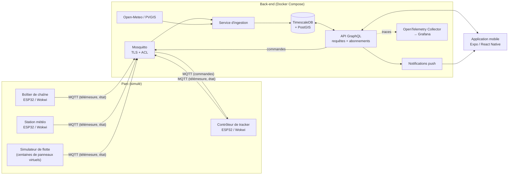
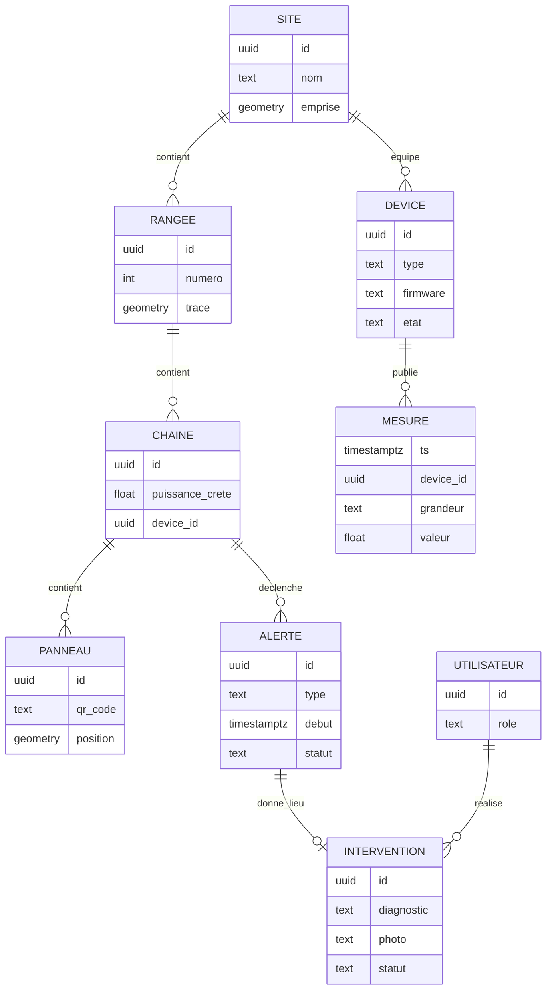

# Étude de faisabilité : supervision et maintenance d'un parc solaire

> Module « Applications mobiles et connectées » (M2 DFS).
> Statut : **piste à l'étude**, non validée par le groupe.
> Dernière mise à jour : 6 novembre 2026.

## Sommaire

1. [Résumé](#1-résumé)
2. [Contexte et problème](#2-contexte-et-problème)
3. [Utilisateurs et cas d'usage](#3-utilisateurs-et-cas-dusage)
4. [Adéquation avec le module](#4-adéquation-avec-le-module)
5. [Architecture technique](#5-architecture-technique)
6. [Objets connectés et capteurs](#6-objets-connectés-et-capteurs)
7. [Données](#7-données)
8. [Contraintes de fonctionnement](#8-contraintes-de-fonctionnement)
9. [Sécurité et conformité](#9-sécurité-et-conformité)
10. [Observabilité, tests et livraison](#10-observabilité-tests-et-livraison)
11. [Visualisation 3D](#11-visualisation-3d)
12. [Charge de travail et planning](#12-charge-de-travail-et-planning)
13. [Risques](#13-risques)
14. [Points à valider](#14-points-à-valider)
15. [Conclusion](#15-conclusion)
16. [Références](#16-références)

---

## 1. Résumé

Le projet consiste à superviser un parc solaire depuis une application mobile. L'application affiche la production en temps réel sur une carte du parc, détecte les panneaux défaillants et guide un technicien jusqu'à eux, y compris sans réseau. Les boîtiers de mesure sont des ESP32 simulés dans Wokwi, qui communiquent en MQTT avec un back-end stockant les mesures dans TimescaleDB.

| Question | Réponse courte |
|---|---|
| Le sujet est-il dans l'esprit du module ? | Oui. C'est un prolongement de la station météo (ensoleillement → production), avec des actionneurs (trackers, coupure de chaîne). |
| Couvre-t-il les cinq gestes ? | Oui, tous, de façon naturelle (section 4.1). |
| Couvre-t-il les sept chapitres ? | Oui (section 4.3). Les chapitres 4 (données) et 5 (terrain) sont particulièrement bien servis. |
| Est-il faisable sans matériel ? | Oui. Tout le socle est simulable dans Wokwi. Seuls certains bonus (OTA, secure boot) demandent un vrai ESP32. |
| Est-il faisable dans le temps imparti ? | Oui pour le socle et une partie des éléments valorisants. La 3D et les tests de pénétration restent des bonus (section 12). |
| Principal risque | Dispersion : le sujet offre beaucoup de pistes (3D, sécurité, OTA). Il faut tenir l'ordre de priorité. |

**Verdict : viable et faisable**, à condition de livrer d'abord le socle (les cinq gestes) et de borner les bonus dans le temps.

---

## 2. Contexte et problème

Un parc solaire au sol compte des milliers de panneaux répartis sur plusieurs hectares, souvent en zone rurale. Les principales sources de perte de production sont :

- un panneau ou une chaîne de panneaux défaillant (câblage, onduleur, point chaud) ;
- la salissure (poussière, pollen, fientes) ;
- l'ombrage (végétation, rangées voisines) ;
- un tracker bloqué dans une mauvaise orientation.

Pour l'exploitant, la difficulté est double :

1. **Savoir qu'il y a un problème** : il faut comparer la production réelle à la production attendue compte tenu de l'ensoleillement.
2. **Trouver physiquement le problème** : repérer un panneau précis parmi des milliers, dans une zone où le réseau mobile est souvent médiocre.

**Proposition de valeur :** « On aide un technicien à trouver et réparer un panneau défaillant dans un champ sans réseau. »

---

## 3. Utilisateurs et cas d'usage

### 3.1 Profils

| Profil | Besoin principal | Contexte d'usage |
|---|---|---|
| **Exploitant** | Vision globale du parc, alertes, pilotage des trackers | Au bureau ou en mobilité, bonne connexion |
| **Technicien** | Ordres de travail, guidage jusqu'au panneau, saisie du diagnostic | Sur le terrain, en plein soleil, parfois avec des gants, réseau intermittent |
| **Propriétaire ou investisseur** | Rapports de production et de disponibilité | Consultation occasionnelle |

### 3.2 Récits utilisateurs

**Socle :**

- En tant qu'exploitant, je vois la production instantanée et la production du jour de chaque chaîne de panneaux.
- En tant qu'exploitant, je vois le parc sur une carte, chaque élément étant coloré selon sa performance.
- En tant qu'exploitant, je reçois une notification quand une chaîne produit nettement moins que prévu ou qu'un panneau surchauffe.
- En tant qu'exploitant, je consulte l'historique d'une chaîne sur une période donnée.

**Valorisant :**

- En tant que technicien, je reçois un ordre de travail et je suis guidé par géolocalisation jusqu'au panneau.
- En tant que technicien, je scanne le QR code du panneau, je saisis mon diagnostic et une photo, même sans réseau. Tout se synchronise au retour de la connexion.
- En tant qu'exploitant, je commande l'orientation des trackers et je vois s'ils ont bien appliqué la commande.
- En tant qu'exploitant, les trackers passent automatiquement en position de sécurité quand le vent dépasse un seuil.
- En tant que propriétaire, j'obtiens un rapport mensuel de production.

**Bonus :**

- En tant qu'exploitant, je visualise le parc en 3D, avec l'angle réel des trackers et l'ombrage selon l'heure.

---

## 4. Adéquation avec le module

Référence : carte du module et relevé (`supports-cours/`).

### 4.1 Les cinq gestes

| Geste | Mise en œuvre |
|---|---|
| Lire une grandeur en temps réel | Ensoleillement, courant, tension et température des chaînes de panneaux, publiés en MQTT par les ESP32 |
| L'afficher | Écran de supervision, carte 2D du parc, graphiques d'historique |
| Alerter au seuil | Production inférieure à 80 % de l'attendu, surchauffe, vent fort : notification push et marqueur sur la carte |
| Synchroniser vers un back-end | MQTT → service d'ingestion → TimescaleDB, puis API vers l'application |
| Démo live (archi, sécu, lien) | Panne injectée → alerte → intervention hors ligne → synchronisation (section 12.3) |

### 4.2 Choix par famille

| Famille | Choix | Justification |
|---|---|---|
| Framework | React Native (Expo) | Framework JavaScript déjà connu du groupe, écosystème riche (cartes, notifications, 3D) |
| Protocole du fil | MQTT | Publication et abonnement entre de nombreux capteurs et un back-end. Le BLE n'a pas la portée nécessaire sur un parc. |
| Objet | Wokwi (ESP32 simulé) | Pas de matériel à acheter. Le livrable accepte « firmware ou simu ». |
| Broker | Mosquitto | Auto-hébergé, ACL et TLS configurables |
| Rétention | TimescaleDB (+ PostGIS) | Séries temporelles, relationnel et géographie dans une même base PostgreSQL |
| Banc | Téléphone | Géolocalisation, mode avion et conditions réelles (soleil, batterie) |
| Distribution | Device de test | APK installé via la distribution interne d'EAS |

### 4.3 Chapitres

| Chapitre | Lettre proposée | Contenu dans le projet |
|---|---|---|
| 1 Mobile | E | Supervision, carte, fiche panneau, écran technicien |
| 2 Dialogue avec l'objet | E | Télémesure, commandes, modèle état désiré / état rapporté |
| 3 Passerelles et brokers | S | QoS, messages retained, Last Will, ACL. Concentrateur de parc qui stocke puis renvoie. LoRaWAN situé comme standard du secteur. |
| 4 Données capteur | E | Agrégats continus, production attendue, détection d'anomalies, rétention |
| 5 UI et terrain | E | Mode hors ligne, lisibilité en plein soleil, batterie, accessibilité |
| 6 Sécurité | S | TLS, identifiants par appareil, ACL, chiffrement, conformité |
| 7 Observer, tester, déployer | S | Métriques, traces, tests automatisés, OTA |

Les éléments hors module (embarqué profond, audit de sécurité, CI plateforme) sont traités comme des **bonus**.

---

## 5. Architecture technique

### 5.1 Vue d'ensemble



### 5.2 Choix techniques

| Couche | Technologie | Rôle |
|---|---|---|
| Firmware | C++ (Arduino ou ESP-IDF) via PlatformIO | Lecture des capteurs, publication MQTT, tampon hors ligne |
| Simulation | Wokwi (réseau `Wokwi-GUEST` via la passerelle publique gratuite, qui ne joint qu'Internet) | Exécution des firmwares sans matériel |
| Broker | Mosquitto | Transport MQTT, TLS, ACL par appareil |
| Ingestion | Service Node.js (TypeScript) | Validation des messages, déduplication, écriture en base |
| Base | TimescaleDB + PostGIS | Mesures (tables temporelles), modèle métier, géométries |
| API | GraphQL (requêtes, mutations, abonnements via `graphql-ws`) | Accès aux données, commandes, temps réel |
| Mobile | Expo, React Native, TanStack Query, `expo-sqlite`, carte MapLibre ou `react-native-maps` | Application exploitant et technicien |
| Observabilité | OpenTelemetry, Grafana (Tempo, Prometheus, Loki) | Traces, métriques, logs |
| CI/CD | GitHub Actions, EAS Build et EAS Update | Tests, builds, livraisons |

### 5.3 Convention de topics MQTT

```
parc/{site}/{device}/telemetry   # mesures (QoS 0 ou 1)
parc/{site}/{device}/state       # état rapporté (retained)
parc/{site}/{device}/cmd         # commandes (QoS 1, avec expiration)
parc/{site}/{device}/status      # online / offline (Last Will, retained)
```

Chaque message contient un horodatage pris à la source et un numéro de version du format (`"v": 1`).

---

## 6. Objets connectés et capteurs

### 6.1 Boîtiers

Wokwi gère en pratique une seule carte par projet. On crée donc **un projet Wokwi par type de boîtier**, et le **simulateur de flotte** génère le reste du parc.

| Boîtier | Rôle |
|---|---|
| Boîtier de chaîne | Mesure électrique d'une chaîne de panneaux, coupure |
| Station météo du parc | Conditions de référence : ensoleillement, vent, température |
| Contrôleur de tracker | Orientation des panneaux, mise en sécurité |
| Boîtier de site (optionnel) | Intrusion, état de l'armoire électrique, horloge |

### 6.2 Capteurs et actionneurs

| Grandeur | Composant Wokwi | Équivalent réel | Boîtier | Usage | Priorité |
|---|---|---|---|---|---|
| Ensoleillement | Photorésistance (LDR) | Pyranomètre, cellule de référence | Station | Production attendue | Socle |
| Courant d'une chaîne | Potentiomètre | INA226, capteur à effet Hall | Chaîne | Production réelle | Socle |
| Tension d'une chaîne | Potentiomètre | Pont diviseur + INA226 | Chaîne | Production réelle, détection de défaut | Socle |
| Température des panneaux | DS18B20 | Sonde PT1000 | Chaîne | Correction du rendement, surchauffe | Socle |
| Coupure de chaîne | Relais | Sectionneur motorisé | Chaîne | Mise en sécurité depuis l'application | Socle |
| Injection de pannes | Interrupteur, bouton | Outil de démo | Chaîne | Provoquer une panne pendant la démo | Socle |
| Température et humidité ambiantes | DHT22 | SHT31 | Station | Contexte, comparaison avec Open-Meteo | Valorisant |
| Vitesse du vent | Bouton ou encodeur (impulsions) | Anémomètre à impulsions | Station | Seuil de mise en sécurité | Valorisant |
| Angle du tracker | MPU6050 | Inclinomètre | Tracker | État rapporté, vue 3D | Valorisant |
| Actionneur du tracker | Servo ou moteur pas à pas | Vérin linéaire | Tracker | Orientation, position de sécurité | Valorisant |
| Butées du tracker | Boutons | Fins de course | Tracker | Sécurité mécanique, détection de blocage | Valorisant |
| Salissure | 2e photorésistance (« cellule propre ») | Cellule de référence nettoyée | Station | Écart cellule propre / panneau = taux de salissure | Valorisant |
| Horodatage hors ligne | RTC DS1307 | Horloge RTC | Chaîne, site | Horodater sans réseau | Valorisant |
| Batterie du boîtier | Potentiomètre | Mesure de tension | Tous | Alerte batterie faible, économie d'énergie | Valorisant |
| Intrusion | PIR + bouton (contact) | Détecteur, contact de porte | Site | Alerte de sécurité | Bonus |
| Affichage local | OLED SSD1306 | Écran de maintenance | Tous | Diagnostic sur place | Bonus |

Piste technique bonus : les *custom chips* Wokwi permettent de simuler un vrai capteur de courant I2C (type INA219). Le firmware devient alors identique à celui d'un boîtier réel.

### 6.3 Ordre de mise en œuvre

1. **Cinq gestes :** LDR, deux potentiomètres (courant, tension), DS18B20, relais, bouton d'injection de panne.
2. **Pilotage et 3D :** MPU6050, servo, butées, anémomètre.
3. **Terrain :** RTC, mesure de batterie, deuxième LDR pour la salissure.
4. **Bonus :** PIR et contact d'armoire, OLED, custom chip I2C.

---

## 7. Données

### 7.1 Sources

| Source | Données | Usage | Accès |
|---|---|---|---|
| Boîtiers simulés (Wokwi) | Mesures électriques, températures, angle, vent | Cœur du système | MQTT |
| Simulateur de flotte | Mesures de centaines de panneaux virtuels, pannes injectées | Volume réaliste, démo | MQTT |
| Open-Meteo | Rayonnement solaire, température, vent, prévisions | Référence et prévisions | API HTTP gratuite, sans clé |
| PVGIS (Commission européenne) | Production photovoltaïque de référence pour un lieu | Comparaison avec la production réelle | API HTTP gratuite |

Les conditions d'utilisation et les limites de requêtes de chaque API sont à vérifier avant de s'engager (section 14).

### 7.2 Modèle de données (esquisse)



- `MESURE` est une table temporelle TimescaleDB, avec une contrainte d'unicité sur `(device_id, grandeur, ts)` pour rendre l'ingestion idempotente.
- Des agrégats continus calculent les moyennes et les sommes au quart d'heure, à l'heure et à la journée.
- Des politiques de rétention fixent la durée de conservation : mesures brutes 30 jours, agrégats plus longtemps. Elles servent aussi à appliquer les durées de conservation RGPD.

### 7.3 Production attendue

Modèle volontairement simple :

```
P_attendue = G × S × η × (1 − γ × (T_panneau − 25 °C))

G : ensoleillement (W/m²)     S : surface (m²)
η : rendement nominal         γ : coefficient de température (≈ 0,4 %/°C)
```

Une chaîne est en anomalie si `P_réelle / P_attendue` reste sous un seuil (par exemple 80 %) pendant une durée minimale, ou si elle s'écarte nettement de ses voisines.

---

## 8. Contraintes de fonctionnement

| Contrainte | Solution retenue | Niveau |
|---|---|---|
| **Temps réel** | Abonnements GraphQL alimentés par MQTT. Fréquence de rafraîchissement de l'interface limitée. À la reconnexion, récupération de ce qui a été manqué depuis le dernier horodatage, puis réabonnement. Latence de bout en bout mesurée (p95). | Socle |
| **Connectivité intermittente** | ESP32 : tampon circulaire en flash, horodatage par RTC, renvoi groupé, reconnexion avec délai croissant. Serveur : ingestion idempotente, acceptation des données tardives. Commandes : modèle état désiré / état rapporté, avec expiration. Tests de coupure avec Toxiproxy. | Valorisant |
| **Offline first** | Application technicien : plan du parc, ordres de travail et fonds de carte stockés localement (`expo-sqlite`). File d'envoi locale avec états visibles (en attente, confirmé, échoué). Indicateur de fraîcheur des données. | Valorisant |
| **Économie d'énergie** | Veille profonde la nuit (aucune production à mesurer), envois groupés, fréquence adaptative, niveau de batterie remonté. Budget énergétique calculé, car Wokwi ne mesure pas la consommation. Côté mobile : pas de connexion permanente en arrière-plan, notifications push à la place. | Valorisant |
| **Accessibilité** | Contraste élevé (usage en plein soleil), grandes zones tactiles (gants), états jamais codés par la couleur seule, liste en alternative à la carte et à la 3D, alertes annoncées au lecteur d'écran sans saturer. Tests TalkBack. | Socle |

---

## 9. Sécurité et conformité

### 9.1 Mesures techniques

| Sujet | Mesure | Niveau |
|---|---|---|
| Chiffrement en transit | MQTT sur TLS, HTTPS partout | Socle |
| Authentification des appareils | Identifiants uniques par appareil, ACL Mosquitto limitant chaque appareil à ses propres topics | Socle |
| Authentification des utilisateurs | JWT, rôles (exploitant, technicien, propriétaire), contrôles d'autorisation sur chaque requête et chaque abonnement | Socle |
| Secrets | Aucun secret dans le dépôt, secrets GitHub, gitleaks en CI | Socle |
| TLS mutuel | Certificat par appareil signé par une autorité de certification du projet | Valorisant |
| Chiffrement au repos | NVS chiffrée sur l'ESP32, `expo-secure-store` pour les jetons, base locale chiffrée (SQLCipher), sauvegardes chiffrées | Valorisant |
| OTA sécurisée | Firmware signé, vérification avant installation, partitions A/B avec retour arrière automatique | Valorisant |
| Validation des entrées | Schémas partagés (Zod / JSON Schema) entre le firmware, l'ingestion et l'API | Valorisant |
| Secure boot, chiffrement de la flash | Sur un vrai ESP32 uniquement (réglages irréversibles par eFuses) | Bonus |
| Tests de pénétration | Broker (connexion anonyme, contournement des ACL), API (accès aux objets d'autrui), APK (MobSF), rejeu de commandes vers les trackers. Rapport avec corrections et re-test. | Bonus |

### 9.2 Conformité

| Référentiel | Application |
|---|---|
| **RGPD** | Données personnelles : géolocalisation des techniciens, historique des interventions, comptes utilisateurs. Minimisation (position collectée seulement pendant une intervention), durées de conservation appliquées par la base, droits d'accès et de suppression, registre des traitements, politique de confidentialité dans l'application. |
| **ETSI EN 303 645** | Utilisée comme grille de vérification (matrice de conformité des 13 exigences). Elle vise l'IoT grand public, ce qui est à justifier dans le dossier. |
| **IEC 62443, NIS2** | Cités comme les référentiels réellement applicables à une infrastructure énergétique. Le parc solaire relève des systèmes industriels, et le secteur de l'énergie entre dans le champ de NIS2. |

---

## 10. Observabilité, tests et livraison

| Sujet | Mise en œuvre | Niveau |
|---|---|---|
| Logs locaux | Rotation sur l'ESP32 (LittleFS) et sur le mobile. Envoi sur demande, en cas de crash, ou en WiFi et en charge. | Valorisant |
| Logs chiffrés | Chiffrement par blocs, à clé publique côté ESP32 (l'appareil écrit sans pouvoir relire) | Bonus |
| Traces | OpenTelemetry sur le back-end (HTTP, GraphQL, PostgreSQL), collector, Grafana | Valorisant |
| Trace de bout en bout | Propagation de `traceparent` dans les propriétés utilisateur MQTT v5 : une seule trace de l'application jusqu'à l'ESP32 | Bonus |
| Tests firmware | Tests unitaires PlatformIO, scénarios `wokwi-cli` dans GitHub Actions | Socle → Valorisant |
| Tests back-end | Vitest, Testcontainers (vrais TimescaleDB et Mosquitto) | Socle → Valorisant |
| Tests mobile | Jest et React Native Testing Library, parcours Maestro | Socle → Valorisant |
| Build mobile | Profils EAS : development, preview, production | Socle |
| Distribution | APK via la distribution interne d'EAS | Socle |
| OTA application | EAS Update, `runtimeVersion` en mode `fingerprint`, canaux preview et production | Valorisant |
| OTA firmware | Tag → build → tests → signature → publication du manifeste → campagne progressive | Valorisant |

---

## 11. Visualisation 3D

### 11.1 Intérêt

La 3D est justifiée par le métier, pas seulement par l'effet visuel :

- **ombrage** : en faisant avancer la position du soleil (bibliothèque `suncalc`), on voit les rangées s'ombrer entre elles, ce qui explique une baisse de production ;
- **trackers en direct** : l'angle remonté par MQTT fait pivoter les panneaux dans la scène ;
- **état du parc** : chaque panneau est coloré selon le ratio production réelle / attendue, et un tap ouvre sa fiche.

### 11.2 Options

| Option | Principe | Avantages | Limites |
|---|---|---|---|
| **A. three.js dans l'application** (`@react-three/fiber/native`, `expo-gl`) | Scène générée depuis les données, panneaux en instances d'un même objet | Pas de modélisation 3D, liaison directe avec le temps réel | Performances à surveiller sur les téléphones moyens |
| B. Carte « 2,5D » (MapLibre ou Mapbox) | Polygones extrudés sur une carte | Géoréférencé, peu de code | Pas d'animation des trackers ni d'ombres |
| C. Tableau de bord web (three.js, deck.gl) | 3D réservée à l'exploitant au bureau | Aucune contrainte mobile | Sort du périmètre mobile |

**Choix proposé : option A**, sous la forme d'un écran dédié. La carte 2D reste l'écran principal du technicien.

### 11.3 Garde-fous

- Budget d'heures fixé à l'avance (section 12), avec une preuve de concept dans les premières semaines.
- Si la preuve de concept échoue, repli sur l'option B.
- La 3D n'est jamais le seul accès à une information (accessibilité).
- Rendu uniquement quand quelque chose change, niveau de détail selon le zoom.

---

## 12. Charge de travail et planning

### 12.1 Estimation

Estimations en heures de travail cumulées, toutes personnes confondues. À réviser après la preuve de concept.

| Lot | Contenu | Socle | Valorisant | Bonus |
|---|---|---|---|---|
| Mise en place | Dépôt, Docker Compose, CI de base, conventions | 8 | | |
| Firmware | Boîtier de chaîne et station météo, MQTT, TLS | 14 | | |
| Firmware avancé | Tracker, tampon hors ligne, RTC, veille profonde | | 10 | |
| Simulateur de flotte | Génération de panneaux virtuels, injection de pannes | 6 | | |
| Ingestion et base | Service d'ingestion, TimescaleDB, PostGIS, agrégats | 10 | | |
| Analyse | Production attendue, détection d'anomalies, Open-Meteo | | 8 | |
| API | GraphQL, authentification, rôles, abonnements, notifications | 14 | | |
| Application | Supervision, carte 2D, alertes, historique, fiche panneau | 24 | | |
| Terrain | Mode hors ligne, file d'envoi, ordres de travail, QR codes | | 16 | |
| Commandes | Trackers, état désiré / rapporté, mise en sécurité | | 8 | |
| Sécurité | TLS mutuel, ACL avancées, chiffrement au repos | | 6 | |
| OTA | Firmware signé, pipeline, EAS Update | | 10 | |
| Observabilité et tests | OpenTelemetry, scénarios Wokwi, Maestro | | 8 | |
| Visualisation 3D | Preuve de concept, temps réel, ombres | | | 25 |
| Sécurité offensive | Tests de pénétration, rapport, re-test | | | 10 |
| Logs et trace de bout en bout | Logs chiffrés, propagation MQTT v5 | | | 12 |
| Documentation et démo | Documentation technique, dossier sécurité, répétition | 12 | | |
| **Total** | | **≈ 88 h** | **≈ 66 h** | **≈ 47 h** |

### 12.2 Lecture

| Taille du groupe | Socle + valorisant (≈ 154 h) | Avec tous les bonus (≈ 200 h) |
|---|---|---|
| Binôme | ≈ 77 h par personne : tendu, privilégier le socle et une partie du valorisant | Peu réaliste |
| Trinôme | ≈ 51 h par personne : réaliste | ≈ 67 h par personne : possible en choisissant ses bonus |

Le volume du module est de 45 h 30 de cours. Le travail personnel s'y ajoute.

### 12.3 Phases

| Phase | Objectif | Livrable de fin de phase |
|---|---|---|
| 0. Cadrage | Valider le sujet, l'architecture, la convention de topics et la répartition | Ce document, dépôt initialisé |
| 1. Fil de bout en bout | Un capteur → MQTT → base → API → affichage dans l'application | Les gestes « lire » et « afficher » démontrés |
| 2. Socle | Alertes, historique, carte 2D, simulateur de flotte. **Preuve de concept 3D en parallèle.** | Les cinq gestes démontrés |
| 3. Terrain | Hors ligne, ordres de travail, commandes des trackers, connectivité intermittente | Scénario de démo complet |
| 4. Durcissement | TLS mutuel, OTA, observabilité, tests | Dossier sécurité, CI verte |
| 5. Bonus et démo | 3D complète, tests de pénétration, répétitions | Soutenance |

**Scénario de démonstration visé :**

1. Production en direct sur la carte, latence affichée.
2. Panne injectée sur une chaîne → alerte push → chaîne en rouge sur la carte et en 3D.
3. Ordre de travail envoyé au technicien, téléphone passé en mode avion.
4. Guidage jusqu'au panneau, scan du QR code, saisie du diagnostic hors ligne.
5. Retour du réseau → synchronisation sans perte ni doublon.
6. Rafale de vent simulée → trackers en position de sécurité, confirmée par leur état rapporté.

### 12.4 Répartition indicative (trinôme)

| Personne | Périmètre principal | Chapitre défendu à l'oral |
|---|---|---|
| A | Firmware, Wokwi, simulateur de flotte, OTA firmware | 2 Dialogue avec l'objet, 3 Passerelles |
| B | Ingestion, base, API, sécurité back-end, observabilité | 4 Données capteur, 6 Sécurité |
| C | Application mobile, hors ligne, 3D, build et distribution | 1 Mobile, 5 UI et terrain |
| Tous | Tests, documentation, chapitre 7 | 7 Observer, tester, déployer |

---

## 13. Risques

| Risque | Probabilité | Impact | Parade |
|---|---|---|---|
| Wokwi ne joint pas le broker local (la passerelle privée est payante) | Certaine en offre gratuite | Fort | Broker hébergé sur Internet avec TLS et authentification (petit serveur ou HiveMQ Cloud), ou abonnement Wokwi Hobby pendant la durée du projet |
| Dispersion entre trop de pistes | Forte | Fort | Ordre de priorité socle → valorisant → bonus ; revue à chaque fin de phase |
| La 3D consomme le planning | Forte | Moyen | Budget fixé, preuve de concept précoce, repli sur la carte 2,5D |
| Performances 3D insuffisantes sur téléphone | Moyenne | Moyen | Instances, niveau de détail, rendu à la demande ; option B en repli |
| Métier mal maîtrisé | Faible | Moyen | Modèle de production simplifié, assumé et documenté |
| API externe indisponible ou limitée | Faible | Faible | Mise en cache, données de secours enregistrées |
| Fonctions OTA ou secure boot non simulables | Forte | Faible | Tests sur un vrai ESP32 (environ 5 €) ; sinon procédure documentée |
| Synchronisation hors ligne plus complexe que prévu | Moyenne | Moyen | Périmètre hors ligne limité aux interventions ; règles de conflit simples et documentées |
| Absence d'un membre du groupe | Moyenne | Fort | Code relu par au moins deux personnes, documentation à jour, lots indépendants |
| Distribution iOS impossible | Forte | Faible | Android en priorité, iOS documenté |

---

## 14. Points à valider

- [ ] Accord du groupe sur le sujet et sur la place de la 3D.
- [ ] Validation du sujet par l'enseignant (le métier est une variante de « station météo »).
- [ ] Taille définitive du groupe (binôme ou trinôme), qui conditionne le périmètre.
- [ ] Hébergement du broker joignable depuis Wokwi (serveur public, HiveMQ Cloud, ou abonnement Wokwi Hobby pour la passerelle privée).
- [ ] Comportement de la veille profonde dans Wokwi (un retour communautaire indique qu'elle se comporte comme un redémarrage).
- [ ] Conditions d'utilisation et limites de requêtes d'Open-Meteo et de PVGIS.
- [ ] Choix de la bibliothèque de carte (MapLibre ou `react-native-maps`) et des fonds de carte hors ligne.
- [ ] Faisabilité de la preuve de concept 3D sur les téléphones du groupe.
- [ ] Disponibilité d'un vrai ESP32 pour les bonus OTA et secure boot.

---

## 15. Conclusion

| Critère | Évaluation |
|---|---|
| Adéquation avec le module | Forte : cinq gestes et sept chapitres couverts, métier proche de la station météo |
| Richesse technique | Très forte : temps réel, commandes, carte, volume de données, hors ligne, sécurité crédible |
| Faisabilité | Bonne pour le socle et le valorisant en trinôme. Tendue en binôme si l'on vise plus que le socle. |
| Originalité | Bonne : sujet peu courant, avec un scénario de démo concret |
| Points faibles | RGPD moins riche qu'un sujet de présence, métier à simplifier, risque de dispersion |

**Le sujet est viable.** Sa réussite dépend surtout de la discipline de priorisation : le fil de bout en bout d'abord, puis les cinq gestes, puis le terrain. La 3D et la sécurité offensive viennent ensuite, comme des bonus bornés dans le temps.

---

## 16. Références

- Wokwi, documentation : <https://docs.wokwi.com>
- Eclipse Mosquitto : <https://mosquitto.org>
- Spécification MQTT 5.0 (OASIS) : <https://docs.oasis-open.org/mqtt/mqtt/v5.0/mqtt-v5.0.html>
- Expo, documentation : <https://docs.expo.dev>
- TimescaleDB : <https://github.com/timescale/timescaledb>
- PostGIS : <https://postgis.net>
- Open-Meteo : <https://open-meteo.com>
- PVGIS (Centre commun de recherche, Commission européenne) : <https://joint-research-centre.ec.europa.eu/photovoltaic-geographical-information-system-pvgis_en>
- OpenTelemetry : <https://opentelemetry.io>
- React Three Fiber : <https://r3f.docs.pmnd.rs>
- SunCalc : <https://github.com/mourner/suncalc>
- ETSI EN 303 645 : <https://www.etsi.org/deliver/etsi_en/303600_303699/303645/>
- CNIL : <https://www.cnil.fr>
