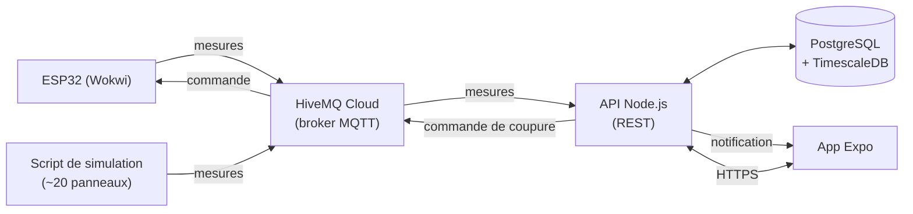

# Étude de faisabilité : supervision d'un parc solaire

> Module « Applications mobiles et connectées » (M2 DFS).
> Statut : **piste à l'étude**, non validée par le groupe.
> Dernière mise à jour : 6 novembre 2026.

## 1. Résumé

Une application mobile supervise un petit parc solaire. Elle affiche la production en direct, alerte quand un panneau produit moins que prévu et permet de couper une chaîne de panneaux à distance. Les mesures viennent d'un ESP32 simulé dans Wokwi.

**Principe directeur : rester simple.** Une app, une API, une base, quelques capteurs. Tout ce qui dépasse est un bonus, traité seulement une fois le socle livré.

| Question | Réponse |
|---|---|
| Dans l'esprit du module ? | Oui : prolongement de la station météo (ensoleillement → production), avec une action retour vers l'objet. |
| Les cinq gestes sont-ils couverts ? | Oui (section 3). |
| Faut-il du matériel ? | Non, tout est simulé dans Wokwi. |
| Faisable dans le temps ? | Oui : environ 60 h de travail au total pour le socle (section 9). |

**Verdict : viable et faisable.**

## 2. Périmètre

| Dans le projet | Hors projet (ou bonus) |
|---|---|
| 1 ESP32 simulé avec 5 composants | Plusieurs boîtiers, tracker, anémomètre |
| Script simulant une vingtaine de panneaux pour peupler la carte | Flotte de centaines de panneaux |
| Broker MQTT hébergé (HiveMQ Cloud) | Broker auto-hébergé, TLS mutuel, ACL avancées |
| Une API REST qui reçoit les mesures et les enregistre | Microservices, GraphQL |
| PostgreSQL avec TimescaleDB | PostGIS, agrégats et rétention avancés |
| App de 4 écrans | Mode hors ligne complet, ordres de travail, QR codes |
| Sécurité de base (TLS, identifiants, JWT) | OTA signée, chiffrement au repos, tests de pénétration |
| CI simple + APK | Observabilité, tests sur simulation en CI |
| **Bonus : vue 3D** (section 7) | — |

## 3. Adéquation avec le module

### Les cinq gestes

| Geste | Mise en œuvre |
|---|---|
| Lire une grandeur en temps réel | L'ESP32 publie ensoleillement, puissance et température toutes les quelques secondes |
| L'afficher | Écrans Supervision et Carte |
| Alerter au seuil | Puissance trop basse par rapport à l'ensoleillement, ou surchauffe : notification push |
| Synchroniser vers un back-end | L'API enregistre chaque mesure en base, l'app consulte l'historique |
| Démo live | Bouton de panne → alerte sur le téléphone → coupure de la chaîne depuis l'app → le relais bascule dans Wokwi |

### Choix par famille

| Famille | Choix | Raison |
|---|---|---|
| Framework | React Native (Expo) | JavaScript déjà connu du groupe |
| Protocole | MQTT | Standard de l'IoT, adapté à des capteurs qui publient en continu |
| Objet | Wokwi (ESP32) | Pas de matériel à acheter |
| Broker | HiveMQ Cloud | Offre gratuite, TLS inclus, rien à administrer, joignable depuis Wokwi |
| Rétention | TimescaleDB | PostgreSQL classique, avec une table optimisée pour les mesures |
| Banc | Téléphone | Notifications push et conditions réelles |
| Distribution | Device de test | APK installé via EAS |

> Wokwi gratuit ne peut joindre que des services sur Internet : c'est pour cela que le broker est hébergé et non lancé en local.

### Chapitres

| Chapitre | Lettre | Contenu |
|---|---|---|
| 1 Mobile | E | Les 4 écrans de l'app |
| 2 Dialogue avec l'objet | E | Publication des mesures, réception de la commande de coupure |
| 3 Passerelles et brokers | S | Fonctionnement de MQTT (topics, QoS, messages retained, Last Will) |
| 4 Données capteur | E | Stockage des mesures, historique, règle d'alerte |
| 5 UI et terrain | E | Lisibilité en extérieur, affichage des dernières données sans réseau |
| 6 Sécurité | S | TLS, identifiants par appareil, authentification JWT |
| 7 Observer, tester, déployer | S | CI GitHub Actions, build EAS |

## 4. Architecture



| Brique | Technologie | Rôle |
|---|---|---|
| Objet | ESP32 sous Wokwi, PlatformIO, framework Arduino | Lire les capteurs, publier, exécuter la commande |
| Broker | HiveMQ Cloud | Transporter les messages MQTT |
| API | Node.js + TypeScript (Express ou Fastify) | S'abonner au broker, écrire en base, exposer les données, envoyer les commandes et les notifications |
| Base | PostgreSQL + TimescaleDB (Docker) | Panneaux, mesures, alertes, utilisateurs |
| App | Expo, React Native, `react-native-maps`, TanStack Query, `expo-notifications` | Supervision, carte, détail, alertes |
| CI | GitHub Actions, EAS Build | Lint, tests de l'API, APK |

### Topics MQTT

```
parc/{panneau}/mesures   # ESP32 → API : ensoleillement, puissance, température
parc/{panneau}/commande  # API → ESP32 : coupure / remise en service
parc/{panneau}/etat      # ESP32 → API : état du relais (retained)
```

### API REST

| Méthode | Route | Rôle |
|---|---|---|
| POST | `/auth/login` | Connexion, renvoie un JWT |
| GET | `/panneaux` | Liste avec dernière mesure et statut (pour la carte) |
| GET | `/panneaux/:id/mesures?depuis=…` | Historique d'un panneau |
| POST | `/panneaux/:id/commande` | Coupure ou remise en service |
| GET | `/alertes` | Alertes en cours et passées |

Le « temps réel » passe par un rafraîchissement automatique toutes les quelques secondes côté app. Un flux poussé (SSE) est un bonus.

## 5. Capteurs

Un seul ESP32 simulé :

| Composant Wokwi | Ce qu'il représente | Usage |
|---|---|---|
| Photorésistance (LDR) | Ensoleillement | Calcul de la production attendue |
| Potentiomètre | Puissance produite par le panneau | Production réelle |
| DS18B20 | Température du panneau | Alerte de surchauffe |
| Relais | Coupure de la chaîne | Action retour depuis l'app |
| Bouton | Panne simulée | Démo |

Les autres panneaux de la carte sont simulés par un script qui publie des mesures sur le broker.

## 6. Données

| Table | Contenu |
|---|---|
| `panneau` | id, nom, latitude, longitude, puissance nominale, état (actif / coupé) |
| `mesure` | horodatage, panneau, ensoleillement, puissance, température (table TimescaleDB) |
| `alerte` | panneau, type, début, fin, statut |
| `utilisateur` | identifiant, mot de passe haché, rôle |

**Règle d'alerte** (volontairement simple) :

```
puissance_attendue = ensoleillement × facteur_du_panneau
alerte si puissance < 70 % de puissance_attendue pendant plus d'une minute
alerte si température > 75 °C
```

## 7. Application

| Écran | Contenu |
|---|---|
| Supervision | Production totale, nombre de panneaux en alerte, liste des panneaux |
| Carte | Marqueurs colorés par statut (avec icône, pas seulement la couleur) |
| Détail d'un panneau | Valeurs actuelles, graphique de l'historique, bouton couper / remettre en service |
| Alertes | Liste des alertes ; les nouvelles arrivent en notification push |

Sans réseau, l'app affiche les dernières données reçues avec leur ancienneté (« mis à jour il y a 5 min »).

### Bonus : vue 3D

Un cinquième écran affiche le parc en 3D (React Three Fiber + `expo-gl`) : la vingtaine de panneaux générée à partir des données de la base, colorée selon leur statut, avec un tap pour ouvrir la fiche du panneau.

- **Quand :** uniquement une fois les quatre écrans et les cinq gestes terminés.
- **Budget :** environ 15 h. Au-delà, on s'arrête là où on en est.
- **Règle :** la 3D n'apporte aucune information exclusive. Tout reste accessible depuis la liste et la carte.

## 8. Sécurité

- Connexion au broker en TLS (fourni par HiveMQ Cloud), un identifiant par appareil.
- Connexion à l'app par identifiant et mot de passe, puis JWT. Mots de passe hachés.
- HTTPS entre l'app et l'API.
- Aucun secret dans le dépôt (fichiers `.env` ignorés par Git, secrets GitHub pour la CI).
- Validation des messages reçus par l'API (format et bornes des valeurs).

## 9. Charge et planning

| Lot | Charge estimée |
|---|---|
| Firmware ESP32 + script de simulation | 8 h |
| Broker et API | 15 h |
| Base de données | 5 h |
| Application (4 écrans + notifications) | 20 h |
| CI et APK | 4 h |
| Documentation et dossier sécurité | 8 h |
| **Total socle** | **≈ 60 h** |
| Bonus 3D | ≈ 15 h |

| Étape | Objectif |
|---|---|
| 1. Fil de bout en bout | Une mesure part de l'ESP32 et s'affiche dans l'app |
| 2. Socle | Les 4 écrans, l'historique, les alertes, la commande de coupure |
| 3. Finitions | Sécurité, CI, APK, documentation, répétition de la démo |
| 4. Bonus | Vue 3D, puis rafraîchissement en direct (SSE) si le temps le permet |

**Répartition indicative :**

| Personne | Périmètre |
|---|---|
| A | ESP32 (Wokwi), script de simulation, broker |
| B | API, base de données, sécurité |
| C (ou A et B en binôme) | Application mobile, build, bonus 3D |

## 10. Risques

| Risque | Parade |
|---|---|
| Wokwi ne joint pas un broker local | Broker hébergé (HiveMQ Cloud) |
| La 3D déborde sur le socle | Commencée seulement après le socle, budget de 15 h |
| Notifications push indisponibles dans Expo Go | Utiliser un development build (EAS) dès le départ |
| Absence d'un membre | Lots indépendants, code relu par au moins deux personnes |

## 11. Points à valider

- [ ] Accord du groupe sur le sujet et sur la 3D en bonus.
- [ ] Taille définitive du groupe (binôme ou trinôme).
- [ ] Création du compte HiveMQ Cloud et premier message publié depuis Wokwi.
- [ ] Hébergement de l'API et de la base (en local pour le développement, hébergement à choisir pour la démo).

## 12. Références

- Wokwi : <https://docs.wokwi.com>
- Réseau WiFi dans Wokwi : <https://docs.wokwi.com/guides/esp32-wifi>
- Exemple ESP32 + MQTT sous Wokwi : <https://wokwi.com/projects/437318648799108097>
- HiveMQ Cloud : <https://www.hivemq.com/products/mqtt-cloud-broker/>
- Expo : <https://docs.expo.dev>
- TimescaleDB : <https://github.com/timescale/timescaledb>
- React Three Fiber : <https://r3f.docs.pmnd.rs>
