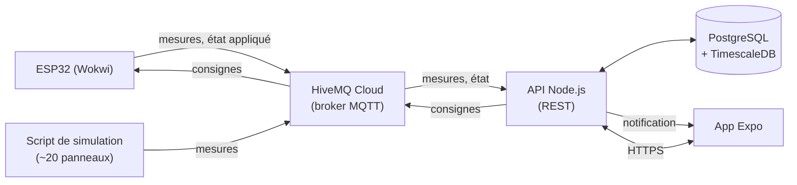

# Étude de faisabilité : supervision et pilotage d'un parc solaire

> Module « Applications mobiles et connectées » (M2 DFS).
> Statut : **piste à l'étude**, non validée par le groupe.
> Dernière mise à jour : 6 novembre 2026.

## 1. Résumé

Une application mobile supervise et **pilote** un petit parc solaire équipé d'une batterie de stockage et raccordé au réseau. Elle affiche la production en direct et alerte en cas d'anomalie. Surtout, elle permet de **décider à distance comment la production se répartit entre la batterie et le réseau**. L'objet applique la consigne, ou la refuse si elle met la batterie en danger, et renvoie ce qu'il fait réellement. Les mesures et les actions passent par un ESP32 simulé dans Wokwi.

**Principe directeur : rester simple.** Une app, une API, une base, un objet. Tout ce qui dépasse est un bonus, traité seulement une fois le socle livré.

| Question | Réponse |
|---|---|
| Dans l'esprit du module ? | Oui : prolongement de la station météo (ensoleillement → production), avec un vrai pilotage de l'objet à distance. |
| Communication bidirectionnelle ? | Oui : mesures de l'objet vers l'app, consignes de l'app vers l'objet, état réellement appliqué en retour (section 4). |
| Les cinq gestes sont-ils couverts ? | Oui (section 3). |
| Faut-il du matériel ? | Non, tout est simulé dans Wokwi. |
| Faisable dans le temps ? | Oui : environ 70 h de travail au total pour le socle (section 10). |

**Verdict : viable et faisable.**

## 2. Périmètre

| Dans le projet | Hors projet (ou bonus) |
|---|---|
| 1 ESP32 simulé : mesures + pilotage batterie / réseau | Plusieurs boîtiers, anémomètre |
| Script simulant une vingtaine de panneaux pour peupler la carte | Flotte de centaines de panneaux |
| Broker MQTT hébergé (HiveMQ Cloud) | Broker auto-hébergé, TLS mutuel, ACL avancées |
| Une API REST qui reçoit les mesures et envoie les consignes | Microservices, GraphQL |
| PostgreSQL avec TimescaleDB | PostGIS, agrégats et rétention avancés |
| App de 5 écrans, dont un écran de pilotage | Mode hors ligne complet, ordres de travail |
| Sécurité de base (TLS, identifiants, JWT, rôles) | OTA signée, chiffrement au repos, tests de pénétration |
| CI simple + APK | Observabilité, tests sur simulation en CI |
| — | **Bonus 1 : vue 3D** · **Bonus 2 : rotation des panneaux (tracker)** (section 8) |

## 3. Adéquation avec le module

### Les cinq gestes

| Geste | Mise en œuvre |
|---|---|
| Lire une grandeur en temps réel | L'ESP32 publie ensoleillement, production, température, niveau de la batterie et répartition des flux |
| L'afficher | Écrans Supervision, Carte et Pilotage (flux en direct, jauge de batterie) |
| Alerter au seuil | Production anormalement basse, surchauffe, batterie faible ou pleine, consigne refusée, objet hors ligne : notification push |
| Synchroniser vers un back-end | L'API enregistre les mesures et l'historique des consignes ; l'app consulte l'historique |
| Démo live | Consigne « 70 % vers la batterie » dans l'app → les relais et la barre de LED réagissent dans Wokwi → batterie à 95 % → l'objet refuse la charge, l'app affiche le refus et sa raison |

### Choix par famille

| Famille | Choix | Raison |
|---|---|---|
| Framework | React Native (Expo) | JavaScript déjà connu du groupe |
| Protocole | MQTT | Publication des mesures et réception des consignes sur un même canal, messages conservés (retained) pour les consignes |
| Objet | Wokwi (ESP32) | Pas de matériel à acheter |
| Broker | HiveMQ Cloud | Offre gratuite, TLS inclus, rien à administrer, joignable depuis Wokwi |
| Rétention | TimescaleDB | PostgreSQL classique, avec une table optimisée pour les mesures |
| Banc | Téléphone | Notifications push et conditions réelles |
| Distribution | Device de test | APK installé via EAS |

> Wokwi gratuit ne peut joindre que des services sur Internet : c'est pour cela que le broker est hébergé et non lancé en local.

### Chapitres

| Chapitre | Lettre | Contenu |
|---|---|---|
| 1 Mobile | E | Les 5 écrans de l'app, dont le pilotage |
| 2 Dialogue avec l'objet | E | Mesures montantes, consignes descendantes, état appliqué en retour |
| 3 Passerelles et brokers | S | Fonctionnement de MQTT (topics, QoS, messages retained, Last Will) |
| 4 Données capteur | E | Stockage des mesures, historique, règles d'alerte, bilan énergétique |
| 5 UI et terrain | E | Lisibilité en extérieur, confirmation avant une commande, dernières données affichées sans réseau |
| 6 Sécurité | S | TLS, identifiants par appareil, JWT, commandes réservées à un rôle |
| 7 Observer, tester, déployer | S | CI GitHub Actions, build EAS |

## 4. Le pilotage

### Principe

Le parc dispose d'**une batterie de stockage** et d'**un raccordement au réseau**. La production se partage entre les deux.

```
Production solaire ──┬──▶ Batterie (charge)
                     └──▶ Réseau (injection)
```

### Modes

| Mode | Comportement |
|---|---|
| **Manuel** | L'utilisateur règle depuis l'app la part de la production envoyée vers la batterie (de 0 à 100 %), le reste part vers le réseau |
| **Automatique** | L'ESP32 applique une règle locale : charger la batterie jusqu'à 80 %, puis envoyer tout le surplus vers le réseau |
| **Restitution** | La batterie se décharge vers le réseau (par exemple pendant une pointe de consommation), jusqu'à 20 % |

### Limites de sécurité appliquées par l'objet

L'objet a toujours le dernier mot, quelle que soit la consigne reçue :

| Situation | Comportement de l'objet |
|---|---|
| Batterie ≥ 95 % | Charge refusée, toute la production part vers le réseau |
| Batterie ≤ 20 % | Pas d'injection de l'énergie stockée vers le réseau |
| Consigne hors bornes ou mal formée | Consigne ignorée, refus signalé |

### Consigne et état appliqué

1. L'utilisateur choisit un mode et une répartition dans l'app, puis confirme.
2. L'API vérifie ses droits et les bornes, enregistre la consigne, puis la publie sur MQTT.
3. L'ESP32 applique ce qu'il peut, en respectant ses limites de sécurité.
4. Il publie son état : consigne reçue, répartition réellement appliquée, refus éventuel et sa raison.
5. L'app affiche le statut : *envoyée → appliquée*, *appliquée partiellement* ou *refusée*.

La consigne est publiée en **retained** : un ESP32 qui se reconnecte reçoit immédiatement la dernière consigne en vigueur.

## 5. Architecture



| Brique | Technologie | Rôle |
|---|---|---|
| Objet | ESP32 sous Wokwi, PlatformIO, framework Arduino | Lire les capteurs, calculer le niveau de la batterie, appliquer les consignes avec leurs limites, publier |
| Broker | HiveMQ Cloud | Transporter les messages MQTT |
| API | Node.js + TypeScript (Express ou Fastify) | S'abonner au broker, écrire en base, exposer les données, valider et publier les consignes, envoyer les notifications |
| Base | PostgreSQL + TimescaleDB (Docker) | Sites, panneaux, mesures, consignes, alertes, utilisateurs |
| App | Expo, React Native, `react-native-maps`, TanStack Query, `expo-notifications` | Supervision, carte, détail, pilotage, alertes |
| CI | GitHub Actions, EAS Build | Lint, tests de l'API, APK |

### Topics MQTT

```
solar/{site}/measurements               # ESP32 → API : production, batterie, flux
solar/{site}/panels/{panel}/measurements # simulateur → API : production d'un panneau
solar/{site}/setpoint                   # API → ESP32 : mode et part batterie       (retained)
solar/{site}/state                      # ESP32 → API : ce qui est appliqué, refus  (retained)
solar/{site}/status                     # ESP32 → API : en ligne / hors ligne (Last Will, retained)
```

Le format exact de chaque message est défini dans [conception/03-cartographie-technique.md](conception/03-cartographie-technique.md).

### API REST

| Méthode | Route | Rôle |
|---|---|---|
| POST | `/v1/auth/login` | Connexion, renvoie un JWT |
| GET | `/v1/sites/{id}` | Dernières mesures, état de la batterie, consigne en vigueur et état appliqué |
| GET | `/v1/sites/{id}/measurements` | Historique |
| POST | `/v1/sites/{id}/setpoints` | Nouvelle consigne (rôle exploitant uniquement) |
| GET | `/v1/sites/{id}/setpoints` | Historique des consignes et de leur application |
| GET | `/v1/sites/{id}/panels` | Panneaux avec statut (pour la carte) |
| GET | `/v1/alerts` | Alertes en cours et passées |

La liste complète des routes est dans [conception/03-cartographie-technique.md](conception/03-cartographie-technique.md).

Le « temps réel » passe par un rafraîchissement automatique toutes les quelques secondes côté app. Un flux poussé (SSE) est un bonus.

## 6. Objet et capteurs

Un seul ESP32 simulé :

| Composant Wokwi | Ce qu'il représente | Usage |
|---|---|---|
| Photorésistance (LDR) | Ensoleillement | Production attendue |
| Potentiomètre | Puissance produite | Production réelle |
| DS18B20 | Température des panneaux | Alerte de surchauffe |
| Relais 1 | Charge de la batterie | Pilotage |
| Relais 2 | Injection sur le réseau | Pilotage |
| Barre de LED (*LED Bar Graph*) | Niveau de charge de la batterie | Visible pendant la démo |
| Bouton | Panne simulée | Démo des alertes |

La batterie n'est pas un composant : **le firmware calcule son niveau de charge** à partir de la puissance qu'il lui envoie au fil du temps (avec une capacité fictive, par exemple 10 kWh, et un temps accéléré pour la démo).

Les autres panneaux de la carte sont simulés par un script qui publie des mesures sur le broker.

## 7. Données

| Table | Contenu |
|---|---|
| `sites` | Site : nom, position, capacité de la batterie |
| `panels` | Panneaux : site, nom, position, puissance nominale |
| `site_measurements`, `panel_measurements` | Mesures (tables TimescaleDB) : ensoleillement, production, température, niveau de batterie, flux |
| `setpoints` | Consignes : auteur, date, mode, part demandée, part appliquée, statut, raison |
| `alerts` | Alertes : site ou panneau, type, début, fin, statut |
| `users` | Utilisateurs : identifiant, mot de passe haché, rôle (exploitant, lecteur) |

Le modèle complet (colonnes, types, contraintes) est dans [conception/01-modele-donnees.md](conception/01-modele-donnees.md). Les noms techniques sont en anglais.

**Règles d'alerte** (volontairement simples) :

```
production_attendue = ensoleillement × facteur_du_parc
alerte si production < 70 % de production_attendue pendant plus d'une minute
alerte si température > 75 °C
alerte si batterie < 20 % ou batterie > 95 %
alerte si une consigne est refusée ou reste sans réponse plus de 30 s
alerte si l'objet passe hors ligne (Last Will)
```

## 8. Application

| Écran | Contenu |
|---|---|
| Supervision | Production, niveau de la batterie, répartition actuelle, nombre d'alertes |
| Carte | Panneaux en marqueurs colorés par statut (avec icône, pas seulement la couleur) |
| Détail d'un panneau | Valeurs actuelles, graphique de l'historique |
| **Pilotage** | Interrupteur Manuel / Automatique, curseur batterie ↔ réseau avec confirmation, flux en direct, jauge de la batterie, statut de la dernière consigne, historique des consignes |
| Alertes | Liste des alertes ; les nouvelles arrivent en notification push |

Sans réseau, l'app affiche les dernières données reçues avec leur ancienneté (« mis à jour il y a 5 min »), et le pilotage est désactivé tant que la connexion n'est pas revenue.

### Bonus

À traiter **uniquement une fois le socle terminé**, dans cet ordre :

| Bonus | Contenu | Budget |
|---|---|---|
| 1. Vue 3D | Écran 3D (React Three Fiber + `expo-gl`) : panneaux générés depuis la base, colorés selon leur statut, tap pour ouvrir la fiche | ≈ 15 h |
| 2. Rotation des panneaux | Servo + deux photorésistances sur l'ESP32 : orientation automatique vers le soleil, mode et position de sécurité commandés depuis l'app. Alimente la vue 3D. | ≈ 10 h |

Au-delà du budget, on s'arrête là où on en est. Les bonus n'apportent aucune information exclusive : tout reste accessible depuis les écrans du socle.

## 9. Sécurité

- Connexion au broker en TLS (fourni par HiveMQ Cloud), un identifiant par appareil.
- Connexion à l'app par identifiant et mot de passe, puis JWT. Mots de passe hachés.
- **Envoi de consignes réservé au rôle exploitant**, vérifié par l'API.
- **Double validation des consignes** : par l'API (droits, bornes), puis par l'objet (limites de sécurité de la batterie).
- Historique des consignes : qui a demandé quoi, et quand.
- HTTPS entre l'app et l'API.
- Aucun secret dans le dépôt (fichiers `.env` ignorés par Git, secrets GitHub pour la CI).
- Validation des messages reçus par l'API (format et bornes des valeurs).

## 10. Charge et planning

| Lot | Charge estimée |
|---|---|
| Firmware ESP32 (mesures, batterie simulée, pilotage) + script de simulation | 12 h |
| Broker et API (dont consignes) | 18 h |
| Base de données | 5 h |
| Application (5 écrans + notifications) | 24 h |
| CI et APK | 4 h |
| Documentation et dossier sécurité | 8 h |
| **Total socle** | **≈ 70 h** |
| Bonus 3D | ≈ 15 h |
| Bonus rotation des panneaux | ≈ 10 h |

| Étape | Objectif |
|---|---|
| 1. Fil de bout en bout | Une mesure part de l'ESP32 et s'affiche dans l'app ; une consigne part de l'app et fait basculer un relais |
| 2. Socle | Les 5 écrans, l'historique, les alertes, les modes manuel et automatique, les limites de sécurité |
| 3. Finitions | Sécurité, CI, APK, documentation, répétition de la démo |
| 4. Bonus | Vue 3D, puis rotation des panneaux, puis rafraîchissement en direct (SSE) si le temps le permet |

**Répartition indicative :**

| Personne | Périmètre |
|---|---|
| A | ESP32 (Wokwi), batterie simulée, logique de pilotage, script de simulation, broker |
| B | API, consignes, base de données, sécurité |
| C (ou A et B en binôme) | Application mobile, build, bonus 3D |

## 11. Risques

| Risque | Parade |
|---|---|
| Wokwi ne joint pas un broker local | Broker hébergé (HiveMQ Cloud) |
| Consigne perdue si l'objet est hors ligne | Consigne publiée en retained, statut « sans réponse » affiché dans l'app |
| Incohérence entre la consigne et ce que fait l'objet | L'objet publie toujours ce qu'il applique réellement ; l'app affiche l'état appliqué, pas la consigne |
| Les bonus débordent sur le socle | Commencés seulement après le socle, budget fixé |
| Notifications push indisponibles dans Expo Go | Utiliser un development build (EAS) dès le départ |
| Absence d'un membre | Lots indépendants, code relu par au moins deux personnes |

## 12. Points à valider

- [ ] Accord du groupe sur le sujet, sur le pilotage batterie / réseau et sur l'ordre des bonus.
- [ ] Taille définitive du groupe (binôme ou trinôme).
- [ ] Création du compte HiveMQ Cloud et premier message publié depuis Wokwi.
- [ ] Hébergement de l'API et de la base (en local pour le développement, hébergement à choisir pour la démo).
- [ ] Mise à jour du prototype Wokwi (`firmware/boitier-panneau`) : deux relais, barre de LED, batterie simulée, consignes.

## 13. Références

- Wokwi : <https://docs.wokwi.com>
- Réseau WiFi dans Wokwi : <https://docs.wokwi.com/guides/esp32-wifi>
- Composants supportés par Wokwi : <https://docs.wokwi.com/getting-started/supported-hardware>
- HiveMQ Cloud : <https://www.hivemq.com/products/mqtt-cloud-broker/>
- Expo : <https://docs.expo.dev>
- TimescaleDB : <https://github.com/timescale/timescaledb>
- React Three Fiber : <https://r3f.docs.pmnd.rs>
