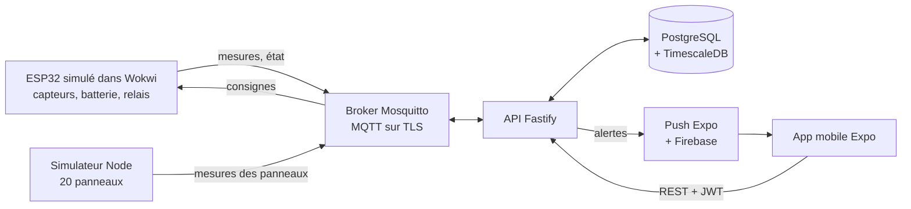
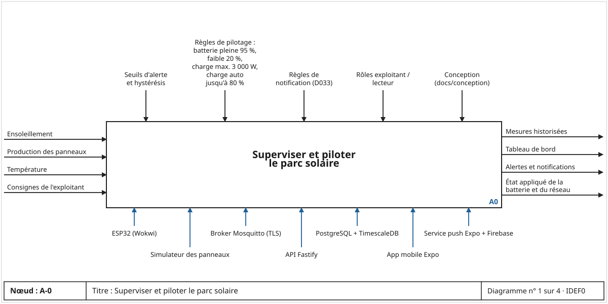
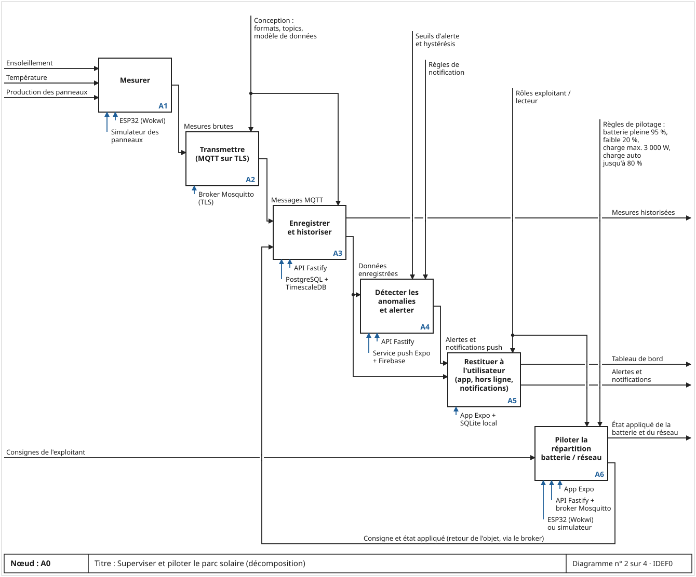
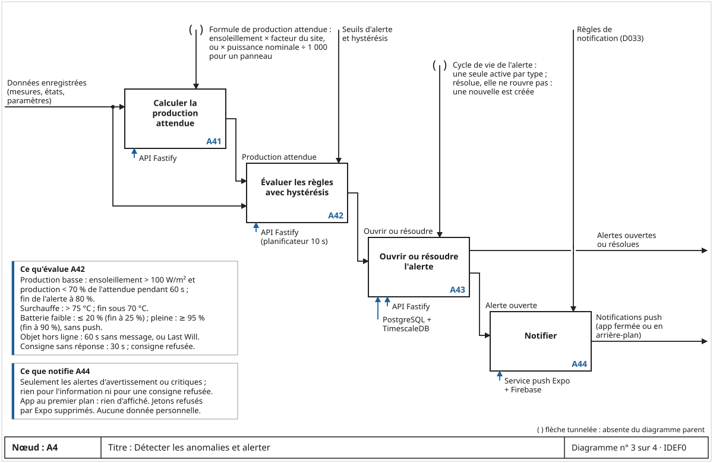
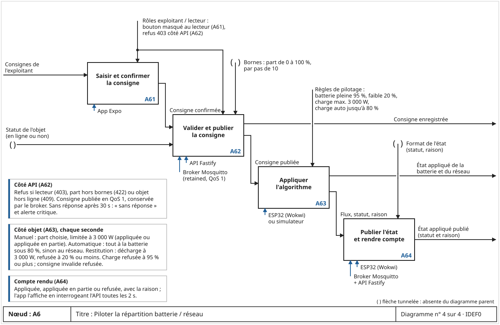

# Synthèse du projet

L'essentiel du projet en quelques pages, pour le présenter à l'oral. Pour installer et lancer le projet, voir le [README](../README.md).

## Le projet

Une application mobile qui surveille un petit parc solaire de 20 panneaux et qui permet de le piloter à distance. Elle affiche la production en direct, prévient quand quelque chose ne va pas, et laisse l'exploitant décider quelle part de la production va dans la batterie et quelle part part sur le réseau. L'objet installé sur le site applique la consigne, ou la refuse si elle met la batterie en danger, et renvoie ce qu'il a réellement fait.

Il y a deux profils : le lecteur, qui consulte, et l'exploitant, qui peut aussi envoyer des consignes et gérer les panneaux.

## Architecture

L'objet du site et le simulateur publient leurs mesures sur le broker. L'API s'y abonne, enregistre tout en base, calcule les alertes et publie les consignes. L'app ne parle qu'à l'API, en REST. Les notifications passent par le service push d'Expo, qui s'appuie sur Firebase pour Android.

Tout le code est dans un seul dépôt. Les formats échangés (messages MQTT, requêtes, réponses) sont décrits une seule fois dans un paquet partagé, `@solar/contracts`, utilisé par l'API, l'app et le simulateur. Le firmware en reprend les mêmes valeurs.

## Le processus

Les diagrammes suivent la méthode IDEF0. Chaque boîte est une fonction du système. À gauche, ce qui entre. À droite, ce qui sort. En haut, les règles qui la contrôlent. En bas, les outils qui la réalisent.

Vue d'ensemble : le système reçoit l'ensoleillement, les mesures et les consignes, et rend un tableau de bord, des alertes et une batterie pilotée.

Les six fonctions : mesurer, transmettre, enregistrer, détecter les anomalies, restituer à l'utilisateur et piloter la batterie. L'état appliqué par l'objet revient dans la base, ce qui ferme la boucle.

Zoom sur les alertes : on calcule la production attendue, on évalue les règles, on ouvre ou on ferme l'alerte, puis on notifie.

Zoom sur le pilotage : l'exploitant confirme la consigne, l'API la vérifie et la publie, l'objet l'applique avec ses limites, puis rend compte de ce qu'il a fait.

## Technologies

| Partie | Outils | Raison principale |
|---|---|---|
| App | Expo, React Native, TypeScript, Expo Router, TanStack Query | Un seul langage avec l'API, build Android dans le cloud |
| Stockage sur le téléphone | SQLite, SecureStore | Affichage sans réseau ; le jeton de connexion est chiffré |
| Graphiques et plan du parc | react-native-svg | Dessinés à la main, fidèles aux maquettes, sans clé Google |
| API | Fastify, Zod, Drizzle | Validation des entrées et types partagés à partir du même schéma |
| Base | PostgreSQL avec TimescaleDB | Relationnel et séries temporelles dans une seule base |
| Messagerie | MQTT avec Mosquitto | Protocole léger fait pour les objets, broker hébergé par nos soins |
| Objet | ESP32, PlatformIO, Wokwi | Simulation complète, aucun matériel à acheter |
| Qualité | GitHub Actions, ESLint, Prettier, Vitest, Jest | Lint, types et tests à chaque pull request |

## Comment ça marche

**Production attendue.** On compare toujours la production réelle à ce que le soleil devrait donner. Pour le site, c'est l'ensoleillement multiplié par 4. Avec 600 W/m², on attend donc 2 400 W. Pour un panneau de 200 W, on attend 600 × 200 / 1 000, soit 120 W.

**Alertes.** Si la production reste sous 70 % de l'attendu pendant une minute, une alerte « production basse » s'ouvre. Elle se ferme quand la production remonte à 80 %. Cet écart entre le seuil d'ouverture et celui de fermeture évite qu'une alerte clignote autour d'une valeur. Le même principe s'applique à la surchauffe, à la batterie faible ou pleine, à l'objet hors ligne et aux consignes sans réponse.

**Objet hors ligne.** Si la connexion de l'objet tombe, le broker prévient l'API tout seul grâce au « Last Will » de MQTT. Si l'objet se tait sans se déconnecter, l'API le déclare hors ligne après 60 secondes sans message. Tant qu'il est hors ligne, on ne peut pas lui envoyer de consigne.

**Pilotage.** Trois modes existent :
- manuel : l'exploitant choisit la part envoyée à la batterie, de 0 à 100 % ;
- automatique : tout va à la batterie jusqu'à 80 %, puis tout part au réseau ;
- restitution : la batterie se vide vers le réseau, sans descendre sous 20 %.

L'objet protège la batterie. Avec 4 000 W produits et une demande de 100 % vers la batterie, il n'accepte que 3 000 W, sa limite de charge : la consigne est appliquée en partie, à 75 %. Si la batterie est déjà pleine, la charge est refusée.

**Envoi d'une consigne.** L'exploitant confirme dans l'app. L'API vérifie son rôle, enregistre la consigne et la publie sur le broker, qui la garde en mémoire : un objet qui se reconnecte retrouve donc la dernière consigne. L'objet l'applique dans la seconde et publie le résultat : appliquée, appliquée en partie ou refusée, avec la raison. Sans réponse au bout de 30 secondes, une alerte s'ouvre.

**Temps accéléré.** Pour la démonstration, une seconde compte pour une minute dans la batterie simulée. Elle passe de 20 % à 95 % en deux à trois minutes au lieu de deux heures et demie.

**Nouveaux panneaux.** Quand un panneau inconnu commence à publier, l'API le crée tout seul, sans position. L'exploitant le voit dans une liste « à positionner », se place devant lui et appuie sur « Placer ici » : la position du téléphone devient celle du panneau.

**Notifications.** Une alerte importante envoie une notification sur les téléphones, sauf quand l'app est ouverte : l'alerte y est déjà visible. Chaque téléphone retient les alertes déjà lues, et la pastille de l'onglet Alertes ne compte que les nouvelles.

**Sans réseau.** L'app garde une copie des dernières données. Sans connexion, elle les affiche avec leur heure et désactive le pilotage.

## Données et historique

Les mesures du site arrivent toutes les 5 secondes et celles des panneaux toutes les 10 secondes. Elles sont stockées dans des tables TimescaleDB découpées par jour et gardées 30 jours. Les courbes de l'app sont calculées à la demande : moyennes par minute sur une heure, par quart d'heure sur 24 heures et par heure sur 7 jours.

Le détail des tables, des topics MQTT et des routes de l'API est dans [le modèle de données](conception/01-modele-donnees.md) et [la cartographie technique](conception/03-cartographie-technique.md).

## Sécurité

Ce qui est en place :
- le broker n'accepte que des connexions chiffrées en TLS, avec des droits par client ; sur l'écoute exposée sur Internet, il exige un certificat client signé par l'autorité des objets du projet, non expiré et non révoqué, et l'objet n'a pas de mot de passe ;
- l'app se connecte avec un jeton JWT valable 8 heures, rangé dans le stockage chiffré du téléphone ;
- les mots de passe sont hachés en argon2id, et les tentatives de connexion sont limitées ;
- les droits de l'exploitant sont vérifiés par l'API, pas seulement masqués dans l'app ;
- chaque requête et chaque message MQTT est validé, un message invalide est ignoré ;
- aucun secret dans le dépôt, aucune donnée personnelle dans les notifications ni dans les journaux.

- l'objet obtient son certificat par **enrôlement** : il envoie à l'API une demande de certificat (sans clé privée), l'exploitant compare l'empreinte de la clé et accepte ; l'API signe le certificat avec le nom de l'objet, quel que soit celui de la demande, puis inscrit l'objet dans l'ACL du broker. Une révocation retire ses droits et ajoute son certificat à la liste de révocation.

- dans l'app, l'écran « Objets », réservé à l'exploitant, affiche l'empreinte complète de chaque demande, rappelle de la comparer avant d'accepter, et demande une confirmation avant de révoquer.

- le simulateur, en mode objet du site, suit exactement ce parcours : il n'a plus de mot de passe pour jouer l'objet et se connecte avec le certificat obtenu par enrôlement.

- le firmware de l'ESP32 suit le même parcours : clé générée en mémoire au démarrage, empreinte affichée sur le moniteur série, certificat demandé à l'API puis vérifié, connexion par certificat ; le projet Wokwi ne contient plus ni mot de passe ni clé privée.

Ce qui reste à faire : vérifier dans Wokwi le parcours complet de l'ESP32 (empreinte, acceptation dans l'app, connexion, révocation) ; il est écrit et compilé, mais pas encore exécuté dans la simulation.

## Limites

- Wokwi tourne dans le cloud et ne voit pas le PC : en développement, on passe par un tunnel gratuit qui coupe parfois. Une fois le serveur installé sur un VPS, ce tunnel disparaît.
- Wokwi simule l'ESP32 à environ la moitié du temps réel, ce qui a obligé à allonger les délais de connexion.
- La bibliothèque MQTT de l'ESP32 ne publie qu'en QoS 0 : un résultat de consigne peut se perdre, l'API le signale alors comme « sans réponse ».
- Une alerte qui se ferme puis se rouvre aussitôt renvoie une notification.
- Les notifications demandent un build de développement de l'app et un projet Firebase.

## Où on en est

Fait : l'API, la base, le simulateur, le firmware, tous les écrans de l'app branchés sur l'API, le mode hors ligne, les alertes, les notifications et le pilotage, vérifiés de bout en bout dans Wokwi ; le bandeau d'alerte app ouverte (#108) et l'arrêt des rafraîchissements en arrière-plan (#111) ; côté sécurité de l'objet, le TLS mutuel du broker (#80), l'enrôlement par l'API (#81), l'écran « Objets » de l'app (#82, maquette à ajouter au canevas), l'enrôlement du simulateur (#84) et du firmware (#83, à vérifier dans Wokwi).

Reste à faire, dans l'ordre :
1. finir les vérifications dans Wokwi (#20, #38 à #40, #83) et sur le téléphone (#62, #82, #84, #108, #111) ;
4. la livraison : VPS (#54), APK (#53), dossier sécurité (#51), mesures de performance (#110), tests (#52), documentation (#55), démonstration (#56), bilan (#57).

Les bonus (vue 3D, rotation des panneaux, temps réel poussé, ajout par QR code) viennent ensuite. Le détail de chaque issue est dans [les besoins fonctionnels](conception/04-besoins-fonctionnels.md).

Les notions du module utilisées par le projet, avec leurs sources : [notions et sources](notions-et-sources.md).
